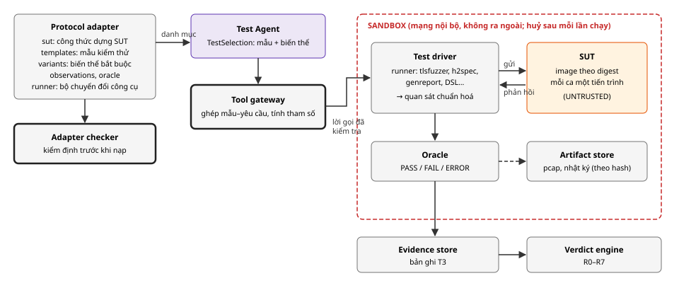

# Thiết kế protocol adapter và kiểm thử thực tế (T3)

*Tài liệu thiết kế chi tiết · Phần bổ sung*

Đề tài: Kiểm chứng tự động và an toàn sự tuân thủ đặc tả giao thức mạng dựa trên bằng chứng, sử dụng hệ thống AI đa tác tử · Học viên: Nguyễn Kỳ Tùng · GVHD: TS. Tống Văn Vạn<br> Tài liệu chi tiết hoá các thành phần Protocol adapters, Adapter checker, Sandbox & Test driver và Test Agent (ĐX mục 1.2, 2.3, 4; thiết kế chính mục 4.3). Nội dung dựa trên thực nghiệm sơ bộ với wolfSSL và tlsfuzzer. Không thêm thành phần mới.

**MỤC LỤC**

- [1. Mục tiêu và ràng buộc](#1-mục-tiêu-và-ràng-buộc)
- [2. Kiến trúc tổng thể](#2-kiến-trúc-tổng-thể)
- [3. Cấu trúc một adapter](#3-cấu-trúc-một-adapter)
- [4. Công thức dựng SUT](#4-công-thức-dựng-sut)
- [5. Mẫu kiểm thử](#5-mẫu-kiểm-thử)
  - [5.1 Hai dạng mẫu](#51-hai-dạng-mẫu)
  - [5.2 Mẫu bọc ca có sẵn](#52-mẫu-bọc-ca-có-sẵn)
  - [5.3 Mẫu viết bằng DSL](#53-mẫu-viết-bằng-dsl)
- [6. Biến thể bắt buộc](#6-biến-thể-bắt-buộc)
- [7. Quan sát và oracle](#7-quan-sát-và-oracle)
- [8. Ghép mẫu với yêu cầu](#8-ghép-mẫu-với-yêu-cầu)
- [9. Test driver: một lần chạy](#9-test-driver-một-lần-chạy)
- [10. Bản ghi T3](#10-bản-ghi-t3)
- [11. Ổn định và lỗi môi trường](#11-ổn-định-và-lỗi-môi-trường)
- [12. Adapter checker](#12-adapter-checker)
- [13. Năm giao thức](#13-năm-giao-thức)
- [14. Ví dụ đầy đủ: TLS 1.3](#14-ví-dụ-đầy-đủ-tls-13-yêu-cầu-về-độ-dài-bản-ghi)
- [15. Kế hoạch xây dựng](#15-kế-hoạch-xây-dựng)
- [16. Rủi ro, điểm cần xác nhận](#16-rủi-ro-và-điểm-cần-xác-nhận)
- [17. Nguồn](#17-nguồn)

## 1. Mục tiêu và ràng buộc

**Mục tiêu.** T3 là bằng chứng mạnh nhất và quyết định nhãn của yêu cầu loại A, B, C (quy tắc R1, R2). Tài liệu này thiết kế cách tạo ra T3 sao cho đúng, phân biệt được bản lỗi và bản đúng, tái lập được, và an toàn. Mọi tri thức riêng của giao thức nằm trong adapter dưới dạng dữ liệu khai báo.

| Mã | Ràng buộc | Nguồn |
| --- | --- | --- |
| K1 | **Tất định:** kết quả PASS, FAIL, ERROR do oracle tính, không do LLM | ĐX 2.4, rủi ro F1 |
| K2 | **Hợp lệ:** T3 chỉ tính cho yêu cầu khi hành vi khai báo của mẫu khớp hành vi mong đợi, và giá trị biến thể khớp ngưỡng của yêu cầu | Thiết kế chính, mục 1.2 |
| K3 | **Phân biệt được:** mỗi mẫu phải FAIL trên ít nhất một phiên bản lỗi tương ứng | Adapter checker |
| K4 | **Tái lập:** image SUT theo digest, cờ build, phiên bản công cụ kiểm thử, tham số đều được cố định | P3, BR4 |
| K5 | **An toàn:** SUT và công cụ chạy trong sandbox không có mạng ra ngoài; agent không thấy nhật ký thô | Rủi ro A2, A5 |
| K6 | **Tái dùng:** ưu tiên bọc ca kiểm thử có sẵn đã gắn mục RFC; chỉ viết mẫu mới khi thiếu | ĐX 4; giảm công sức |

*Bảng 1. Ràng buộc.*

## 2. Kiến trúc tổng thể



***Hình 1.** Kiến trúc tạo T3. Test Agent chỉ chọn mẫu và biến thể. Tool gateway ghép mẫu với yêu cầu và tính tham số một cách tất định. Test driver chạy trong sandbox, chuẩn hoá quan sát; oracle tính kết quả; Evidence store ghi T3.*

**Ký hiệu sử dụng trong Hình 1:**

| Ký hiệu | Ý nghĩa |
| --- | --- |
|  | Agent đặc quyền |
|  | Thành phần tất định hoặc kho dữ liệu của harness |
|  | Điểm kiểm tra |
|  | Hệ thống đang được kiểm chứng (SUT), không tin cậy |
|  | Ranh giới sandbox |
|  | Luồng dữ liệu hoặc lời gọi |
|  | Lưu dữ liệu thô; không tới agent |

**Phân công.** Test Agent là agent đặc quyền theo bản đề xuất, nhưng phạm vi quyết định của nó hẹp:

- chọn mẫu nào trong số các mẫu đã được lọc là hợp lệ;
- chọn biến thể nào chạy trước;
- với loại C, chọn cách kết hợp các bước theo thứ tự thông điệp.

Giá trị tham số (ví dụ độ dài 16641) do Tool gateway tính từ ngưỡng trong yêu cầu, không do agent tự đặt.

## 3. Cấu trúc một adapter

```
adapters/tls13/
  adapter.yaml          # bản kê: phạm vi RFC, phân loại thành phần, từ vựng, gợi ý tìm mã (thiết kế chính 4.3)
  sut/
    wolfssl.yaml        # công thức dựng SUT cho từng bản triển khai (mục 4)
    Dockerfile.wolfssl
  observations.yaml     # từ vựng quan sát chuẩn hoá và miền giá trị (mục 7)
  variants.yaml         # lớp biến thể và cách tính giá trị (mục 6)
  templates/
    record_length.yaml  # mẫu bọc ca tlsfuzzer (mục 5.2)
    ...                 # mẫu DSL (mục 5.3)
  runners/
    tlsfuzzer.yaml      # cách gọi công cụ, chọn ca, đọc kết quả, phiên bản cố định
  queries/              # truy vấn phân tích tĩnh (T2)
  validation/
    known_bugs.yaml     # phiên bản lỗi dùng cho kiểm tra "phân biệt được" (mục 12)
```

Toàn bộ adapter là dữ liệu khai báo; mã chạy duy nhất nằm trong `sandbox/runners/` của lõi. Mỗi runner là một bộ chuyển đổi chung cho một công cụ kiểm thử, dùng lại cho mọi adapter.

## 4. Công thức dựng SUT

```
# adapters/tls13/sut/wolfssl.yaml
implementation: wolfssl
repo: https://github.com/wolfSSL/wolfssl
build:
  steps: ["./autogen.sh",
          "./configure --enable-tls13 --disable-shared --enable-static",
          "make examples/server/server"]
  cflags: ["-DWOLFSSL_TLS13_MIDDLEBOX_COMPAT"]   # cần cho tlsfuzzer với bản trước 8/2026
  # cờ build được ghi vào bản kê và chuyển cho Code gate (tiền xử lý, mục 4.5 tài liệu khả thi)
roles:
  server:
    cmd: "./examples/server/server -v 4 -d -g -i -p {port}"
    certs: "certs/"               # dùng chứng chỉ thử của chính repo
lifecycle:
  per_case_process: true          # server mẫu thoát sau mỗi lỗi
  ready_check: {kind: listen_socket, port: "{port}", timeout_s: 5}   # không mở kết nối thừa
  sanity_case: tlsfuzzer:sanity   # ca hợp lệ phải PASS, nếu không thì kết quả lần chạy là ERROR
resources: {cpus: 1, memory: 512m, pids: 128, timeout_s: 60}
```

| Trường | Vai trò, bài học từ thực nghiệm |
| --- | --- |
| `build.cflags` | Là đầu vào cố định; cùng giá trị cho Test driver và Code gate, để T1 và T3 nói về cùng một bản build |
| `per_case_process` | Server mẫu của wolfSSL thoát sau mỗi lỗi; mỗi ca chạy với một tiến trình mới để ca trước không ảnh hưởng ca sau |
| `ready_check` | Kiểm tra cổng đang nghe mà không kết nối; một kết nối rỗng làm server mẫu lỗi và thoát |
| `sanity_case` | Chạy trước mỗi lô; nếu ca hợp lệ không PASS thì lỗi nằm ở môi trường, mọi kết quả của lô là ERROR, không phải FAIL |

*Bảng 2. Các trường quan trọng của công thức SUT. Image được dựng một lần cho mỗi commit và cố định theo digest.*

## 5. Mẫu kiểm thử

### 5.1. Hai dạng mẫu

| Dạng | Khi nào dùng | Ví dụ |
| --- | --- | --- |
| **Bọc ca có sẵn** | Bộ kiểm thử sẵn có đã có ca cho hành vi cần kiểm. Ưu tiên dạng này (K6) | Các ca của tlsfuzzer `test-tls13-record-layer-limits.py`; ca của h2spec theo mục RFC 9113 |
| **DSL** | Không có ca sẵn, hoặc cần giá trị biến thể mà ca sẵn không có | Bản ghi chưa mã hoá dài đúng 2^14+1 byte; truy vấn DNS có cờ sai |

*Bảng 3. Hai dạng mẫu. Cả hai đều khai báo hành vi kiểm tra, lớp biến thể và oracle theo cùng một schema.*

### 5.2. Mẫu bọc ca có sẵn

```
# adapters/tls13/templates/record_length.yaml
id: tls13.record.length_overflow
requirement_types: [B]
rfc_refs: ["RFC8446§5.1", "RFC8446§5.2"]
checks_behavior: "receive(record, length > {limit}) → send_alert(record_overflow); close"
variant_class: length_bound
runner: tlsfuzzer
runner_version: {tlsfuzzer: "git:<sha>", tlslite-ng: "git:<sha>"}
cases:                      # ánh xạ biến thể → ca của công cụ (tác giả adapter khai báo, Adapter checker kiểm)
  - variant: at_limit_ciphertext       # đối chứng: phải được chấp nhận
    limit: 16640
    case: "max size of Finished msg, with 16587 bytes of record layer padding TLS_AES_128_GCM_SHA256"
    expect: accepted
  - variant: just_above_limit_ciphertext
    limit: 16640
    case: "too big Finished msg, with 16588 bytes of record layer padding TLS_AES_128_GCM_SHA256"
  - variant: max_allowed_by_encoding_ciphertext
    limit: 16640
    case_family: "too big ciphertext with size 2**14 + 256 and*"   # họ ca có fuzz tag
    sample: 5                                                        # lấy 5 ca, hạt giống cố định
  - variant: just_above_limit_plaintext
    limit: 16384
    case: "too big ClientHello msg, with 16168 bytes of padding"
oracle: {pass: "alert == record_overflow and closed", fail: "otherwise",
         error: "sanity_failed or handshake_incomplete_before_trigger"}
```

Ca của công cụ chỉ được dùng khi tác giả adapter đã khai báo ca đó kiểm biến thể nào với ngưỡng nào. Không dùng nguyên tên ca để suy đoán. Adapter checker chạy thử từng ca trên phiên bản lỗi và phiên bản đúng để xác nhận khai báo (mục 12).

### 5.3. Mẫu viết bằng DSL

Khi không có ca sẵn, mẫu được viết bằng một tập thao tác giới hạn. Runner của từng giao thức dịch các thao tác này sang thư viện tương ứng: tlslite-ng (tlsfuzzer) cho TLS, aioquic cho QUIC, hyperframe/h2 cho HTTP/2, dnspython cho DNS, asyncssh cho SSH.

| Thao tác | Ý nghĩa |
| --- | --- |
| `connect`, `complete_handshake` | Mở kết nối; hoàn tất handshake theo cấu hình chuẩn của runner |
| `send_msg(type, fields)` | Gửi thông điệp hợp lệ với các trường ghi đè; tên trường theo định nghĩa RFC |
| `send_raw_record(type, length, body)` | Gửi bản ghi thô với độ dài và nội dung cho trước |
| `mutate(field, op)` | Sửa một trường: `set`, `truncate`, `append_bytes`, `duplicate` |
| `reorder(msgs)`, `repeat(msg)` | Đổi thứ tự hoặc lặp thông điệp (dùng cho loại C) |
| `expect(within_ms)` | Thu quan sát trong khoảng thời gian; không có nhánh hay vòng lặp |

*Bảng 4. Tập thao tác DSL. Không có lệnh hệ thống, không có biểu thức tuỳ ý; Adapter checker từ chối mẫu dùng thao tác ngoài danh sách.*

```
id: tls13.record.plaintext_length_overflow_raw
requirement_types: [B]
rfc_refs: ["RFC8446§5.1"]
checks_behavior: "receive(record, length > {limit}) → send_alert(record_overflow); close"
variant_class: length_bound
runner: dsl_tls
steps:
  - connect
  - send_raw_record: {type: handshake, length: "{length}", body: zeros}
  - expect: {within_ms: 2000}
oracle: {pass: "alert == record_overflow and closed", fail: "otherwise", error: "connect_failed"}
```

## 6. Biến thể bắt buộc

Biến thể được định nghĩa theo lớp. Giá trị của mỗi biến thể được tính từ ngưỡng trong yêu cầu, không do agent chọn. Thực nghiệm cho thấy hai điều về biến thể:

- Biến thể "vừa vượt ngưỡng" tìm ra sai lệch mà biến thể "lớn nhất" bỏ sót.
- Biến thể "đúng ngưỡng" phát hiện được mẫu kiểm thử viết sai.

| Lớp | Biến thể | Giá trị và kỳ vọng | Bắt buộc cho R2 |
| --- | --- | --- | --- |
| `length_bound` | `at_limit` (đối chứng) | = ngưỡng; kỳ vọng được chấp nhận | Có |
| `length_bound` | `just_above_limit` | = ngưỡng + 1; kỳ vọng phản ứng của yêu cầu | Có |
| `length_bound` | `max_allowed_by_encoding` | = giá trị lớn nhất mà trường mã hoá được (ví dụ 2^16−1) | Có |
| `enum_value` | `each_forbidden` | Mỗi giá trị bị cấm, tối đa 5, chọn với hạt giống cố định | Có |
| `enum_value` | `unknown_value` | Một giá trị chưa được định nghĩa | Có, nếu RFC nói về giá trị chưa biết |
| `message_order` | `unexpected_before` | Thông điệp đến sớm hơn trạng thái cho phép | Có |
| `message_order` | `duplicate` | Thông điệp lặp lại | Có |
| `message_order` | `after_close` | Dữ liệu sau cảnh báo fatal hoặc đóng kết nối | Nếu áp dụng |
| `field_presence` | `missing`, `duplicated`, `trailing_bytes` | Thiếu, lặp hoặc thừa byte sau trường/phần mở rộng | Có |

*Bảng 5. Lớp biến thể. Bảng này là bản mở rộng của `required_variants` trong bản kê ở thiết kế chính.*

## 7. Quan sát và oracle

Runner không trả nhật ký thô cho bất kỳ agent nào. Nó chuẩn hoá điều quan sát được thành một bản ghi `Observation` mà mọi trường đều có miền hữu hạn (rủi ro A2). Nhật ký và gói tin thô chỉ vào Artifact store để người kiểm chứng xem.

```
// Observation@1 (TLS)
{
  "alert": "record_overflow",        // giá trị trong từ vựng adapter, hoặc "none", "other:<mã số>"
  "alert_level": "fatal",
  "alert_encrypted": true,
  "closed": true,                    // kết nối bị đóng trong khoảng expect
  "reached_trigger": true,           // đã gửi được dữ liệu kích hoạt (ví dụ handshake xong trước khi gửi)
  "sut_alive_after": true,           // tiến trình SUT còn sống
  "response": "none"                 // thông điệp đáp lại, nếu có, ví dụ "server_hello"
}
```

| Kết quả | Điều kiện | Dùng thế nào |
| --- | --- | --- |
| PASS | Biểu thức `pass` của oracle đúng, và `reached_trigger` | Bằng chứng ủng hộ |
| FAIL | Đã tới điểm kích hoạt, và biểu thức `pass` sai | Bằng chứng bác bỏ; kích hoạt chạy lại (mục 11) |
| ERROR | Ca sanity hỏng, không tới điểm kích hoạt, hết thời gian, SUT chết trước khi gửi | Không phải bằng chứng; ghi lý do |

*Bảng 6. Ba kết quả của oracle. Phân biệt FAIL với ERROR là điều kiện để không biến lỗi môi trường thành VIOLATION. Trong thực nghiệm, cả 68 ca ban đầu đều "hỏng" vì lỗi môi trường; nhờ ca sanity, những kết quả đó được xếp là ERROR.*

SUT bị sập sau khi nhận dữ liệu kích hoạt (`sut_alive_after = false`) được tính là FAIL, và gắn thêm cờ cho báo cáo, vì đây có thể là lỗi bảo mật.

## 8. Ghép mẫu với yêu cầu

Tool gateway kiểm tra tất định trước khi chạy. Chỉ những mẫu qua đủ các kiểm tra mới được đưa cho Test Agent làm ứng viên.

| # | Kiểm tra | Ví dụ TLS13-0042 |
| --- | --- | --- |
| 1 | `requirement.type` thuộc `requirement_types` của mẫu | B ∈ [B] |
| 2 | Hành vi khai báo của mẫu khớp hành vi mong đợi của yêu cầu, sau khi chuẩn hoá theo từ vựng adapter | `receive(record, length>16640) → send_alert(record_overflow); close` |
| 3 | Ngưỡng của biến thể trong mẫu bằng ngưỡng trong yêu cầu | Biến thể `_ciphertext` có ngưỡng 16640: khớp. Biến thể `_plaintext` có ngưỡng 16384: chỉ khớp yêu cầu §5.1 |
| 4 | Mục RFC của mẫu chứa câu của yêu cầu (`rfc_refs`) | RFC8446§5.2 |
| 5 | Tham số nằm trong miền; tham số do lớp biến thể tính | length = 16641, 65535 |

*Bảng 7. Ghép mẫu với yêu cầu. Kiểm tra 3 ngăn việc dùng ca kiểm giới hạn của bản ghi chưa mã hoá làm bằng chứng cho yêu cầu về bản ghi đã mã hoá, hoặc ngược lại.*

Nếu không có mẫu nào hợp lệ, Verdict engine ghi `feasible.T3 = false`. Khi đó Planner không giao `SELECT_TESTS` nữa (tài liệu phối hợp agent, mục 8), và yêu cầu loại A–C sẽ là UNVERIFIABLE nếu không có bằng chứng khác.

## 9. Test driver: một lần chạy

```
Tool gateway ── run(template_id, variants, params, sut_image, run_id) ──▶ Test driver
 1. Tạo mạng nội bộ riêng; khởi động container test-driver và container SUT từ image theo digest
 2. Với mỗi lô: khởi động SUT, ready_check, chạy sanity_case
       sanity không PASS → mọi ca của lô là ERROR (môi trường)
 3. Với mỗi ca: khởi động lại tiến trình SUT (per_case_process), ready_check,
       runner chạy ca → Observation, áp oracle → PASS / FAIL / ERROR
       lưu pcap và nhật ký vào Artifact store theo hash
 4. Ca FAIL: chạy lại thêm 2 lần (mục 11)
 5. Ghi bản ghi T3 vào Evidence store; huỷ container và mạng
 6. Trả về cho Execution loop: chỉ template_id, variant, kết quả, các trường Observation
```

Thời gian ước lượng từ thực nghiệm: khoảng 1–2 giây cho mỗi ca, gồm cả khởi động tiến trình. Một yêu cầu với 3–8 ca hết dưới 30 giây, chưa tính thời gian dựng image (chỉ dựng một lần cho mỗi commit).

## 10. Bản ghi T3

```
{
  "evidence_id": "ev-35", "tier": "T3", "requirement_id": "TLS13-0042",
  "template_id": "tls13.record.length_overflow", "variant": "just_above_limit_ciphertext",
  "case": "too big Finished msg, with 16588 bytes of record layer padding TLS_AES_128_GCM_SHA256",
  "params": {"limit": 16640, "length": 16641},
  "sut": {"impl": "wolfssl", "commit": "0cecccdf6", "image": "sha256:…", "cflags": ["-DWOLFSSL_TLS13_MIDDLEBOX_COMPAT"]},
  "runner": {"name": "tlsfuzzer", "version": "git:…", "tlslite-ng": "git:…"},
  "runs": [{"result": "FAIL", "observation": {"alert": "none", "closed": true, "reached_trigger": true}},
           {"result": "FAIL", "...": "…"}, {"result": "FAIL", "...": "…"}],
  "result": "FAIL", "stable": true,
  "artifacts": ["sha256:…pcap", "sha256:…sut.log"],
  "labels": {"ifc": "UNTRUSTED"}
}
```

Bản ghi này đủ để chạy lại đúng ca, với cùng image, cùng công cụ và cùng tham số (K4).

## 11. Ổn định và lỗi môi trường

| Tình huống | Xử lý |
| --- | --- |
| Ca FAIL | Chạy lại thêm 2 lần. Ba lần cùng FAIL thì `stable = true`. Kết quả khác nhau thì `stable = false`, và R0 đưa yêu cầu sang NEEDS\_REVIEW |
| Ca PASS | Không chạy lại trong lúc điều tra. Adapter checker đã kiểm tính ổn định của mẫu (chạy 3 lần) |
| Ca sanity hỏng | Cả lô là ERROR; Test driver thử dựng lại môi trường một lần; vẫn hỏng thì báo người kiểm chứng |
| Hết thời gian | ERROR. Riêng trường hợp đã gửi dữ liệu kích hoạt mà SUT không phản hồi và không đóng kết nối, đây là một quan sát (`alert = none`, `closed = false`), không phải ERROR |
| Không dựng được image | Dừng lần chạy trước giai đoạn điều tra (thiết kế chính, xử lý lỗi) |

*Bảng 8. Xử lý tình huống.*

## 12. Adapter checker

Năm kiểm tra của thiết kế chính được cụ thể hoá như sau:

| Kiểm tra | Cách làm | Không đạt thì |
| --- | --- | --- |
| Hình thức | Schema của bản kê, công thức SUT, mẫu, biến thể; mọi thao tác DSL thuộc Bảng 4; mọi hành vi viết bằng từ vựng adapter; ca được bọc có tồn tại trong phiên bản công cụ đã cố định | Không nạp adapter |
| Dựng được SUT | Dựng image tại commit cố định; `sanity_case` PASS | Không nạp |
| Oracle ổn định | Mỗi ca chạy 3 lần trên phiên bản tham chiếu, cùng kết quả | Loại ca khỏi danh mục |
| Oracle phân biệt được | Mỗi mẫu cho FAIL trên ít nhất một phiên bản trong `validation/known_bugs.yaml`: commit lỗi lịch sử (ví dụ cha của `c18833f52`) hoặc phiên bản tự tạo lỗi. Biến thể `at_limit` phải PASS trên phiên bản tham chiếu | Loại mẫu; mẫu "luôn PASS" tạo ra COMPLIANT giả |
| Độ phủ | Liệt kê yêu cầu trong phạm vi chưa có mẫu hợp lệ theo Bảng 7 | Báo cáo; các yêu cầu này sẽ là UNVERIFIABLE |

*Bảng 9. Adapter checker.*

```
# adapters/tls13/validation/known_bugs.yaml
- id: wolfssl-record-overflow-2026
  impl: wolfssl
  buggy: "c18833f52^"     # commit cha
  fixed: "c18833f52"
  expect_fail: [tls13.record.length_overflow:just_above_limit_ciphertext,
                tls13.record.length_overflow:max_allowed_by_encoding_ciphertext]
  expect_pass_on_fixed: same
```

Dùng lỗi lịch sử để kiểm định adapter phải tách khỏi tập đánh giá: commit đã dùng trong `known_bugs.yaml` không được tính vào kết quả đánh giá chính.

## 13. Năm giao thức

| Giao thức | Ca có sẵn để bọc | Runner DSL | SUT ứng viên (ĐX 4) | Đánh giá |
| --- | --- | --- | --- | --- |
| TLS 1.3 | tlsfuzzer: **đã chạy được** với wolfSSL; TLS-Anvil là phương án bổ sung | tlslite-ng | wolfSSL, OpenSSL, rustls | Sẵn sàng; 40–60 yêu cầu |
| HTTP/2 | h2spec, có ca theo mục RFC | hyperframe, h2 | nghttp2 | Thuận lợi; chưa thử |
| QUIC | QUIC Interop Runner chủ yếu kiểm tương tác, ít ca vi phạm; dùng để dựng SUT và làm ca sanity | aioquic | ngtcp2, quiche | Phần lớn là mẫu DSL; nhiều công sức hơn |
| DNS | ISC DNS Compliance Testing (`genreport`), gồm các ca về EDNS và cờ | dnspython | Knot DNS, CoreDNS | Kết hợp ca có sẵn và DSL; 10–15 yêu cầu |
| SSH | Chưa tìm được bộ kiểm thử tuân thủ phù hợp | asyncssh | OpenSSH, Dropbear | Mẫu DSL tự viết; 10–15 yêu cầu |

*Bảng 10. Công cụ cho năm giao thức. Đúng như ĐX mục 4: DNS và SSH dùng để đo công sức thêm giao thức mới (mục tiêu 2), nên việc phải tự viết nhiều mẫu cũng chính là dữ liệu cần đo.*

Trạng thái (2026-10-22, BL-83): cả năm giao thức đã có gói khai báo trong `backend/adapters/<tên>/` (từ vựng, miền giá trị, gợi ý Locator, công thức SUT, mẫu kiểm thử, RBS ví dụ trỏ câu RFC có thật) và skill giao thức trong `backend/skills/<tên>/`, đều qua phần hình thức của Adapter checker. Backend `dnspython`, `h2spec`, `aioquic`, `asyncssh` mới cài phần kiểm kịch bản theo DSL riêng của giao thức; `run` và `sanity` cần container test-driver (BL-03 trở đi), giống backend `tlsfuzzer`, nên chưa giao thức nào chạy được với SUT thật (CT-09).

## 14. Ví dụ đầy đủ: TLS 1.3, yêu cầu về độ dài bản ghi

| Bước | Kết quả (từ thực nghiệm 14/10/2026) |
| --- | --- |
| Adapter checker | Mẫu `tls13.record.length_overflow`: sanity PASS; ổn định; FAIL trên bản lỗi `c18833f52^`, PASS trên bản sửa (biến thể ciphertext). Đạt |
| Ghép với TLS13-0042 (§5.2) | Các biến thể hợp lệ: `at_limit_ciphertext`, `just_above_limit_ciphertext`, `max_allowed_by_encoding_ciphertext` |
| Chạy trên bản lỗi | just\_above, max: FAIL ổn định (không có cảnh báo) → R1: VIOLATION |
| Chạy trên bản sửa, bản head | Cả ba biến thể PASS → R2: COMPLIANT (nếu T1 không bác bỏ) |
| Ghép với yêu cầu §5.1 (bản ghi chưa mã hoá) | Biến thể `just_above_limit_plaintext` hợp lệ; chạy trên bản head: FAIL (wolfSSL trả server\_hello) → R1: VIOLATION, ứng viên cần xác nhận |

*Bảng 11. Ví dụ chạy trọn phần T3.*

## 15. Kế hoạch xây dựng

| Thời gian | Việc | Đầu ra kiểm tra được |
| --- | --- | --- |
| Tuần 1 | Runner tlsfuzzer: chọn ca, đọc kết quả, chuẩn hoá Observation; công thức SUT wolfSSL trong Docker | Chạy lại được Bảng 11 bằng một lệnh |
| Tuần 2 | Test driver: vòng đời, sanity, chạy lại ca FAIL, bản ghi T3; Tool gateway: ghép mẫu theo Bảng 7 | Bản ghi T3 trong Evidence store |
| Tuần 3 | Adapter checker (5 kiểm tra); `known_bugs.yaml` với 5 lỗi loại B sau 7/2026 | Báo cáo kiểm định adapter TLS |
| Tuần 4 | Mở rộng danh mục mẫu TLS theo các mục RFC trong phạm vi; runner DSL tối thiểu | Báo cáo độ phủ: số yêu cầu có mẫu hợp lệ |
| Sau lát cắt dọc | HTTP/2 (h2spec), rồi QUIC, DNS, SSH | Số giờ công cho mỗi adapter (dữ liệu cho mục tiêu 2) |

*Bảng 12. Kế hoạch xây dựng phần T3. Tuần 1–3 trùng với chuẩn bị lát cắt dọc cuối tháng 11.*

## 16. Rủi ro và điểm cần xác nhận

| Rủi ro | Biện pháp |
| --- | --- |
| Khai báo sai ca nào kiểm biến thể nào | Adapter checker chạy trên bản lỗi và bản sửa; biến thể `at_limit` làm đối chứng |
| Lỗi môi trường bị hiểu là vi phạm | Ca sanity, phân biệt FAIL với ERROR, điều kiện `reached_trigger` |
| Không có mẫu cho nhiều yêu cầu | Báo cáo độ phủ trước khi chạy; yêu cầu không có mẫu là UNVERIFIABLE, được báo cáo như một kết quả |
| QUIC và SSH tốn công viết mẫu | Giữ số yêu cầu như ĐX (khoảng 20 và 10–15); đo số giờ công làm dữ liệu cho mục tiêu 2 |
| Kết quả khác nhau giữa các lần chạy | Chạy lại ca FAIL; R0; image cố định theo digest |

*Bảng 13. Rủi ro.*

> [!WARNING]
> **Điểm cần thầy xác nhận.**
>
> 1. Bổ sung biến thể đối chứng `at_limit` vào danh sách biến thể bắt buộc của R2.
> 2. Dùng commit lỗi lịch sử để kiểm định adapter, đồng thời tách chúng khỏi tập đánh giá chính.
> 3. SSH dùng mẫu DSL tự viết vì chưa có bộ kiểm thử tuân thủ phù hợp; QUIC Interop Runner chủ yếu dùng để dựng SUT.

## 17. Nguồn

- tlsfuzzer. [github.com/tlsfuzzer/tlsfuzzer](https://github.com/tlsfuzzer/tlsfuzzer); tlslite-ng. [github.com/tlsfuzzer/tlslite-ng](https://github.com/tlsfuzzer/tlslite-ng)
- M. Maehren et al., TLS-Anvil: Adapting Combinatorial Testing for TLS Libraries, USENIX Security 2022. [usenix.org](https://www.usenix.org/conference/usenixsecurity22/presentation/maehren)
- ISC, EDNS Compliance. [ednscomp.isc.org](https://ednscomp.isc.org/); genreport. [mankier.com/1/genreport](https://mankier.com/1/genreport)
- wolfSSL, commit c18833f52. [github.com/wolfSSL/wolfssl](https://github.com/wolfSSL/wolfssl/commit/c18833f5206e5a96ab7400c569f830903f0c36c5)
- Tài liệu trong project: "Thiết kế chi tiết" (mục 1.2, 4.3), "Đánh giá khả thi và thực nghiệm sơ bộ".
