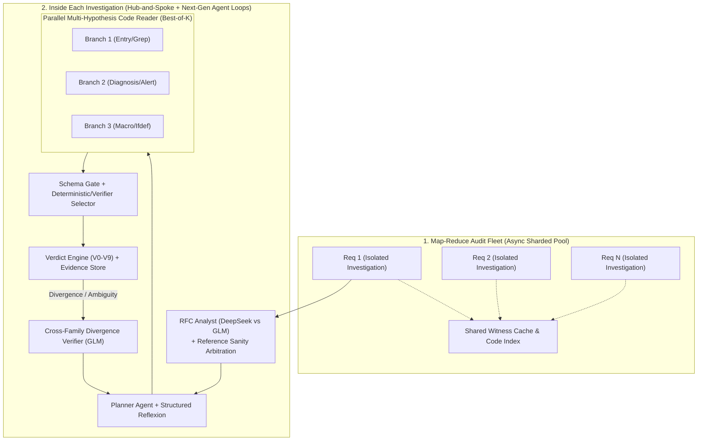

# Thiết kế Tiến hoá AI Agent & Quy trình Nghiên cứu Thế hệ mới

Tài liệu này định nghĩa hướng phát triển và nghiên cứu mới của `RFC-Audit` (bắt đầu từ nhánh `feat/nextgen-agent-research`, xây trên nền lõi an toàn đã kiểm chứng tại `dev` @ `b433e9d`). Mục tiêu kép:

1. **Chứng minh năng lực thực sự và hiệu quả của AI Agent** trên **mọi cỡ mô hình** (từ frontier đến các mô hình nhỏ/nhanh như DeepSeek-Flash, GLM-4-Flash/Air, Qwen 7B–14B) mà **không tách nhánh riêng SLM/LLM** và **không thay thế agent bằng kịch bản cứng**.
2. **Áp dụng các phương pháp AI-for-Research tối tân nhất (2025–2026)** vào cả **quy trình nghiên cứu (Phần 1)** lẫn **cơ chế vận hành bên trong `RFC-Audit` (Phần 2)**.

---

## Mục lục

- [1. Đánh giá nền tảng hiện có & Nguyên tắc bất biến](#1-đánh-giá-nền-tảng-hiện-có--nguyên-tắc-bất-biến)
- [2. Phần 1: Quy trình Nghiên cứu AI-for-Research (Meta-Level)](#2-phần-1-quy-trình-nghiên-cứu-ai-for-research-meta-level)
- [3. Phần 2: Cơ chế AI Agent Thế hệ mới bên trong RFC-Audit (System-Level)](#3-phần-2-cơ-chế-ai-agent-thế-hệ-mới-bên-trong-rfc-audit-system-level)
- [4. Unified Model-Agnostic ACI & Runtime](#4-unified-model-agnostic-aci--runtime)
- [5. Lộ trình thực thi 3 Chặng & Tiêu chí kiểm chứng](#5-lộ-trình-thực-thi-3-chặng--tiêu-chí-kiểm-chứng)

---

## 1. Đánh giá nền tảng hiện có & Nguyên tắc bất biến

### Nền tảng đã vững (Baseline `B0` trên `dev`)
- **An toàn theo thiết kế:** Vùng cách ly (`quarantine`) cho đọc mã, kiểm soát luồng thông tin (`ifc.py`), `Schema gate`, `Tool gateway`, `Output gate`, `Evidence store` chuỗi hash.
- **Không ảo giác kết luận:** Nhãn chỉ do `Verdict engine` (quy tắc V0–V9) quyết định; hai tham chiếu độc lập (OpenSSL, GnuTLS) tự phát hiện lỗi đặc tả RBS (`CT-26`).

### Nguyên tắc đỏ không bao giờ phá vỡ
Dù tích hợp cơ chế đa tác tử chạy song song, tiến hoá hay phản biện sâu, hệ thống luôn giữ 3 bất biến:
1. **Agents propose, deterministic components verify:** Không agent nào được tự gán nhãn.
2. **IFC intact:** Chuỗi tự do từ mã nguồn không tin cậy không bao giờ lọt vào ngữ cảnh agent đặc quyền.
3. **Model-Agnostic Harness:** Một bộ công cụ (ACI), một runtime và một bộ prompt chuẩn hoá dùng chung cho mọi mô hình — thứ giúp model nhỏ chạy mượt cũng giúp model lớn nhanh, rẻ và chính xác hơn.

---

## 2. Phần 1: Quy trình Nghiên cứu AI-for-Research (Meta-Level)

Thay vì phát triển tuyến tính trên một nhánh duy nhất và đánh giá cảm tính, quy trình nghiên cứu áp dụng kết hợp **6 phương pháp AI Agent hàng đầu (2025–2026)**:

| Phương pháp | Tham chiếu | Cách áp dụng cho `RFC-Audit` |
|---|---|---|
| **1. Automated Evaluator & Hill-Climbing (`results.tsv`)** | Karpathy `autoresearch`, Google AlphaEvolve | Dựng 1 script đánh giá chuẩn trả về vector điểm `{ci_pass, verdict_acc, false_compliant, defect_hit, avg_tokens, worker_failures}`. Chỉ giữ thay đổi làm tăng điểm trên đường biên Pareto; ghi lịch sử mọi thí nghiệm vào `results.tsv`. |
| **2. Controlled Multi-Branch Tournament & Crossover** | Google AlphaEvolve & AI Co-Scientist | Tách các nhánh thực nghiệm song song trên workspace cô lập (git worktree), chạy cùng Evaluator → dùng **Judge/Meta-Review Agent** chấm đối kháng 1-vs-1 từ `trace.db` → **lai ghép (crossover)** kỹ thuật thắng cuộc. |
| **3. Synthetic Bug Factory (Zero Data Leakage)** | SWE-Smith | Dùng **Bug-Injector Agent** tự động tiêm 20–50 lỗi tuân thủ RFC đa dạng vào mã nguồn thật (wolfSSL: lệch ngưỡng 1 byte, đổi mã alert, bọc nhầm `#ifdef`, bỏ `close()`, nhánh phụ) để có ground truth 100% và 0% nguy cơ rò rỉ dữ liệu huấn luyện. |
| **4. Trajectory Distillation / Skill Crystallization** | Voyager / Skill Library | Cho model mạnh giải các ca khó nhất → dùng **Crystallizer Agent** rút trích chiến lược đọc mã, bẫy `#ifdef` và ví dụ chuẩn thành skill/few-shot tinh gọn để mọi model nhỏ (DeepSeek-Flash, GLM) dùng lại miễn phí. |
| **5. Contrastive Trace Mining + MAST** | Meta MUSE, MAST Taxonomy | Gom cặp trace đối lập (ĐÚNG vs SAI trên cùng 1 yêu cầu) → tìm đúng bước rẽ nhánh đầu tiên (*first divergence step*) và phân loại tự động vào `coord_mast.py`. |
| **6. Hội đồng Phản biện 4 Vai Giả lập** | Adversarial Peer Review | 4 sub-agent độc lập (*Security Attacker*, *Systems Skeptic*, *Empirical Statistician*, *Claim-vs-Evidence Auditor*) rà soát thiết kế, mã và số đo trước khi chốt từng mốc. |

---

## 3. Phần 2: Cơ chế AI Agent Thế hệ mới bên trong `RFC-Audit` (System-Level)

Bản thân bên trong kiến trúc vận hành của `RFC-Audit` tích hợp **4 cơ chế thế hệ mới** để chứng minh sức mạnh thực sự của AI Agent ngay trên các mô hình nhỏ/nhanh:

### Chi tiết 4 cơ chế tích hợp trong hệ thống

1. **Map-Reduce Audit Fleet (Tầng Orchestrator):**
   - Nâng cấp bộ chạy yêu cầu từ tuần tự sang **async worker pool cô lập** (mỗi yêu cầu có `Investigation`, `BudgetTracker`, `ToolSession` riêng), chia sẻ `Witness Cache` và `Code Index`.
   - Cho phép quét hàng chục–trăm yêu cầu RFC hoặc nhiều commit song song, giảm thời gian chạy thực tế $10\times\text{–}20\times$.
2. **Parallel Multi-Hypothesis Exploration — Best-of-$K$ (Bên trong `Code Reader`):**
   - Thay vì để 1 `Code Reader` chạy vòng ReAct dài 15–25 bước dễ lạc/cạn token, Hub có thể khởi chạy **$K=2\text{–}3$ nhánh `Code Reader` ngắn song song** (mỗi nhánh 3–4 bước theo giả thuyết/điểm vào khác nhau).
   - Mọi ứng viên `LocationClaim` đều qua `Schema Gate` và bộ chọn lọc tất định/Verifier để lấy bằng chứng T1 có độ khớp cao nhất → **Test-Time Scaling** giúp model cỡ Flash/GLM đạt độ chính xác vượt trội.
3. **Cross-Family Divergence Critique & Reference Arbitration (`RFC Analyst` & `Verifier`):**
   - **RFC Analyst:** Hai luồng khác họ (**DeepSeek** vs **GLM**) độc lập dịch câu RFC → nếu bất đồng, chạy **Reference Sanity Check** (OpenSSL/GnuTLS) làm trọng tài tất định kiểm định phía hợp lệ trước khi chốt RBS (giải quyết gốc rễ `CT-26`).
   - **Verifier:** Chạy bằng họ mô hình thứ hai (**GLM** đối chiếu **DeepSeek**, đóng `CT-07`), tập trung kiểm toán tại **các điểm rẽ nhánh lập luận** (`#ifdef`, `unexplored`, từ định lượng *"every/all"* trong câu RFC gốc, mâu thuẫn T1↔T3).
4. **Structured Reflexion Memory (Trong `Execution Loop`):**
   - Khi `Schema Gate` hoặc `Verifier` bác bỏ một đề xuất, Hub ghi nhận **phản tư có cấu trúc** (mã lỗi + lý do tuân thủ IFC, không chứa chuỗi tự do từ mã nguồn) vào trạng thái vòng sau để agent tự điều chỉnh thay vì lặp lỗi cũ.

---

## 4. Unified Model-Agnostic ACI & Runtime

Để cả 4 cơ chế trên hoạt động mượt trên mọi mô hình (Frontier, DeepSeek-Flash, GLM-4-Flash/Air, Qwen/Llama cục bộ), cần nâng cấp **4 điểm nền tảng** trong tầng giao diện Agent-Computer Interface (ACI) và Runtime:

1. **Static Skill Injection mặc định:** Nhúng trực tiếp skill cô đọng theo `role.yaml` vào system prompt thay vì bắt agent gọi meta-tool `load_capability` → triệt tiêu `CT-01` (0 lần nạp lặp skill).
2. **Đa chế độ xuất Schema (`output_mode: tool | native | prompted`) + JSON Coercion nhẹ:** Giải quyết xung đột `thinking` vs `tool_choice` trên DeepSeek/GLM và tự chuẩn hoá lỗi kiểu nhẹ (`"16486"` → `16486`, bóc code fence) trước khi tốn `MAX_OUTPUT_RETRIES`.
3. **Inline `#ifdef` Annotation trong `code__read`:** Khi `Code Reader` đọc tệp C theo `adapter.build_flags`, công cụ gắn trực tiếp nhãn dòng bị tắt biên dịch (`[DISABLED]`) ngay cạnh số dòng → agent vẫn tự khám phá nhưng nhìn rõ mã thật ngay trong 1 lần đọc.
4. **Ngữ cảnh sạch & nén lịch sử thông minh:** Rút gọn `code_reader/prompt.md` dạng bảng + 1 ví dụ chuẩn `LocationClaim@1`; giữ `KEEP_TOOL_RESULTS = 2`, `READ_KEEP_CHARS = 20_000`; nén các dòng T3 `PASS` trong `evidence.summary` gửi cho `Report` (~34k → ~4k token).

---

## 5. Lộ trình thực thi 3 Chặng & Tiêu chí kiểm chứng

| Chặng | Mục tiêu cụ thể | Đầu ra & Kiểm chứng |
|---|---|---|
| **Chặng 1: Nền tảng ACI & Evaluator** *(trên `feat/nextgen-agent-research`)* | Cài đặt 4 nâng cấp Unified ACI & Runtime (Mục 4), bổ sung mẫu cấu hình đa họ DeepSeek + GLM trong `models.yaml`, dựng script `scripts/eval_score.py` (Automated Evaluator + `results.tsv`). | `pytest`, `ruff`, `pyright`, `lint-imports` xanh 100%; `skill_reloads = 0`; có bảng điểm Baseline `B0` và `B1`. |
| **Chặng 2: 3 Nhánh Song song & Crossover** *(Phần 1 + Phần 2)* | 3 sub-agent trên 3 workspace cô lập cài đặt & đo đối chứng: **(A)** Best-of-$K$ `Code Reader`, **(B)** Cross-Family Divergence `Verifier` + `RFC Analyst` Pre-Check, **(C)** Map-Reduce Async Fleet + Structured Reflexion. Chấm Elo/Meta-Review → lai ghép thành bản tổng hợp. | Bảng so sánh Pareto (`B0` vs `A` vs `B` vs `C` vs `Synthesis`) trên `e2e_live`, `e2e_hard`, ca đối kháng `injected` (`CT-08`) và wolfSSL thật. |
| **Chặng 3: Chứng minh quy mô lớn & Adversarial Review** | Dùng Synthetic Bug Factory tiêm 20–30 lỗi thật trên wolfSSL, chạy Audit Fleet với $n \ge 3$ lần lặp (DeepSeek + GLM), chạy 4-Role Adversarial Review rà soát toàn bộ báo cáo. | Số liệu thống kê có ý nghĩa (Recall, Precision, `False COMPLIANT = 0%`, `defect_hit`, độ lệch chuẩn, chi phí/yêu cầu). |
