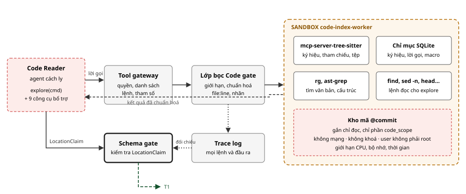

# Thiết kế khả năng khám phá mã nguồn của AI Agent

*Tài liệu thiết kế chi tiết · Phần bổ sung*

Đề tài: Kiểm chứng tự động và an toàn sự tuân thủ đặc tả giao thức mạng dựa trên bằng chứng, sử dụng hệ thống AI đa tác tử · Học viên: Nguyễn Kỳ Tùng · GVHD: TS. Tống Văn Vạn<br> Tài liệu chi tiết hoá Code gate, Locator, Code Indexer Agent và Code Reader Agent của bản đề xuất; không thêm thành phần mới.

**MỤC LỤC**

- [1. Mục tiêu và ràng buộc](#1-mục-tiêu-và-ràng-buộc)
- [2. Cơ sở lựa chọn](#2-cơ-sở-lựa-chọn)
- [3. Kiến trúc tổng thể](#3-kiến-trúc-tổng-thể)
- [4. Hai chế độ khám phá](#4-hai-chế-độ-khám-phá)
  - [4.1 Tự khám phá: explore](#41-tự-khám-phá-công-cụ-explorecommand)
  - [4.2 Chín công cụ bổ trợ](#42-chín-công-cụ-bổ-trợ)
- [5. Sandbox](#5-sandbox)
- [6. Định dạng đầu ra và ghi vết](#6-định-dạng-đầu-ra-và-ghi-vết)
- [7. Chiến lược khám phá](#7-chiến-lược-khám-phá-của-code-reader)
- [8. Kiểm tra ở Schema gate](#8-kiểm-tra-ở-schema-gate-trước-khi-ghi-t1)
- [9. Vai trò hỗ trợ](#9-vai-trò-hỗ-trợ-của-locator-và-code-indexer)
- [10. Đặc thù C, Rust, Go](#10-đặc-thù-của-c-rust-và-go)
- [11. Ví dụ](#11-ví-dụ-rfc-8446-52-trên-wolfssl)
- [12. Hiện thực](#12-hiện-thực)
- [13. Đo lường](#13-đo-lường-trong-luận-văn)
- [14. Rủi ro, điểm cần xác nhận](#14-rủi-ro-và-điểm-cần-xác-nhận)
- [15. Nguồn](#15-nguồn)

## 1. Mục tiêu và ràng buộc

**Mục tiêu.** Cung cấp cho agent khả năng khám phá mã nguồn gần với cách một lập trình viên làm việc: tự định hướng trong kho mã, tự tìm kiếm, đọc và lần theo quan hệ giữa các đoạn mã cho tới khi hiểu được đoạn xử lý một yêu cầu RFC. Agent có thể khám phá theo hai chế độ:

- **Tự khám phá:** tự viết lệnh tìm kiếm và đọc mã theo ý mình, bằng một công cụ linh hoạt.
- **Dùng công cụ bổ trợ:** gọi các công cụ chuyên dụng cho những thao tác thường gặp, trả kết quả gọn và có cấu trúc.

Cả hai chế độ phải đồng thời thoả bốn ràng buộc:

| Mã | Ràng buộc | Nguồn |
| --- | --- | --- |
| C1 | **Hiệu quả:** định vị đúng hàm và đúng dòng với chi phí token hợp lý | Mục tiêu cụ thể 1 |
| C2 | **An toàn:** không ghi tệp, không gọi mạng, không chạy mã của kho mã, không đọc ngoài phạm vi | ĐX mục 2.4 và 3 (A1, A3, A4, A6) |
| C3 | **Truy vết:** mọi vị trí agent chỉ ra phải đối chiếu được với kho mã tại commit cố định | Định nghĩa T1 ở ĐX mục 2.4 |
| C4 | **Đa ngôn ngữ:** chạy được trên C, Rust và Go, kể cả mã giao thức dùng nhiều macro và con trỏ hàm | Kho mã ứng viên ở ĐX mục 4 |

*Bảng 1. Ràng buộc của cơ chế khám phá mã.*

## 2. Cơ sở lựa chọn

Các coding agent và công trình nghiên cứu hiện nay cho thấy năm điều mà thiết kế này dựa vào:

| Phát hiện | Bằng chứng | Áp dụng vào thiết kế |
| --- | --- | --- |
| Tìm kiếm bằng công cụ tốt hơn RAG vector cho bài toán đọc mã | Nhóm Claude Code từng dùng RAG kèm cơ sở dữ liệu vector, sau đó chuyển sang tìm kiếm bằng công cụ vì "agentic search generally works better" | Không dùng RAG vector |
| Công cụ thiết kế riêng tốt hơn shell trần | SWE-agent: agent chỉ có shell giải được 11% SWE-bench Lite; có bộ công cụ tìm và đọc riêng giải được 18% | Có bộ công cụ bổ trợ, không chỉ cho lệnh |
| Kết quả tìm phải có giới hạn, cửa sổ đọc vừa phải | SWE-agent: tìm lần lượt từng kết quả đạt 12,0%, kém cả không có công cụ tìm (15,7%); cửa sổ 100 dòng đạt 18,0%, đọc cả tệp đạt 12,7% | Tối đa 50 kết quả; đọc 100 dòng mỗi lần |
| Biết cấu trúc mã giúp định vị tốt hơn grep thuần | LocAgent (đồ thị mã): đúng hàm trong top 10 đạt 77,4%, so với 64,6% của SWE-agent. AutoCodeRover (công cụ theo AST): chi phí khoảng 0,43 USD mỗi bài so với 2,51 USD của SWE-agent | Có công cụ theo cấu trúc: ký hiệu, tham chiếu, định nghĩa |
| Trên mã giao thức viết bằng C, truy xuất theo quan hệ gọi hàm và tự kiểm tra là then chốt | RFCAudit: precision 81,9%; bỏ truy xuất caller/callee còn 44,7%; bỏ bước tự phê bình còn 35,7% | Có `find_references`, `callees`; có bước tự kiểm tra trong vòng khám phá |

*Bảng 2. Cơ sở lựa chọn. Số liệu SWE-agent, LocAgent, AutoCodeRover đo trên mã Python; RFCAudit đo trên mã giao thức viết bằng C.*

> [!TIP]
> **Lựa chọn thiết kế.** Agent đọc mã theo **hai cách**: **theo văn bản** (tìm và đọc như grep) và **theo cấu trúc** (hàm, ký hiệu, tham chiếu, quan hệ gọi). Agent được dùng hai cách này qua **hai chế độ**: một công cụ linh hoạt để tự khám phá, và chín công cụ bổ trợ. Mọi lệnh đều chạy trong sandbox chỉ đọc, sau Tool gateway. Cách phối hợp này giống SWE-agent, vốn vừa có bộ công cụ riêng vừa cho agent chạy lệnh.

## 3. Kiến trúc tổng thể



***Hình 1.** Kiến trúc khám phá mã: Code Reader gọi công cụ qua Tool gateway và lớp bọc Code gate; mọi lệnh chạy trong SANDBOX code-index-worker; Schema gate đối chiếu kết luận với Trace log trước khi ghi T1.*

**Ký hiệu sử dụng trong Hình 1:**

| Ký hiệu | Ý nghĩa |
| --- | --- |
|  | Thành phần không tin cậy: agent cách ly đọc mã, và chính kho mã |
|  | Thành phần tất định của harness |
|  | Điểm kiểm tra cuối trước khi ghi bằng chứng |
|  | SANDBOX: container không mạng, kho mã chỉ đọc |
|  | Công cụ và dữ liệu bên trong sandbox |
|  | Lời gọi công cụ hoặc kết luận của agent |
|  | Kết quả đã chuẩn hoá trả về cho agent |
|  | Ghi vết và đối chiếu với Trace log |
|  | Ghi bằng chứng T1 vào Evidence store |

Agent không có shell và không kết nối trực tiếp tới MCP server. Mọi lời gọi đi theo một đường duy nhất:

1. **Tool gateway** kiểm tra quyền của vai trò, danh sách lệnh cho phép và miền tham số.
2. **Lớp bọc của Code gate** chuyển lời gọi vào sandbox, áp giới hạn đầu ra, chuẩn hoá về `file:line`, gắn nhãn UNTRUSTED và ghi Trace log.
3. Kết quả mới được trả lại cho agent.

## 4. Hai chế độ khám phá

### 4.1. Tự khám phá: công cụ `explore(command)`

Agent tự viết lệnh tìm kiếm và đọc mã như một lập trình viên trên terminal, nhưng chỉ được dùng các lệnh đọc trong danh sách cho phép. Công cụ này dành cho những việc mà bộ công cụ bổ trợ không làm gọn được: tìm theo mẫu cấu trúc phức tạp, thống kê nhanh, ghép nhiều bước tìm kiếm, theo dấu một bảng con trỏ hàm.

| Lệnh được phép | Cờ và dạng được phép | Dùng để |
| --- | --- | --- |
| `rg`, `grep` | Tìm theo regex, lọc tệp (`-g`, `-t`), ngữ cảnh (`-A`, `-B`, `-C`), số dòng (`-n`), chỉ tên tệp (`-l`), đếm (`-c`) | Tìm văn bản |
| `ast-grep` (`sg`) | Chỉ chế độ tìm: `-p`, `-l`, `--json`; không có `-r` (rewrite) và `-U` (update) | Tìm theo mẫu cấu trúc, ví dụ `sg -p 'if ($A > $B) { $$$ }' -l c` |
| `find`, `ls`, `tree` | `find` chỉ với `-name`, `-path`, `-type`, `-maxdepth` | Khám phá cấu trúc thư mục |
| `sed`, `head`, `tail`, `cat` | `sed` chỉ dạng `-n 'A,Bp'`; `cat` chỉ với `-n` | Đọc theo khoảng dòng |
| `wc`, `sort`, `uniq`, `cut` | Tuỳ chọn thông thường, không ghi tệp | Đếm, lọc, thống kê |
| Dấu `\|` | Chỉ nối các lệnh trong bảng này | Ghép bước |

*Bảng 3. Danh sách lệnh cho phép của `explore`.*

| Bị chặn | Lý do |
| --- | --- |
| `rg --pre`, `--pre-glob` | Chạy một chương trình tuỳ ý trên từng tệp |
| `find -exec`, `-execdir`, `-ok`, `-delete`, `-fprint` | Chạy lệnh, xoá hoặc ghi tệp |
| `sed -i`, lệnh `e`, `w`, `r` của sed; `ast-grep -r`, `-U` | Ghi tệp hoặc chạy lệnh |
| `awk`, `xargs`, `bash`, `sh`, `python`, `perl`, `env`, `git`, `make`, mọi lệnh ngoài Bảng 3 | Có thể chạy mã tuỳ ý, kể cả mã của kho mã |
| `>`, `>>`, `<`, `;`, `&&`, `\|\|`, `$( )`, backtick, `&`, biến môi trường | Chuyển hướng, ghép lệnh, chạy nền, thay thế lệnh |

*Bảng 4. Những gì bị chặn trong `explore`.*

**Cách kiểm tra.** Tool gateway kiểm tra theo ba bước, và từ chối ngay khi một bước không qua:

1. Tách lệnh theo `|` và phân tích từng đoạn bằng `shlex`.
2. So tên lệnh và từng cờ với Bảng 3.
3. Giải mọi đường dẫn về đường dẫn thật (kể cả qua symlink) và kiểm tra chúng nằm trong `code_scope`.

Lệnh hợp lệ được chạy trực tiếp bằng `execve`, không qua shell. Phân tích cú pháp do harness làm, nên không có cách nào chèn thêm lệnh.

**Giới hạn.** Mỗi lệnh tối đa 10 giây và tối đa 200 dòng hoặc 16 KB đầu ra. Quá giới hạn thì công cụ không trả kết quả mà báo agent thu hẹp lệnh, theo cách của SWE-agent. Mỗi lần gọi tính vào ngân sách của Code Reader.

### 4.2. Chín công cụ bổ trợ

Các công cụ bổ trợ phục vụ những thao tác thường gặp nhất. Chúng nhanh, tiết kiệm token, và luôn trả kết quả có `file:line`. Lời nhắc hệ thống của Code Reader hướng agent dùng các công cụ này trước, và chỉ dùng `explore` khi cần.

| Nhóm | Công cụ | Trả về | Cách đọc | Giới hạn |
| --- | --- | --- | --- | --- |
| **Định hướng** | `list_dir(path, depth≤2)` | Cây thư mục, số dòng mỗi tệp | Cấu trúc | 200 mục |
| **Định hướng** | `file_outline(file)` | Chữ ký hàm, struct, macro trong tệp, kèm dòng; không có thân hàm | Cấu trúc | 200 ký hiệu |
| **Tìm** | `search_text(regex, path_glob?)` | Dòng khớp, ±2 dòng ngữ cảnh, tên hàm chứa dòng đó | Văn bản | 50 kết quả |
| **Tìm** | `search_symbol(name, kind?)` | Ký hiệu khớp tên: loại, tệp, dòng, chữ ký | Cấu trúc | 50 kết quả |
| **Đọc** | `read_function(symbol, page?)` | Thân hàm có số dòng; hàm dài trả chữ ký, danh sách khối lệnh và trang đầu | Cấu trúc | 100 dòng mỗi trang |
| **Đọc** | `read_range(file, start, end)` | Đoạn mã bất kỳ có số dòng, kể cả ngoài hàm (bảng con trỏ hàm, khai báo, `#ifdef`) | Văn bản | 100 dòng mỗi lần |
| **Đọc** | `get_definition(name)` | Định nghĩa macro, hằng, struct, kiểu | Cấu trúc | 1 định nghĩa, hoặc danh sách nếu trùng tên |
| **Lần theo** | `find_references(symbol)` | Mọi chỗ dùng ký hiệu (hàm, biến, trường struct), kèm hàm chứa và loại tham chiếu (gọi, đọc, ghi, gán vào con trỏ) | Cấu trúc | 50 kết quả |
| **Lần theo** | `callees(function)` | Các hàm được gọi trong thân hàm, kèm dòng | Cấu trúc | 100 kết quả |

*Bảng 5. Chín công cụ bổ trợ. `find_references` thay cho `callers`: nơi gọi một hàm là một loại tham chiếu tới hàm đó, và công cụ này còn theo dấu được biến và trường dữ liệu.*

> [!NOTE]
> **Agent có đọc được toàn bộ một tệp không?** Có, bằng cách gọi `read_range` hoặc `sed -n` liên tiếp, mỗi lần 100 dòng. Không có công cụ nào trả cả tệp trong một lần, vì theo SWE-agent, đọc cả tệp làm hiệu quả giảm từ 18,0% xuống 12,7%. Tổng số lần đọc bị chặn bởi ngân sách của Code Reader.

## 5. Sandbox

Mọi lệnh và mọi công cụ đều chạy trong container `code-index-worker` thuộc ANALYSIS ZONE ở kiến trúc triển khai. Không có lệnh nào chạy trên máy của harness.

| Thuộc tính | Cấu hình | Chặn rủi ro |
| --- | --- | --- |
| Mạng | `--network none` | A4 (lộ dữ liệu ra ngoài) |
| Kho mã | Gắn chỉ đọc, chỉ các thư mục trong `code_scope`; tệp khoá, chứng chỉ bị loại khỏi lúc gắn | A4, ghi đè mã |
| Hệ thống tệp còn lại | `--read-only`; chỉ có `/tmp` nhỏ dạng tmpfs cho chỉ mục tạm | Ghi tệp |
| Người dùng | Không phải root; bỏ mọi capability (`--cap-drop ALL`); `no-new-privileges` | Leo thang quyền |
| Bí mật | Không có khoá API, không có biến môi trường của harness | A4 |
| Tài nguyên | Giới hạn CPU, bộ nhớ, số tiến trình (`--pids-limit`), thời gian mỗi lệnh 10 giây | A6 |
| Chương trình có trong image | Chỉ các lệnh ở Bảng 3, mcp-server-tree-sitter và SQLite; không có trình biên dịch, không có trình thông dịch ngoài Python của MCP server | A3 (chạy mã của kho) |
| Vòng đời | Một container cho mỗi lần chạy; huỷ khi kết thúc | Tồn dư trạng thái |

*Bảng 6. Cấu hình sandbox.*

## 6. Định dạng đầu ra và ghi vết

Mọi kết quả trả cho agent, dù từ `explore` hay công cụ bổ trợ, có cùng khuôn dạng: tiêu đề nêu nguồn, nội dung có số dòng, và đánh dấu rõ là dữ liệu không tin cậy.

```
[UNTRUSTED CODE] tool=read_function  src/internal.c  GetRecordHeader  lines 9100–9124  page 1/1
9100  static int GetRecordHeader(WOLFSSL* ssl, word32* inOutIdx, RecordLayerHeader* rh, word16 *size)
9101  {
...
9118      if (*size > (MAX_RECORD_SIZE + MAX_COMP_EXTRA + MAX_MSG_EXTRA)) {
9119          SendAlert(ssl, alert_fatal, record_overflow);

[UNTRUSTED CODE] tool=explore  cmd="rg -n record_overflow src/"
src/internal.c:9119:        SendAlert(ssl, alert_fatal, record_overflow);
src/tls13.c:4410:           SendAlert(ssl, alert_fatal, record_overflow);
```

Lớp bọc ghi mỗi lần gọi vào Trace log, gồm vai trò, công cụ, lệnh hoặc tham số, thời gian và đầu ra. Từ đầu ra, lớp bọc trích tập **dòng đã hiển thị**, tức các cặp (tệp, dòng) xuất hiện kèm số dòng. Tập này được Schema gate dùng ở kiểm tra số 2 (mục 8). Đầu ra không kèm số dòng (ví dụ `rg -l`, `wc`) vẫn hữu ích để định hướng nhưng không đóng góp vào tập dòng đã hiển thị.

## 7. Chiến lược khám phá của Code Reader

Code Reader được tự do chọn công cụ và thứ tự. Lời nhắc hệ thống gợi ý một chiến lược sáu bước, tương tự cách RFCAudit và LocAgent tổ chức việc định vị, trong ngân sách của hồ sơ vai trò (khởi điểm 30 lời gọi công cụ, 12 lời gọi LLM).

| Bước | Việc làm | Công cụ thường dùng |
| --- | --- | --- |
| 1. Định hướng | Xem gợi ý của Locator; nắm cấu trúc thư mục và các tệp ứng viên | `locator.suggest`, `list_dir`, `file_outline` |
| 2. Tìm điểm vào | Tìm theo thuật ngữ của yêu cầu: tên cảnh báo, tên trường, hằng số; tìm theo mẫu cấu trúc khi cần | `search_text`, `search_symbol`, `explore` với `rg` hoặc `ast-grep` |
| 3. Đọc | Đọc hàm ứng viên và đoạn mã xung quanh | `read_function`, `read_range` |
| 4. Lần theo | Tra định nghĩa hằng và macro; xem ai gọi hàm, hàm gọi ai; theo dấu biến độ dài hay trường trạng thái | `get_definition`, `find_references`, `callees` |
| 5. Kết luận | Soạn `LocationClaim`: tệp, dòng, ký hiệu, `check_kind`, `finding`, `call_path` | Không gọi công cụ |
| 6. Tự kiểm tra | Đọc lại đúng các dòng sẽ dẫn; xác nhận điều kiện, ngưỡng, và hàm nằm trên luồng xử lý; sai thì quay lại bước 4 | `read_range` |

*Bảng 7. Chiến lược khám phá gợi ý. Bước 6 dựa trên RFCAudit: bỏ bước tự phê bình làm precision giảm từ 81,9% xuống 35,7%.*

Hết ngân sách mà chưa kết luận được, Code Reader trả `finding = UNCLEAR` kèm vị trí tốt nhất đã thấy. Với loại A–C, yêu cầu vẫn có thể được kết luận nhờ T3.

## 8. Kiểm tra ở Schema gate trước khi ghi T1

| # | Kiểm tra | Mục đích |
| --- | --- | --- |
| 1 | `symbol` có trong chỉ mục; khoảng dòng nằm trong thân ký hiệu đó | Vị trí có thật tại commit |
| 2 | Mọi dòng được dẫn thuộc **tập dòng đã hiển thị** cho agent trong phiên (mục 6) | Agent không dẫn được dòng nó chưa từng đọc |
| 3 | Mỗi cạnh của `call_path` có trong chỉ mục lời gọi, hoặc đã hiển thị cho agent trong một đầu ra có số dòng; cạnh thứ hai được đánh dấu `edge_kind = textual` | Đường gọi hàm có căn cứ; xử lý được con trỏ hàm |
| 4 | `check_kind`, `finding` thuộc danh sách liệt kê; trường `note` tự do mang nhãn UNTRUSTED | Không có chuỗi tự do đi tới agent đặc quyền |

*Bảng 8. Kiểm tra LocationClaim. Không qua thì Code Reader được làm lại tối đa hai lần trong ngân sách.*

## 9. Vai trò hỗ trợ của Locator và Code Indexer

Locator và Code Indexer không phải là cách đọc mã riêng. Chúng dùng chỉ mục cấu trúc để giúp Code Reader biết nên bắt đầu từ đâu.

- **Code Indexer Agent** gán mỗi hàm trong phạm vi vào một thành phần của giao thức, chọn từ danh sách liệt kê của adapter (ví dụ `record_layer`, `handshake`). Nó dùng chính các công cụ ở mục 4.
- **Locator** chấm điểm hàm bằng một công thức cố định:

  ```
  score(f) = 3·kw(f) + 2·comp(f) + 2·near(f) + 1·hint(f)
    kw    số từ khoá của yêu cầu và của adapter xuất hiện trong tên hoặc thân hàm
    comp  1 nếu thành phần của f trùng thành phần của yêu cầu
    near  1/(1+d), d là khoảng cách trên đồ thị gọi hàm tới điểm vào do adapter khai báo
    hint  1 nếu f nằm trong đường dẫn gợi ý của adapter
  ```

  Trọng số là giá trị khởi điểm, hiệu chỉnh trên 10 yêu cầu TLS 1.3 trước thực nghiệm chính.
- **Tóm tắt ngữ nghĩa** cho từng hàm (cách RFCAudit làm) là **tuỳ chọn**, mặc định tắt. Chỉ bật nếu ở mốc tháng 11 độ chính xác định vị chưa đạt. Khi bật, tóm tắt là chuỗi tự do nên mang nhãn UNTRUSTED và chỉ Code Reader đọc được.

## 10. Đặc thù của C, Rust và Go

| Vấn đề | Cách xử lý |
| --- | --- |
| Macro trong C | `get_definition` trả thân macro; lời nhắc gợi ý tra định nghĩa khi gặp tên viết hoa trong điều kiện |
| Con trỏ hàm, bảng xử lý theo loại thông điệp | `find_references` báo loại tham chiếu "gán vào con trỏ"; dùng `explore` với `rg` theo tên hàm làm dự phòng; kiểm tra số 3 chấp nhận cạnh `textual` |
| `#ifdef`, tuỳ chọn biên dịch | `read_range` đọc được khối điều kiện; adapter khai báo cờ biên dịch của SUT để agent biết nhánh nào được bật |
| Rust: trait, `macro_rules!` | `search_symbol` trả mọi phương thức trùng tên ở các kiểu; `ast-grep` tìm theo mẫu khi cần |
| Go: interface, phương thức có bộ nhận | Như Rust; tree-sitter Go trích được bộ nhận của phương thức |

*Bảng 9. Xử lý theo ngôn ngữ.*

## 11. Ví dụ: RFC 8446 §5.2 trên wolfSSL

Tên hàm và số dòng là minh hoạ; sẽ thay bằng giá trị thật khi chạy ở mốc tháng 11. Ví dụ cho thấy agent kết hợp hai chế độ.

```
Yêu cầu : TLS13-0042, loại B — bản ghi dài hơn 2^14+256 byte → gửi record_overflow, đóng kết nối

 1 locator.suggest(TLS13-0042)                     → GetRecordHeader, ProcessReplyEx, ...
 2 explore("rg -n record_overflow src/")           → internal.c:9119, tls13.c:4410        [tự khám phá]
 3 read_function("GetRecordHeader")                → 9100–9124: so sánh *size với MAX_RECORD_SIZE + ...
 4 get_definition("MAX_RECORD_SIZE")               → 16384
   get_definition("MAX_MSG_EXTRA")                 → phụ thuộc cấu hình
 5 find_references("GetRecordHeader")              → gọi từ ProcessReplyEx (internal.c:9530)
 6 explore("sg -p 'if ($S > MAX_RECORD_SIZE + $$$) { $$$ }' -l c src/")
                                                   → thêm một chỗ ở tls13.c:4402           [tự khám phá]
 7 read_range("src/tls13.c", 4395, 4415)           → nhánh TLS 1.3 có ngưỡng riêng
 8 Tự kiểm tra: đọc lại tls13.c:4402–4410, đối chiếu ngưỡng với 2^14+256
 9 LocationClaim: src/tls13.c 4402–4410, check_kind LENGTH_BOUND, finding PRESENT,
                  call_path [ProcessReplyEx → GetRecordHeader]
```

Bước 6 là ví dụ cho giá trị của tự khám phá: tìm theo mẫu cấu trúc giúp agent phát hiện thêm một nhánh xử lý riêng cho TLS 1.3, điều mà một lần tìm theo tên cảnh báo có thể bỏ sót. Schema gate kiểm tra các dòng 4402–4410 đã hiển thị ở bước 7, rồi ghi T1. Nhãn cuối cùng vẫn do T3 quyết định.

## 12. Hiện thực

| Công cụ | Hiện thực |
| --- | --- |
| `list_dir` | `list_files` của mcp-server-tree-sitter |
| `file_outline`, `search_symbol` | `get_symbols` của mcp-server-tree-sitter |
| `read_function`, `read_range` | `get_file` theo khoảng dòng, ranh giới hàm lấy từ `get_symbols` |
| `find_references` | `find_usage` của mcp-server-tree-sitter, bổ sung phân loại tham chiếu bằng `run_query` |
| `get_definition`, `callees` | Tự viết bằng `run_query` (truy vấn tree-sitter) và chỉ mục SQLite |
| `search_text`, `explore` | `rg` và `ast-grep` chạy bằng `execve` trong sandbox |
| Lớp bọc Code gate | Tự viết bằng Python: MCP client, kiểm tra lệnh, giới hạn đầu ra, chuẩn hoá, ghi Trace log; ước lượng vài trăm dòng |

*Bảng 10. Hiện thực. mcp-server-tree-sitter hỗ trợ đầy đủ C, Rust, Go và không cần biên dịch kho mã. Phiên bản của MCP server và các công cụ được cố định trong image sandbox, và ghi vào bản kê lần chạy. Serena (dùng language server) là tuỳ chọn về sau, cho `find_references` chính xác hơn khi SUT có `compile_commands.json`.*

## 13. Đo lường trong luận văn

Bộ dữ liệu tạo lỗi ở ĐX mục 4 có sẵn vị trí lỗi, nên khả năng khám phá đo được trực tiếp trong thực nghiệm đã có.

| Chỉ số | Cách tính |
| --- | --- |
| Định vị đúng hàm, đúng dòng | T1 so với `fault_location` của phiên bản tạo lỗi |
| Tỉ lệ dùng `explore` | Số lời gọi `explore` trên tổng số lời gọi; phân loại theo lệnh (`rg`, `ast-grep`, `find`…) |
| Đóng góp của tự khám phá | So độ chính xác định vị giữa cấu hình đầy đủ và cấu hình tắt `explore` (chỉ còn 9 công cụ bổ trợ) |
| Số lệnh bị từ chối | Theo lý do: lệnh ngoài danh sách, cờ bị chặn, đường dẫn ngoài phạm vi, quá giới hạn; đồng thời là số liệu cho rủi ro A3 |
| Chi phí | Số lời gọi công cụ, token và thời gian cho mỗi yêu cầu |

*Bảng 11. Chỉ số đánh giá khả năng khám phá mã.*

## 14. Rủi ro và điểm cần xác nhận

| Rủi ro | Biện pháp |
| --- | --- |
| Agent bị chỉ thị trong mã dẫn dắt chạy lệnh nguy hiểm qua `explore` | Danh sách cho phép, chạy bằng `execve` không qua shell, sandbox không mạng và chỉ đọc; kịch bản A3 đo số lệnh bị chặn và số lệnh lọt qua (kỳ vọng 0) |
| Agent lạm dụng `explore`, tốn ngân sách | Giới hạn đầu ra, ngân sách lời gọi; lời nhắc ưu tiên công cụ bổ trợ |
| Lỗ hổng trong mcp-server-tree-sitter hoặc các lệnh đọc | Cố định phiên bản; chạy trong sandbox không mạng; agent không gọi MCP trực tiếp |
| tree-sitter phân tích sai mã nhiều macro | Thử trên wolfSSL, OpenSSL trong tháng 10; `explore` với `rg` luôn là dự phòng |

*Bảng 12. Rủi ro của cơ chế khám phá mã.*

> [!WARNING]
> **Điểm cần thầy xác nhận.** ĐX mục 2.4 ghi agent cách ly "không có công cụ nào gây tác động (chạy lệnh, ghi tệp, gọi mạng)". Công cụ `explore` có chạy lệnh, nhưng chỉ là lệnh đọc trong danh sách cho phép, trong sandbox chỉ đọc và không có mạng, nên không gây tác động. Thiết kế hiểu "chạy lệnh" trong bản đề xuất theo nghĩa lệnh gây tác động. Nếu thầy muốn giữ đúng nghĩa đen, có thể bỏ `explore` và thêm một công cụ bổ trợ `search_pattern(pattern, lang)` bọc riêng `ast-grep`; phần còn lại của thiết kế không đổi.

## 15. Nguồn

- J. Yang et al., SWE-agent: Agent-Computer Interfaces Enable Automated Software Engineering, NeurIPS 2024. [arXiv:2405.15793](https://arxiv.org/pdf/2405.15793)
- Y. Zhang et al., AutoCodeRover: Autonomous Program Improvement, ISSTA 2024. [arXiv:2404.05427](https://arxiv.org/html/2404.05427v3)
- Z. Chen et al., LocAgent: Graph-Guided LLM Agents for Code Localization, 2025. [arXiv:2503.09089](https://arxiv.org/html/2503.09089v1)
- M. Zheng et al., RFCAudit (RFCScan): An LLM Agent for Functional Bug Detection in Network Protocols, ASE 2025. [arXiv:2506.00714](https://arxiv.org/abs/2506.00714)
- Why Claude Code dropped vector DB-based RAG. [smartscope.blog](https://smartscope.blog/en/ai-development/practices/rag-debate-agentic-search-code-exploration/)
- MCP Tree-sitter Server: Feature Matrix. [glama.ai](https://glama.ai/mcp/servers/@wrale/mcp-server-tree-sitter/blob/a10571771f509d60ffff33752d97689bf18dd893/FEATURES.md)
- Serena MCP: Semantic Code Tools. [mcp.directory](https://mcp.directory/blog/serena-mcp-complete-guide-2026)
