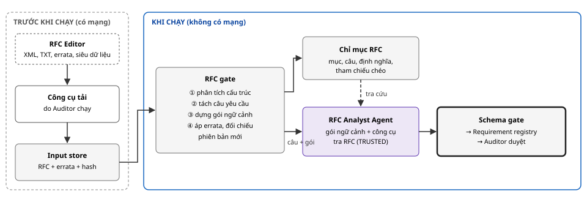
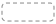

# Thiết kế nguồn RFC và cách cung cấp RFC cho AI Agent

*Tài liệu thiết kế chi tiết · Phần bổ sung*

Đề tài: Kiểm chứng tự động và an toàn sự tuân thủ đặc tả giao thức mạng dựa trên bằng chứng, sử dụng hệ thống AI đa tác tử · Học viên: Nguyễn Kỳ Tùng · GVHD: TS. Tống Văn Vạn<br> Tài liệu chi tiết hoá luồng đặc tả trong bản đề xuất (RFC gate, RFC Analyst Agent, Requirement registry); không thêm thành phần mới.

**MỤC LỤC**

- [1. Mục tiêu và ràng buộc](#1-mục-tiêu-và-ràng-buộc)
- [2. Nguồn RFC](#2-nguồn-rfc)
  - [2.1 Nguồn chính thức](#21-nguồn-chính-thức)
  - [2.2 Định dạng](#22-định-dạng)
  - [2.3 Errata](#23-errata)
  - [2.4 Phiên bản RFC từng giao thức](#24-phiên-bản-rfc-cho-từng-giao-thức)
- [3. Kiến trúc tổng thể](#3-kiến-trúc-tổng-thể-của-luồng-đặc-tả)
- [4. Thu thập và cố định](#4-thu-thập-và-cố-định-rfc)
- [5. Xử lý trong RFC gate](#5-xử-lý-trong-rfc-gate-tất-định)
  - [5.1 Phân tích cấu trúc](#51-phân-tích-cấu-trúc)
  - [5.2 Tách câu yêu cầu](#52-tách-câu-yêu-cầu)
  - [5.3 Gói ngữ cảnh](#53-dựng-gói-ngữ-cảnh-cho-mỗi-câu)
  - [5.4 Áp errata](#54-áp-errata-và-đối-chiếu-phiên-bản-mới)
- [6. Cung cấp cho agent](#6-cung-cấp-rfc-cho-agent)
  - [6.1 Gói ngữ cảnh đẩy vào](#61-gói-ngữ-cảnh-đẩy-vào)
  - [6.2 Công cụ tra RFC](#62-công-cụ-tra-rfc)
  - [6.3 Theo từng agent](#63-cung-cấp-theo-từng-agent)
- [7. Từ câu RFC tới yêu cầu](#7-từ-câu-rfc-tới-yêu-cầu-có-cấu-trúc)
- [8. Chọn 40–60 yêu cầu](#8-chọn-4060-yêu-cầu-tls-13-cho-đánh-giá)
- [9. Ví dụ](#9-ví-dụ-rfc-8446-mục-52)
- [10. Kiểm chứng](#10-kiểm-chứng-phần-xử-lý-rfc)
- [11. Rủi ro, điểm cần xác nhận](#11-rủi-ro-và-điểm-cần-xác-nhận)
- [12. Nguồn](#12-nguồn)

## 1. Mục tiêu và ràng buộc

**Mục tiêu.** Đưa đặc tả RFC tới các agent theo cách vừa đủ ngữ cảnh để hiểu đúng từng yêu cầu, vừa cố định được để mọi kết luận truy về đúng một câu trong đúng một phiên bản RFC. Theo ĐX mục 2.1, luồng đặc tả gồm hai bước: RFC gate tách các câu chứa MUST, SHOULD, MAY; RFC Analyst Agent chuyển các câu này thành danh sách yêu cầu có cấu trúc.

| Mã | Ràng buộc | Nguồn |
| --- | --- | --- |
| R1 | **Đúng nguồn:** RFC lấy từ nguồn chính thức, phiên bản cố định, có hash | ĐX mục 4 (cố định phiên bản RFC) |
| R2 | **Truy vết:** mỗi yêu cầu có định danh câu ổn định, truy về mục và câu gốc | YC1, bằng chứng "câu RFC" |
| R3 | **Đủ ngữ cảnh:** agent thấy được câu xung quanh, định nghĩa cấu trúc dữ liệu và mục được tham chiếu, chứ không chỉ một câu đơn lẻ | Chất lượng phân loại A–D |
| R4 | **Tiết kiệm:** không nhồi cả RFC vào ngữ cảnh; RFC 8446 dài khoảng 160 trang | Chi phí token |
| R5 | **Không cần mạng khi chạy:** toàn bộ RFC và errata có sẵn trước lần chạy | Kiến trúc triển khai |

*Bảng 1. Ràng buộc của luồng đặc tả.*

## 2. Nguồn RFC

### 2.1. Nguồn chính thức

| Nguồn | Cung cấp | Dùng cho |
| --- | --- | --- |
| **RFC Editor** (`rfc-editor.org`) | Bản chính thức của mọi RFC ở nhiều định dạng (XML, TXT, HTML, PDF); trang thông tin từng RFC (trạng thái, obsoletes, updates); cơ sở dữ liệu errata; tải hàng loạt qua rsync (`rsync.rfc-editor.org`, có mô-đun chỉ chứa tệp văn bản và mô-đun chỉ chứa tệp JSON siêu dữ liệu) | Nguồn duy nhất cho văn bản RFC và errata |
| **IETF Datatracker** (`datatracker.ietf.org`) | Lịch sử, quan hệ giữa các tài liệu, bản nháp kế nhiệm | Tra cứu khi chọn phiên bản; không dùng khi chạy |

*Bảng 2. Nguồn chính thức. Không dùng bản sao từ trang thứ ba, vì định dạng và nội dung có thể khác bản chính thức.*

### 2.2. Định dạng

| Định dạng | Đặc điểm | Cách dùng trong thiết kế |
| --- | --- | --- |
| **XML (RFCXML v3)** | Bản chính thức của các RFC mới (định dạng v3, áp dụng từ cuối năm 2019). Có cấu trúc mục, đoạn, hình, bảng; từ khoá BCP 14 được đánh dấu bằng phần tử `<bcp14>` | **Ưu tiên**: tách mục và từ khoá một cách tất định, không cần đoán |
| **TXT** | Bản chính thức của RFC cũ; có đầu trang, chân trang, ngắt trang; cấu trúc phải suy ra từ định dạng | **Dự phòng** cho RFC cũ (DNS, SSH); bộ phân tích riêng, kiểm thử kỹ |
| HTML, PDF | Sinh từ bản chính thức | Chỉ để người đọc đối chiếu trong báo cáo |

*Bảng 3. Định dạng RFC.*

### 2.3. Errata

Errata là các lỗi được báo cáo sau khi RFC đã xuất bản. RFC Editor phân loại errata theo trạng thái: đã xác nhận (verified), giữ lại cho lần cập nhật sau (held for document update), bị từ chối (rejected), và mới báo cáo (reported). Thiết kế xử lý theo trạng thái như sau:

- **Verified:** áp vào văn bản như một lớp sửa đổi, ghi rõ nguồn errata.
- **Held, reported:** không áp, nhưng gắn cảnh báo vào câu liên quan để RFC Analyst biết câu đó đang có tranh cãi.
- **Rejected:** bỏ qua.

Cơ sở dữ liệu errata được tải dưới dạng JSON từ RFC Editor (công cụ `rfc-errata` của IETF cũng lấy từ đây), rồi cố định bằng hash cùng với văn bản RFC.

### 2.4. Phiên bản RFC cho từng giao thức

> [!WARNING]
> **Thay đổi quan trọng sau khi nộp bản đề xuất.** RFC 8446 (TLS 1.3) đã bị thay thế bởi **RFC 9846**, công bố ngày 11/7/2026. RFC 9846 cũng thay thế RFC 5246 (TLS 1.2) và một số RFC liên quan. Các bản triển khai trong danh sách ứng viên và các bộ kiểm thử TLS-Anvil, tlsfuzzer được xây dựng theo RFC 8446.

| Giao thức | RFC chính (dự kiến) | Ghi chú |
| --- | --- | --- |
| TLS 1.3 | **RFC 8446** + errata đã xác nhận; RFC 9846 làm đặc tả đối chiếu | Xem đề xuất ngay dưới bảng |
| QUIC | RFC 9000 (giao vận), RFC 9001 (dùng TLS cho QUIC) | RFC 9002 (phát hiện mất gói, điều khiển tắc nghẽn) nằm ngoài phạm vi vì khó kiểm thử theo câu |
| HTTP/2 | RFC 9113; RFC 7541 (HPACK) cho phần nén tiêu đề | RFC 9113 thay thế RFC 7540; h2spec gắn với các mục của HTTP/2 |
| DNS | RFC 1034, RFC 1035; RFC 2181 (làm rõ), RFC 6891 (EDNS(0)) | RFC cũ, chỉ có TXT; một số không dùng từ khoá BCP 14 viết hoa, cần lưu ý ở mục 5.2 |
| SSH | RFC 4253 (tầng giao vận); RFC 4252, 4254 khi cần | Chỉ có TXT; chọn mục theo phạm vi adapter |

*Bảng 4. Phiên bản RFC dự kiến. Adapter của mỗi giao thức chốt danh sách RFC và mục trong phạm vi.*

**Đề xuất cho TLS 1.3.** Dùng **RFC 8446 kèm errata đã xác nhận** làm đặc tả chính, vì đó là đặc tả mà các bản triển khai tại commit cố định và các bộ kiểm thử tuân theo. RFC 9846 được dùng làm **đặc tả đối chiếu**: RFC gate so khớp từng câu yêu cầu của RFC 8446 với RFC 9846 và gắn cờ những câu đã đổi nội dung hoặc bị bỏ. Những yêu cầu bị gắn cờ được báo cáo riêng, không bị loại. Cách làm này giữ nguyên phạm vi của bản đề xuất, đồng thời cho thấy kết luận có còn đúng với phiên bản mới hay không.

## 3. Kiến trúc tổng thể của luồng đặc tả



***Hình 1.** Luồng đặc tả: RFC được tải và cố định TRƯỚC KHI CHẠY; KHI CHẠY, RFC gate dựng chỉ mục RFC và gói ngữ cảnh cho RFC Analyst Agent, kết quả đi qua Schema gate vào Requirement registry.*

**Ký hiệu sử dụng trong Hình 1:**

| Ký hiệu | Ý nghĩa |
| --- | --- |
|  | Giai đoạn TRƯỚC KHI CHẠY, được phép dùng mạng |
|  | Giai đoạn KHI CHẠY, không có mạng |
|  | Hệ thống bên ngoài |
|  | Công cụ do người kiểm chứng chạy |
|  | Thành phần tất định hoặc kho dữ liệu của harness |
|  | Agent đặc quyền; RFC là dữ liệu TRUSTED nên đi thẳng tới agent này |
|  | Điểm kiểm tra trước khi ghi yêu cầu |
|  | Luồng dữ liệu |
|  | RFC Analyst gọi công cụ tra RFC khi cần thêm ngữ cảnh |

## 4. Thu thập và cố định RFC

RFC được tải một lần trước khi chạy, bằng một lệnh do người kiểm chứng chạy, rồi lưu vào Input store. Khi chạy, harness chỉ đọc từ Input store và không cần mạng (R5).

```
rfcv rfc fetch --adapter tls13
  → tải từ rfc-editor.org: rfc8446.xml (hoặc .txt), rfc9846.xml, siêu dữ liệu, errata
  → ghi inputs/rfc/manifest.json
```

```
{
  "retrieved_at": "2026-10-20T09:00:00Z",
  "source": "https://www.rfc-editor.org",
  "documents": [
    {"rfc": 8446, "role": "primary",   "format": "xml", "sha256": "…", "status": "Obsoleted by RFC 9846"},
    {"rfc": 9846, "role": "reference", "format": "xml", "sha256": "…"}
  ],
  "errata": {"file": "errata.json", "sha256": "…", "applied": ["verified"], "flagged": ["held", "reported"]}
}
```

Hash của bản kê này được ghi vào bản kê của mỗi lần chạy. Nhờ vậy mọi kết luận gắn với đúng một phiên bản văn bản RFC và một bản chụp errata (R1).

## 5. Xử lý trong RFC gate (tất định)

### 5.1. Phân tích cấu trúc

| Đầu vào | Cách phân tích |
| --- | --- |
| XML v3 | Duyệt cây XML: `<section>` cho mục và tiêu đề, `<t>` cho đoạn, `<sourcecode>`, `<artwork>` cho khối mã và định nghĩa cấu trúc dữ liệu, `<table>` cho bảng, `<xref>` cho tham chiếu chéo, `<bcp14>` cho từ khoá |
| TXT | Bỏ đầu trang, chân trang và ký tự ngắt trang; nhận tiêu đề mục theo mẫu số mục ở đầu dòng; nối các dòng của cùng đoạn; giữ nguyên khối thụt lề làm khối mã; nhận tham chiếu chéo theo mẫu "Section x.y" |

*Bảng 5. Phân tích cấu trúc. Kết quả là chỉ mục RFC gồm mục, đoạn, câu, khối định nghĩa và tham chiếu chéo.*

Khối định nghĩa cấu trúc dữ liệu rất quan trọng với giao thức. Ví dụ TLS mô tả bản ghi bằng ngôn ngữ trình bày riêng (`struct { ... } TLSCiphertext;`), và nhiều ràng buộc về độ dài hay giá trị nằm trong các khối này. RFC gate lưu mỗi khối kèm danh sách tên kiểu và tên trường xuất hiện trong khối, để tra ngược từ câu yêu cầu.

### 5.2. Tách câu yêu cầu

- **Từ khoá:** MUST, MUST NOT, REQUIRED, SHALL, SHALL NOT, SHOULD, SHOULD NOT, RECOMMENDED, NOT RECOMMENDED, MAY, OPTIONAL. Theo RFC 8174, những từ này chỉ mang nghĩa quy định khi viết hoa toàn bộ; RFC gate chỉ tách câu có từ khoá viết hoa. Với XML v3, RFC gate lấy trực tiếp từ phần tử `<bcp14>`.
- **RFC cũ không dùng từ khoá viết hoa** (một phần RFC 1034, 1035): adapter khai báo danh sách mục và mẫu câu quy định thay thế (ví dụ "must", "should" viết thường trong các mục được chọn). Số câu tách theo cách này được báo cáo riêng.
- **Phạm vi:** chỉ lấy câu trong các mục mà adapter khai báo (`sections_in_scope`).
- **Định danh ổn định:** `RFC8446§5.2#p3s2`, nghĩa là mục 5.2, đoạn 3, câu 2. Kèm hash của văn bản câu để phát hiện thay đổi (R2).

### 5.3. Dựng gói ngữ cảnh cho mỗi câu

Mỗi câu yêu cầu đi kèm một **gói ngữ cảnh**, đủ để hiểu câu mà không phải đọc cả RFC (R3, R4):

| Thành phần | Nội dung | Giới hạn |
| --- | --- | --- |
| Câu yêu cầu | Văn bản câu, từ khoá, định danh | 1 câu |
| Đoạn chứa câu | Toàn bộ đoạn văn chứa câu | 1 đoạn |
| Đường dẫn mục | Tiêu đề các mục cha, ví dụ "5. Record Protocol › 5.2. Record Payload Protection" |  |
| Khối định nghĩa liên quan | Các khối `struct` hoặc bảng có chứa tên kiểu, tên trường xuất hiện trong câu hoặc đoạn | Tối đa 3 khối |
| Tham chiếu chéo | Tiêu đề và câu đầu của mục được nhắc tới ("as described in Section 4.2.10") | Tối đa 3 mục |
| Errata | Văn bản đã sửa (verified) hoặc cảnh báo (held, reported) |  |
| Đối chiếu phiên bản mới | Câu tương ứng trong RFC 9846 và trạng thái: giữ nguyên, đã đổi, bị bỏ | Chỉ với TLS 1.3 |

*Bảng 6. Gói ngữ cảnh của một câu yêu cầu.*

### 5.4. Áp errata và đối chiếu phiên bản mới

Errata đã xác nhận được áp theo mục và văn bản gốc mà errata nêu. Câu bị sửa giữ cả văn bản gốc lẫn văn bản đã sửa, kèm mã errata, để báo cáo nói rõ đã dùng văn bản nào.

Việc đối chiếu RFC 8446 với RFC 9846 làm theo hai bước:

1. Ghép mục theo tiêu đề.
2. Ghép câu bằng độ tương đồng văn bản. Ngưỡng cố định, các trường hợp không chắc chắn được ghi là "cần duyệt".

Việc này hoàn toàn tất định, không dùng LLM.

## 6. Cung cấp RFC cho agent

RFC là đầu vào TRUSTED (Bảng 8 của tài liệu thiết kế chính), nên được đưa thẳng tới agent đặc quyền mà không cần cách ly. Cách cung cấp theo cùng nguyên tắc với khám phá mã: **đẩy vào một gói ngữ cảnh vừa đủ**, cộng **công cụ tra cứu có giới hạn** khi agent cần thêm.

### 6.1. Gói ngữ cảnh đẩy vào

Mỗi nhiệm vụ của RFC Analyst xử lý một nhóm 5–10 câu yêu cầu cùng mục, kèm gói ngữ cảnh của từng câu (mục 5.3). Xử lý theo mục giúp agent thấy các câu liên quan nằm cạnh nhau, và nhận ra những yêu cầu trải trên nhiều câu.

### 6.2. Công cụ tra RFC

| Công cụ | Trả về | Giới hạn |
| --- | --- | --- |
| `rfc.get_sentences(scope)` | Danh sách câu yêu cầu trong một mục, kèm định danh | Tối đa 50 câu |
| `rfc.read_section(section_id, page?)` | Nội dung một mục, đánh dấu câu yêu cầu và định danh | Khoảng 1.500 token mỗi trang |
| `rfc.search(term)` | Các câu và tiêu đề có chứa thuật ngữ, kèm định danh | Tối đa 30 kết quả |
| `rfc.get_definition(name)` | Khối định nghĩa của một kiểu, trường, hằng hoặc tên cảnh báo | Tối đa 3 khối |
| `rfc.get_errata(section_id)` | Errata của một mục kèm trạng thái |  |

*Bảng 7. Công cụ tra RFC. Tất cả chỉ đọc chỉ mục RFC trong Input store, không có mạng.*

### 6.3. Cung cấp theo từng agent

| Agent | Nhận gì từ RFC | Công cụ tra RFC |
| --- | --- | --- |
| RFC Analyst | Gói ngữ cảnh của nhóm câu; từ vựng hành vi của adapter | Đủ 5 công cụ ở Bảng 7 |
| Planner | Yêu cầu đã chuẩn hoá và câu RFC gốc | Không |
| Test | Yêu cầu đã chuẩn hoá, câu RFC gốc, khối định nghĩa liên quan | `rfc.get_definition` |
| Verifier | Câu RFC gốc và đoạn chứa câu, để phản biện vị trí mã có đúng ý nghĩa không | `rfc.read_section` |
| Report | Câu RFC gốc, văn bản errata nếu có, cờ đối chiếu phiên bản mới | Không |
| Code Reader | Yêu cầu đã chuẩn hoá và câu RFC gốc. Đây là dữ liệu TRUSTED đi vào vùng cách ly, không có chiều ngược lại | Không |
| Code Indexer | Không cần | Không |

*Bảng 8. RFC cung cấp cho từng agent; các quyền này được bổ sung vào ma trận quyền công cụ trong Policy store.*

## 7. Từ câu RFC tới yêu cầu có cấu trúc

Quan hệ giữa câu và yêu cầu không phải lúc nào cũng một-một, nên RFC Analyst xử lý bốn trường hợp:

| Trường hợp | Cách xử lý |
| --- | --- |
| Một câu, một yêu cầu | Một bản ghi `Requirement` |
| Một câu chứa nhiều yêu cầu | Tách thành nhiều bản ghi cùng `sentence_id`, hậu tố `.a`, `.b` |
| Một yêu cầu trải trên nhiều câu (ví dụ câu trước định nghĩa ngưỡng, câu sau quy định hành vi) | Một bản ghi, trường `sentence_ids` liệt kê đủ các câu |
| Câu không mô tả hành vi kiểm chứng được (IANA, khuyến nghị cho người vận hành, cân nhắc bảo mật chung) | Gắn `type = NON_BEHAVIORAL` kèm lý do; không đưa vào điều tra; số lượng được báo cáo |

*Bảng 9. Bốn trường hợp chuyển câu thành yêu cầu.*

Schema gate kiểm tra ba điều trước khi ghi vào Requirement registry. Sau đó người kiểm chứng duyệt nhanh danh sách theo ĐX mục 2.1.

- Mọi `sentence_id` tồn tại trong chỉ mục RFC.
- `modal` khớp với từ khoá thực có trong câu.
- `trigger` và `expected_behavior` chỉ dùng từ vựng của adapter.

## 8. Chọn 40–60 yêu cầu TLS 1.3 cho đánh giá

RFC 8446 có số câu yêu cầu lớn hơn nhiều so với 40–60 yêu cầu mà ĐX mục 4 dự kiến. Để tránh chọn có lợi cho kết quả, việc chọn theo một quy trình cố định và ghi vào luận văn:

1. RFC gate tách mọi câu yêu cầu trong các mục thuộc phạm vi adapter; báo cáo tổng số.
2. RFC Analyst phân loại toàn bộ thành A, B, C, D hoặc NON\_BEHAVIORAL.
3. Chọn mẫu phân tầng theo loại, tỉ lệ theo phân bố thực tế, với hạt giống ngẫu nhiên cố định; ưu tiên mức MUST, MUST NOT.
4. Báo cáo song song: bao nhiêu yêu cầu được chọn có mẫu kiểm thử sẵn trong TLS-Anvil, tlsfuzzer, và bao nhiêu không.

## 9. Ví dụ: RFC 8446 mục 5.2

```
Câu yêu cầu  RFC8446§5.2#p?s2   modal: MUST NOT
  "The length MUST NOT exceed 2^14 + 256 bytes."
Câu yêu cầu  RFC8446§5.2#p?s3   modal: MUST
  "An endpoint that receives a record that exceeds this length MUST terminate
   the connection with a "record_overflow" alert."

Gói ngữ cảnh
  Đường dẫn mục : 5. Record Protocol › 5.2. Record Payload Protection
  Đoạn chứa câu : mô tả trường length của TLSCiphertext (độ dài nội dung, phần đệm,
                  một byte kiểu nội dung, và phần mở rộng do AEAD)
  Khối định nghĩa: struct { ContentType opaque_type; ProtocolVersion legacy_record_version;
                    uint16 length; opaque encrypted_record[TLSCiphertext.length]; } TLSCiphertext;
  Errata        : (theo bản chụp errata.json)
  Đối chiếu 9846: (trạng thái giữ nguyên / đã đổi, do RFC gate tính)

Kết quả RFC Analyst
  requirement TLS13-0042  sentence_ids [§5.2#…s2, §5.2#…s3]   type B   modal MUST
    actor: both   trigger: receive(record, TLSCiphertext.length > 16640)
    expected_behavior: send_alert(record_overflow); close
```

Ví dụ cho thấy một yêu cầu trải trên hai câu: câu trước định ngưỡng, câu sau quy định hành vi. Số đoạn chính xác (`p?`) sẽ do RFC gate tính khi phân tích bản chính thức.

## 10. Kiểm chứng phần xử lý RFC

| Kiểm tra | Cách làm |
| --- | --- |
| Tách đủ câu yêu cầu | So số từ khoá viết hoa mà RFC gate tìm được với kết quả đếm độc lập bằng `grep -cw` trên bản TXT; mọi chênh lệch phải giải thích được (ví dụ từ khoá nằm trong phần boilerplate trích RFC 2119) |
| Ranh giới câu đúng | Kiểm tra thủ công 30 câu chọn ngẫu nhiên mỗi giao thức |
| Gói ngữ cảnh đúng | Kiểm tra thủ công khối định nghĩa và tham chiếu chéo của 20 câu |
| Chuyển câu thành yêu cầu | Tỉ lệ yêu cầu phải sửa ở bước duyệt của người kiểm chứng, theo loại A–D |
| Ảnh hưởng của phiên bản mới | Số yêu cầu bị gắn cờ "đã đổi" hoặc "bị bỏ" trong RFC 9846, và nhãn kết luận của chúng |

*Bảng 10. Kiểm chứng luồng đặc tả.*

## 11. Rủi ro và điểm cần xác nhận

| Rủi ro | Biện pháp |
| --- | --- |
| Phân tích sai bản TXT của RFC cũ (DNS, SSH) | Bộ phân tích có kiểm thử; đối chiếu số từ khoá; kiểm tra thủ công mẫu |
| Câu quy định không dùng từ khoá viết hoa | Adapter khai báo mục và mẫu thay thế; báo cáo riêng số câu này |
| Errata làm đổi nghĩa yêu cầu | Giữ cả văn bản gốc lẫn đã sửa; báo cáo nêu rõ văn bản đã dùng |
| RFC Analyst hiểu sai câu vì thiếu ngữ cảnh | Gói ngữ cảnh kèm khối định nghĩa và tham chiếu chéo; công cụ tra RFC; bước duyệt của người kiểm chứng |

*Bảng 11. Rủi ro của luồng đặc tả.*

> [!WARNING]
> **Điểm cần thầy xác nhận.** Với TLS 1.3, dùng RFC 8446 kèm errata đã xác nhận làm đặc tả chính, và RFC 9846 (công bố tháng 7/2026, thay thế RFC 8446) làm đặc tả đối chiếu như mục 2.4. Phương án khác là dùng thẳng RFC 9846; khi đó các bộ kiểm thử TLS-Anvil, tlsfuzzer và các bản triển khai tại commit cố định có thể chưa theo kịp phiên bản mới, khiến nhiều yêu cầu khó kiểm chứng hơn.

## 12. Nguồn

- RFC Editor, RFC 8446 (trạng thái: thay thế bởi RFC 9846). [rfc-editor.org/info/rfc8446](https://www.rfc-editor.org/info/rfc8446)
- RFC Editor, RFC 9846: The Transport Layer Security (TLS) Protocol Version 1.3. [rfc-editor.org/info/rfc9846](https://www.rfc-editor.org/info/rfc9846)
- IETF Datatracker, lịch sử draft-ietf-tls-rfc8446bis (xuất bản thành RFC 9846 ngày 11/7/2026). [datatracker.ietf.org](https://datatracker.ietf.org/doc/draft-ietf-tls-rfc8446bis/history/)
- RFC 8174: Ambiguity of Uppercase vs Lowercase in RFC 2119 Key Words. [rfc-editor.org/rfc/rfc8174](https://www.rfc-editor.org/rfc/rfc8174)
- RFC Editor, How to use rsync to download RFCs. [rfc-editor.org/retrieve/rsync](https://www.rfc-editor.org/retrieve/rsync/)
- IETF Tools, rfc-errata. [github.com/ietf-tools/rfc-errata](https://github.com/ietf-tools/rfc-errata)
