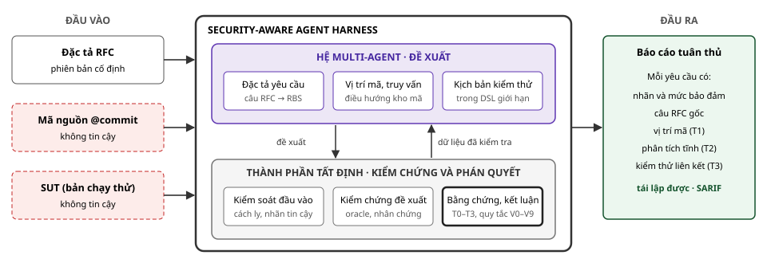
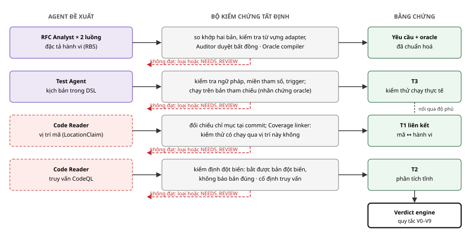
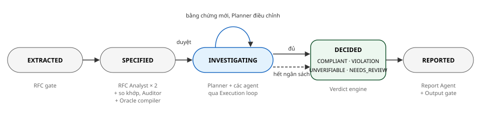
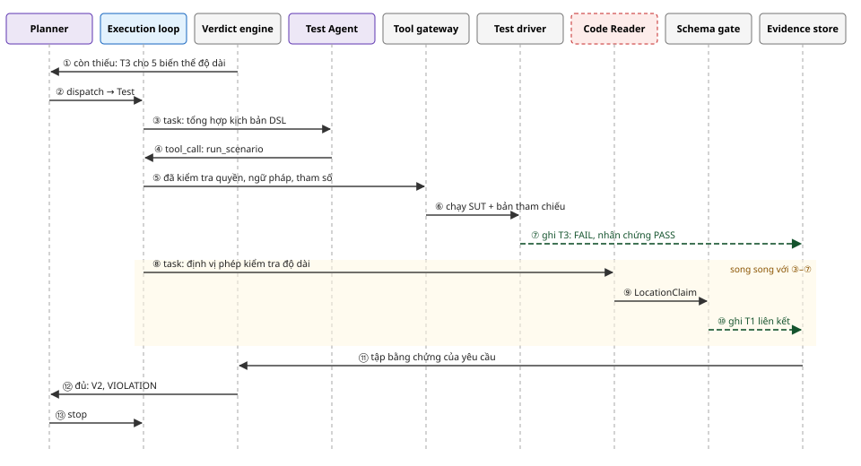
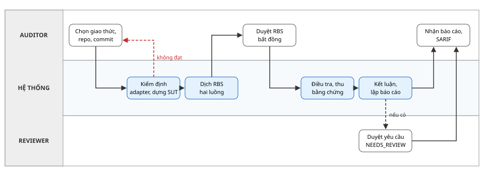
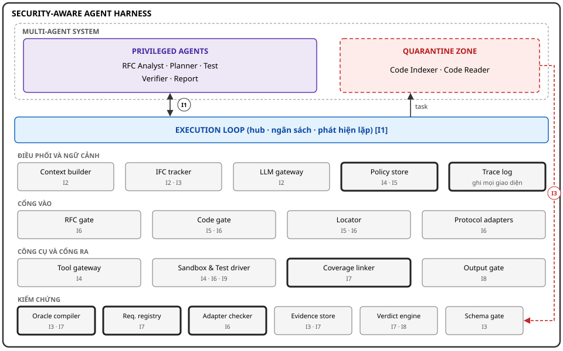
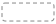
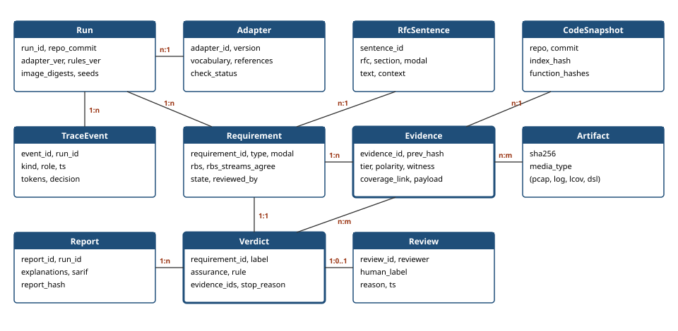
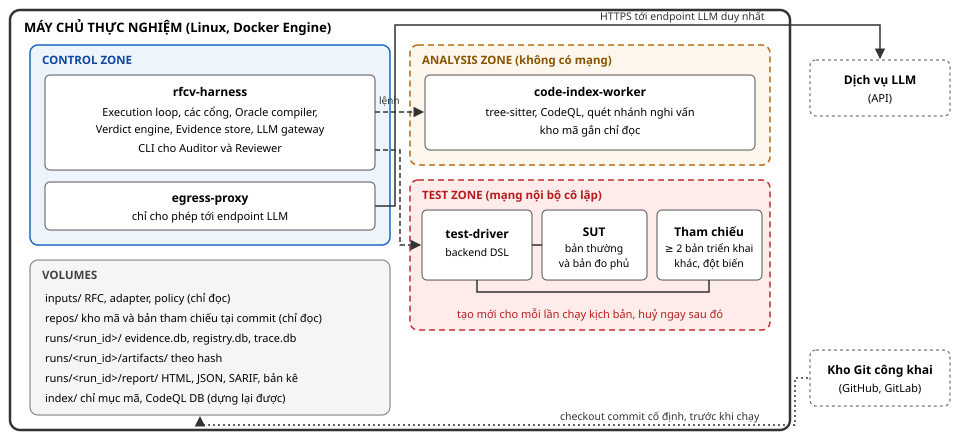

# Kiểm chứng tự động và an toàn sự tuân thủ đặc tả giao thức mạng dựa trên bằng chứng, sử dụng hệ thống AI đa tác tử

*Tài liệu thiết kế chi tiết · Bản hoàn chỉnh · Mốc cuối tháng 10/2026*

Học viên: Nguyễn Kỳ Tùng (20251075M) · Giảng viên hướng dẫn: TS. Tống Văn Vạn<br> Tài liệu tiếp nối bản đề xuất đề tài. Phần I trình bày giải pháp và lý do giải pháp giải quyết được các điểm đau; phần II–IV đặc tả kiến trúc ở mức đủ để cài đặt; phần V là kế hoạch thực hiện và đánh giá; phần VI tóm tắt các thay đổi so với bản đề xuất, các vấn đề cần thầy góp ý và tài liệu tham khảo.

**MỤC LỤC**

- [I. Mô tả giải pháp đề xuất](#i-mô-tả-giải-pháp-đề-xuất)
  - [1.1 Tổng quan giải pháp](#11-tổng-quan-giải-pháp-đề-xuất)
    - [Bài toán và điểm đau](#bài-toán-và-các-điểm-đau)
    - [Công trình liên quan, khoảng trống](#công-trình-liên-quan-và-khoảng-trống)
    - [Ý tưởng cốt lõi và đóng góp](#ý-tưởng-cốt-lõi-và-đóng-góp)
  - [1.2 Mô tả giải pháp](#12-mô-tả-giải-pháp)
    - [M1 Đề xuất và kiểm chứng](#m1-hệ-đa-agent-theo-nguyên-tắc-đề-xuất-và-kiểm-chứng-giải-quyết-p1)
    - [M2 Đặc tả hành vi, oracle](#m2-đặc-tả-hành-vi-và-oracle-biên-dịch-tất-định-giải-quyết-p3-p6)
    - [M3 Kịch bản DSL, nhân chứng](#m3-kịch-bản-trong-dsl-giới-hạn-và-nhân-chứng-oracle-giải-quyết-p1-p6)
    - [M4 Bằng chứng và kết luận](#m4-bằng-chứng-phân-tầng-liên-kết-độ-phủ-và-quy-tắc-kết-luận-giải-quyết-p3-p5-p6)
    - [M5 Adapter và backend](#m5-adapter-khai-báo-và-tầng-backend-giải-quyết-p4)
    - [M6 Kiểm chứng lại, đầu ra](#m6-kiểm-chứng-lại-gia-tăng-và-đầu-ra-cho-quy-trình-thật-giải-quyết-p2)
    - [M7 An toàn trước đối thủ](#m7-an-toàn-khi-mã-nguồn-là-đối-thủ-giải-quyết-p7-p8)
    - [Vì sao nhãn đúng](#vì-sao-nhãn-đúng-mà-không-cần-agent-luôn-đúng)
    - [Tính khả thi thực tế](#tính-khả-thi-thực-tế)
  - [1.3 Luồng xử lý](#13-luồng-xử-lý)
- [II. Kiến trúc hệ thống](#ii-kiến-trúc-hệ-thống)
  - [2.1 Kiến trúc nghiệp vụ](#21-kiến-trúc-nghiệp-vụ)
  - [2.2 Kiến trúc ứng dụng](#22-kiến-trúc-ứng-dụng)
  - [2.3 Kiến trúc công nghệ](#23-kiến-trúc-công-nghệ)
  - [2.4 Kiến trúc dữ liệu](#24-kiến-trúc-dữ-liệu)
- [III. Kiến trúc triển khai](#iii-kiến-trúc-triển-khai)
- [IV. Giao diện](#iv-giao-diện)
  - [4.1 Giao diện người dùng](#41-giao-diện-người-dùng)
  - [4.2 Agent và harness](#42-giao-diện-giữa-agent-và-harness)
  - [4.3 Adapter và backend](#43-giao-diện-adapter-và-backend)
  - [4.4 Hệ thống bên ngoài](#44-giao-diện-với-hệ-thống-bên-ngoài)
- [V. Kế hoạch thực hiện và đánh giá](#v-kế-hoạch-thực-hiện-và-đánh-giá)
  - [5.1 Phạm vi và công sức](#51-phạm-vi-và-công-sức)
  - [5.2 Tiến độ và mốc](#52-tiến-độ-và-mốc-kiểm-tra)
  - [5.3 Phương pháp đánh giá](#53-phương-pháp-đánh-giá)
- [VI. Thay đổi, góp ý, tham khảo](#vi-thay-đổi-so-với-bản-đề-xuất-vấn-đề-cần-góp-ý-và-tài-liệu-tham-khảo)

## I. MÔ TẢ GIẢI PHÁP ĐỀ XUẤT

### 1.1. Tổng quan giải pháp đề xuất

#### Bài toán và các điểm đau

Nhiều lỗ hổng nghiêm trọng bắt nguồn từ việc bản triển khai không làm đúng một yêu cầu cụ thể trong RFC, trong khi việc kiểm chứng sự tuân thủ hiện vẫn chủ yếu làm thủ công (mục 1.1 của bản đề xuất). Từ đó có thể rút ra tám điểm đau, chia làm hai nhóm. Nhóm thứ nhất là hạn chế của cách làm hiện nay, cũng là lý do cần tự động hoá. Nhóm thứ hai là các rủi ro mới xuất hiện khi dùng AI Agent để tự động hoá. Giải pháp chỉ có giá trị nếu giải quyết được cả hai nhóm cùng lúc.

| Mã | Điểm đau | Hệ quả |
| --- | --- | --- |
| **Nhóm 1. Hạn chế của cách kiểm chứng hiện nay** |  |  |
| P1 | Chi phí lớn: mỗi RFC có hàng trăm yêu cầu, chuyên gia phải đối chiếu từng yêu cầu với mã nguồn. | Chỉ kiểm chứng được một phần nhỏ yêu cầu. |
| P2 | Khó lặp lại khi mã nguồn thay đổi. | Kết luận nhanh lỗi thời; lỗi mới xuất hiện sau mỗi bản cập nhật. |
| P3 | Kết luận thường không kèm bằng chứng tái lập được. | Người khác không kiểm tra lại được; khó thuyết phục nhà phát triển sửa. |
| P4 | Mỗi giao thức cần bộ công cụ riêng. | Chi phí nhân lên theo số giao thức. |
| P5 | Công cụ tự động hiện có không nối trực tiếp yêu cầu RFC với vị trí trong mã và bằng chứng. | Biết có lỗi nhưng không biết vi phạm yêu cầu nào, ở đâu; hoặc ngược lại. |
| **Nhóm 2. Rủi ro khi dùng AI Agent để tự động hoá** |  |  |
| P6 | Agent kết luận "tuân thủ" khi chưa có bằng chứng, hoặc kết luận sai. | Lỗi bị bỏ sót nhưng được báo là an toàn. |
| P7 | Agent bị chính mã nguồn đang kiểm chứng thao túng, qua chỉ thị cài sẵn (prompt injection) hoặc qua mã cố ý cư xử khác khi bị kiểm thử. | Bên viết mã có thể "đặt" kết luận mong muốn. |
| P8 | Agent hành động vượt quyền. | Chạy lệnh tuỳ ý, lộ khoá, ảnh hưởng hệ thống bên ngoài. |

*Bảng 1. Tám điểm đau mà giải pháp phải giải quyết.*

Điểm đau P7 không phải giả định. Các nghiên cứu gần đây cho thấy tấn công chèn chỉ thị qua tài nguyên phát triển đạt tỉ lệ thành công tới 84% với các trình soạn mã có AI, và chú thích trong mã là một trong những kênh nguy hiểm nhất. Năm 2026 đã có tấn công thực tế lên các agent review mã chạy trong GitHub Actions. Ở phía còn lại, phân tích phần mềm gian lận khí thải của Volkswagen và Fiat Chrysler cho thấy mã có thể nhận ra lúc đang bị kiểm định để đổi hành vi, và một bài kiểm định cố định là không đủ.

#### Công trình liên quan và khoảng trống

Hai công trình năm 2025 gần với đề tài nhất đã chứng minh LLM có thể tham gia kiểm chứng tuân thủ RFC:

- **RFCAudit** (ASE 2025) dùng một agent lập chỉ mục ngữ nghĩa và một agent phát hiện tự phê bình. Trên sáu bản triển khai giao thức, nó tìm được 47 lỗi với precision 81,9%, trong đó 20 lỗi đã được nhà phát triển xác nhận hoặc sửa; chi phí trung bình khoảng 5 USD và 81 phút cho mỗi giao thức. Kết luận do LLM đưa ra, không có kiểm thử chạy thực tế.
- **iPanda** (2025) để LLM sinh ca kiểm thử và viết chương trình kiểm thử, chạy, rồi cũng để LLM đánh giá kết quả; báo cáo phải lọc bằng từ khoá và duyệt thủ công.

Các công trình khác cung cấp những thành phần mà đề tài tái sử dụng:

- Nghiên cứu ở ISSTA 2025 dùng LLM dịch RFC thành đặc tả hình thức làm "gần oracle", kết quả kiểm chứng truy được về câu RFC.
- TLS-Anvil cung cấp bộ kiểm thử tuân thủ TLS dựa trên kiểm thử tổ hợp; nó phát hiện 116 vấn đề xử lý cảnh báo trên 13 thư viện.
- TLS-Attacker khai báo luồng thông điệp bằng WorkflowTrace và sửa từng trường mà không phá máy trạng thái.
- SCALE/Ferret sinh kiểm thử DNS từ mô hình hình thức và so sánh 8 bản triển khai.
- Protocol state fuzzing học máy trạng thái của TLS, SSH và DTLS để tìm lỗi thứ tự thông điệp.
- CaMeL hiện thực mẫu Dual LLM với theo dõi luồng dữ liệu.

| Khía cạnh | RFCAudit | iPanda | Giải pháp đề xuất |
| --- | --- | --- | --- |
| Ai quyết định nhãn | LLM, sau tự phê bình | LLM so assertion với kết quả chạy | Quy tắc tất định trên bằng chứng đã kiểm chứng |
| Bằng chứng chạy thực tế | Không | Có, chương trình do LLM viết | Có, kịch bản trong DSL giới hạn |
| Nguồn oracle | Suy luận LLM | Assertion do LLM viết và đánh giá | Đặc tả hành vi đã duyệt, biên dịch tất định, có nhân chứng |
| Chỉ ra vị trí mã | Có, chưa đối chiếu | Không | Có, đối chiếu chỉ mục và độ phủ |
| Đối thủ kiểm soát mã | Không xét | Không xét | Chống chèn chỉ thị và gian lận kiểm thử |

*Bảng 2. So sánh với hai công trình gần nhất.*

Như vậy, câu hỏi "LLM có kiểm chứng được tuân thủ RFC không" đã có câu trả lời. Khoảng trống còn lại là: **có thể tin kết luận của hệ thống đến mức nào, kể cả khi bên viết mã muốn đánh lừa nó?** Đây là câu hỏi mà đề tài giải quyết.

#### Ý tưởng cốt lõi và đóng góp

Các bước của việc kiểm chứng chia làm hai loại. Loại thứ nhất cần hiểu ngôn ngữ và suy luận: đọc câu RFC, lần trong kho mã, nghĩ ra cách kiểm thử. Đây là phần tốn công của chuyên gia (P1) và là phần LLM làm tốt. Loại thứ hai là kiểm soát và phán quyết: dữ liệu nào đáng tin, hành động nào được phép, khi nào bằng chứng đủ để kết luận. Nếu giao phần này cho LLM thì sinh ra các rủi ro P6–P8.

Giải pháp giao hai loại việc cho hai bên khác nhau. Hệ Multi-Agent đảm nhận toàn bộ phần suy luận. Security-Aware Agent Harness, gồm các thành phần chương trình cố định không dùng LLM, đảm nhận toàn bộ phần kiểm soát và phán quyết. Nguyên tắc vận hành là **agent đề xuất, thành phần tất định kiểm chứng**: agent được đề xuất mọi thứ, gồm đặc tả yêu cầu, kịch bản kiểm thử, vị trí mã và truy vấn phân tích tĩnh, nhưng mỗi đề xuất chỉ thành bằng chứng sau khi qua một bộ kiểm chứng không dùng LLM, và nhãn chỉ do quy tắc cố định gán.



***Hình 1.** Ý tưởng cốt lõi: khối HỆ MULTI-AGENT chỉ đề xuất, khối THÀNH PHẦN TẤT ĐỊNH kiểm chứng và phán quyết, cả hai nằm trong SECURITY-AWARE AGENT HARNESS.*

**Ký hiệu sử dụng trong Hình 1:**

| Ký hiệu | Ý nghĩa |
| --- | --- |
|  | Đầu vào tin cậy do người kiểm chứng cung cấp |
|  | Đầu vào không tin cậy, có thể do đối thủ kiểm soát |
|  | Ranh giới SECURITY-AWARE AGENT HARNESS |
|  | Phần dùng LLM: các loại đề xuất của hệ Multi-Agent |
|  | Phần không dùng LLM: kiểm soát, kiểm chứng và phán quyết |
|  | Chức năng giữ quyền kết luận (Evidence store và Verdict engine) |
|  | Đầu ra của hệ thống |
|  | Luồng dữ liệu; giữa hai khối bên trong harness, agent chỉ gửi "đề xuất" xuống và chỉ nhận "dữ liệu đã kiểm tra" lên |

> [!TIP]
> **Đóng góp dự kiến.** **C1.** Kiến trúc "agent đề xuất, tất định kiểm chứng" cho kiểm chứng tuân thủ RFC: mọi đầu ra LLM chỉ thành bằng chứng sau một bộ kiểm chứng không dùng LLM; nhãn được tính từ bằng chứng theo quy tắc cố định. **C2.** Bằng chứng liên kết mã và hành vi: kết quả kiểm thử chỉ được tính khi oracle có nhân chứng, và độ phủ mã cho thấy kiểm thử đã đi qua đúng đoạn mã được chỉ ra. **C3.** Mô hình đe doạ và cơ chế phòng vệ khi bên viết mã là đối thủ, gồm cả chèn chỉ thị lẫn gian lận kiểm thử. **C4.** Adapter khai báo có kiểm định tự động, cho phép áp dụng cho nhiều giao thức mà không sửa lõi. **C5.** Đánh giá so sánh trực tiếp với RFCAudit và với cách để LLM làm oracle, trên bộ dữ liệu có nhãn đúng được công bố kèm luận văn.

Ý tưởng được hiện thực bằng bảy cơ chế. Bảng 3 cho biết mỗi điểm đau được giải quyết bởi cơ chế nào và được chứng minh bằng đại lượng nào trong thực nghiệm.

| Cơ chế | Điểm đau | Đại lượng chứng minh (phần V) |
| --- | --- | --- |
| **M1.** Hệ đa agent theo nguyên tắc đề xuất và kiểm chứng | P1 | Phút công người mỗi yêu cầu so với thủ công; chi phí token và thời gian |
| **M2.** Đặc tả hành vi và oracle biên dịch tất định | P3, P6 | Tỉ lệ câu RFC biểu diễn được; tỉ lệ đặc tả phải sửa; lỗi sót ước lượng |
| **M3.** Kịch bản trong DSL giới hạn và nhân chứng oracle | P1, P6 | Độ phủ quyết định so với chỉ chạy mẫu viết tay; tỉ lệ oracle bị loại |
| **M4.** Bằng chứng phân tầng, liên kết độ phủ, quy tắc kết luận | P3, P5, P6 | Tỉ lệ COMPLIANT sai; precision VIOLATION; độ chính xác vị trí mã |
| **M5.** Adapter khai báo và tầng backend | P4 | Số dòng lõi thay đổi khi thêm giao thức; tuần công viết adapter |
| **M6.** Kiểm chứng lại gia tăng và đầu ra cho quy trình thật | P2 | Chi phí kiểm chứng lại so với chạy toàn bộ; số lỗi được nhà phát triển xác nhận |
| **M7.** An toàn khi mã nguồn là đối thủ | P7, P8 | Tỉ lệ đổi nhãn dưới kịch bản tấn công A1–A7; lời gọi trái phép lọt qua |

*Bảng 3. Ánh xạ điểm đau, cơ chế và đại lượng chứng minh.*

### 1.2. Mô tả giải pháp

Mỗi cơ chế dưới đây được trình bày theo cùng trình tự: cơ chế làm gì, vì sao nó giải quyết được điểm đau, và giới hạn của nó. Sau bảy cơ chế là hai lập luận tổng hợp: vì sao nhãn đúng mà không cần agent luôn đúng, và vì sao giải pháp chạy được trong thực tế.

#### M1. Hệ đa agent theo nguyên tắc đề xuất và kiểm chứng (giải quyết P1)

**Cơ chế.** Bảy agent đảm nhận những bước tốn công nhất của chuyên gia, chia thành hai nhóm. Năm agent đặc quyền chỉ làm việc với dữ liệu đã có cấu trúc: RFC Analyst, Planner, Test, Verifier, Report. Hai agent cách ly là nơi duy nhất đọc mã nguồn không tin cậy: Code Indexer, Code Reader. Agent tạo ra bốn loại đề xuất, và mỗi loại có một bộ kiểm chứng riêng (Hình 2).



***Hình 2.** Nguyên tắc đề xuất và kiểm chứng: bốn loại đề xuất ở cột AGENT ĐỀ XUẤT chỉ thành BẰNG CHỨNG sau khi qua cột BỘ KIỂM CHỨNG TẤT ĐỊNH.*

**Ký hiệu sử dụng trong Hình 2:**

| Ký hiệu | Ý nghĩa |
| --- | --- |
|  | Đề xuất của agent đặc quyền |
|  | Đề xuất của agent cách ly |
|  | Bộ kiểm chứng tất định; tên thành phần thực hiện ghi trong ô |
|  | Bằng chứng hoặc yêu cầu đã được chấp nhận |
|  | Verdict engine, nơi duy nhất gán nhãn |
|  | Đề xuất đi qua bộ kiểm chứng |
|  | Không qua kiểm chứng: đề xuất bị loại, hoặc yêu cầu chuyển sang NEEDS\_REVIEW |
|  | T3 và T1 được nối với nhau qua dữ liệu độ phủ mã (M4) |

Bảng 4 tóm tắt nhiệm vụ của từng agent. Planner điều phối thứ tự điều tra qua hub của harness; các agent không gọi nhau trực tiếp. Công việc của con người thu lại còn ba việc: viết hoặc duyệt adapter một lần cho mỗi giao thức, duyệt các đặc tả yêu cầu mà hai luồng dịch không thống nhất (M2), và duyệt các yêu cầu NEEDS\_REVIEW.

| Agent | Nhóm | Nhiệm vụ |
| --- | --- | --- |
| RFC Analyst | Đặc quyền | Dịch câu RFC thành đặc tả hành vi (RBS); chạy hai luồng độc lập |
| Planner | Đặc quyền | Dựa trên đánh giá độ đủ của Verdict engine, quyết định giao việc gì cho agent nào, theo thứ tự nào |
| Test | Đặc quyền | Tổng hợp kịch bản kiểm thử trong DSL đưa SUT tới trạng thái tiền điều kiện và tạo sự kiện kích hoạt |
| Verifier | Đặc quyền | Phản biện nội dung: vị trí có đúng ý nghĩa không, có mâu thuẫn không, còn thiếu đường xử lý nào; không quyết định dừng hay nhãn |
| Report | Đặc quyền | Viết giải thích cho từng kết luận, chỉ được trích dẫn bằng chứng đã lưu |
| Code Indexer | Cách ly | Gán hàm vào thành phần giao thức để thu hẹp phạm vi tìm kiếm |
| Code Reader | Cách ly | Tìm đoạn mã xử lý yêu cầu (LocationClaim); đề xuất truy vấn CodeQL cho yêu cầu loại D |

*Bảng 4. Bảy agent.*

**Vì sao hiệu quả.** Chi phí kiểm chứng thủ công tỉ lệ với số yêu cầu nhân thời gian đọc mã và viết kiểm thử cho mỗi yêu cầu. Giải pháp chuyển phần nhân này sang máy, để chi phí con người chỉ còn tỉ lệ với số giao thức và số yêu cầu khó. Việc chia nhỏ thành nhiều agent còn có lợi về chất lượng: mỗi agent chỉ nhận ngữ cảnh của một nhiệm vụ. RFCAudit đã cho thấy điều này qua ablation: bỏ chỉ mục ngữ nghĩa hoặc bỏ truy xuất theo nhu cầu đều làm precision giảm mạnh.

**Giới hạn.** Mức tiết kiệm phụ thuộc tỉ lệ yêu cầu phải duyệt; tỉ lệ này được đo chứ không giả định.

#### M2. Đặc tả hành vi và oracle biên dịch tất định (giải quyết P3, P6)

**Cơ chế.** Oracle là phần quyết định một kiểm thử đạt hay không, nên phải đúng. Giải pháp không để LLM viết oracle hay đánh giá kết quả. RFC Analyst chỉ dịch câu RFC thành một **đặc tả hành vi** (Requirement Behavior Spec, RBS) viết bằng một ngôn ngữ nhỏ có ngữ pháp cố định và dùng từ vựng của adapter. Sau đó Oracle compiler, một chương trình tất định, sinh oracle từ RBS.

```
requirement TLS13-0042  from RFC8446§5.2#s…   modal MUST   type B
  actor     server
  state     connected                                  # trạng thái tiền điều kiện
  trigger   receive(record) where record.length > 16640
  expect    send_alert(record_overflow) then close   within 2000ms
  forbid    send(application_data)                     # hành vi bị cấm sau kích hoạt
  variants  boundary(record.length, 16641), max(record.length), random(record.length, k=3)
```

Oracle compiler chuyển `expect` và `forbid` thành bộ kiểm tra trên vết sự kiện quan sát được (cảnh báo, đóng kết nối, dữ liệu gửi ra), và `variants` thành tập biến thể bắt buộc. Để kiểm soát lỗi của bước dịch, RFC Analyst chạy **hai luồng độc lập** (hai mô hình, hoặc cùng mô hình với hai lời nhắc khác nhau), rồi so khớp hai RBS theo cấu trúc. RBS khớp nhau và qua kiểm tra từ vựng thì được chấp nhận. RBS lệch nhau được chuyển cho Auditor. Thêm một mẫu ngẫu nhiên 10% trong nhóm khớp nhau cũng được duyệt, để ước lượng tỉ lệ lỗi còn sót kèm khoảng tin cậy.

**Vì sao hiệu quả.** Hướng "LLM dịch đặc tả, chương trình kiểm tra" đã được nghiên cứu ở ISSTA 2025 dùng để kiểm chứng parser giao thức, với kết quả truy được về câu RFC. Ở đây, lỗi của LLM chỉ còn nằm ở bước dịch; bước này nhỏ, được kiểm tra chéo và duyệt có trọng tâm. Ngữ pháp RBS đủ nhỏ để kiểm thử toàn bộ Oracle compiler.

**Giới hạn.** Có những câu RFC không biểu diễn được bằng RBS (ví dụ yêu cầu mang tính khuyến nghị thiết kế). Các câu này nhận nhãn UNVERIFIABLE, và tỉ lệ của chúng được báo cáo như một giới hạn của phương pháp.

#### M3. Kịch bản trong DSL giới hạn và nhân chứng oracle (giải quyết P1, P6)

**Cơ chế.** Test Agent tổng hợp kịch bản đưa SUT vào trạng thái `state` rồi tạo `trigger` của RBS. Kịch bản viết bằng DSL của backend: WorkflowTrace của TLS-Attacker cho TLS và QUIC, một DSL dựa trên dnspython cho DNS, bảng chữ cái thông điệp của SSH-Mapper cho SSH. DSL chỉ có các thao tác gửi, nhận, sửa trường thông điệp và chờ; không có lệnh hệ thống. Harness kiểm tra ngữ pháp và miền tham số, rồi kiểm tra vết chạy để xác nhận `trigger` đã thật sự xảy ra. Mẫu viết tay của TLS-Anvil và tlsfuzzer vẫn được dùng làm thư viện ví dụ, không còn là giới hạn của hệ thống.

Mỗi kịch bản được chạy trên ít nhất hai bản triển khai tham chiếu của cùng giao thức (danh sách ứng viên đã có sẵn trong bản đề xuất). Kịch bản chỉ được dùng làm bằng chứng khi có **nhân chứng dương**, tức ít nhất một bản tham chiếu PASS; điều này chứng tỏ oracle đạt được. Khi có bản đột biến cho yêu cầu đó, cần thêm **nhân chứng âm**, tức bản đột biến FAIL; điều này chứng tỏ kịch bản phân biệt được. Nếu mọi bản tham chiếu đều FAIL, rất có thể RBS hiểu sai hoặc RFC mơ hồ, nên yêu cầu được chuyển sang NEEDS\_REVIEW.

**Vì sao hiệu quả.** iPanda đã cho thấy LLM tổng hợp được kiểm thử giao thức chạy được. Ở đây đầu ra bị giới hạn trong DSL, và agent không tự đánh giá kết quả, nên giữ được lợi ích mà không mang theo rủi ro. Giá trị của agent đo được trực tiếp bằng **độ phủ quyết định**, tức số yêu cầu nhận nhãn xác định, so với cấu hình chỉ chạy mẫu viết tay. Nhân chứng oracle đi theo tinh thần của SCALE/Ferret, vốn dùng khác biệt giữa 8 bản triển khai DNS để làm lộ lỗi; ở đây khác biệt được dùng theo chiều ngược lại, để kiểm chứng chính oracle.

**Giới hạn.** Nhân chứng đòi hỏi dựng thêm bản tham chiếu. Với các giao thức trong phạm vi, mỗi giao thức đều có ít nhất ba bản triển khai mã nguồn mở.

#### M4. Bằng chứng phân tầng, liên kết độ phủ và quy tắc kết luận (giải quyết P3, P5, P6)

**Cơ chế.** Mọi kết quả đã qua kiểm chứng được lưu thành bằng chứng bất biến kèm hash, gắn một mức tin cậy và một chiều (ủng hộ hay bác bỏ sự tuân thủ). Nhãn cuối cùng do Verdict engine gán theo bộ quy tắc cố định, tuỳ theo loại của yêu cầu.

##### Bốn mức bằng chứng

| Mức | Nội dung | Ai xác nhận | Dùng để kết luận |
| --- | --- | --- | --- |
| T0 | Nhận định của LLM chưa đối chiếu | Không ai | Không bao giờ |
| T1 | Vị trí cụ thể trong mã (tệp, dòng, ký hiệu, đường gọi hàm) | Schema gate đối chiếu với chỉ mục tại commit | Có, kèm điều kiện |
| T2 | Kết quả truy vấn phân tích tĩnh trả lời một câu hỏi cụ thể về yêu cầu | CodeQL chạy truy vấn đã qua kiểm định đột biến | Có |
| T3 | Kết quả chạy kịch bản trên SUT, phán định bằng oracle biên dịch, có nhân chứng | Test driver và Oracle compiler | Có, mạnh nhất |

*Bảng 5. Mức tin cậy của bằng chứng. Gợi ý vị trí của Locator không phải là bằng chứng.*

##### Bốn loại yêu cầu và phương pháp tương ứng

Loại bằng chứng nào khẳng định được một yêu cầu tuỳ thuộc vào câu hỏi: hành vi mà yêu cầu đòi hỏi có quan sát được từ bên ngoài khi chạy hay không. Mỗi loại vì vậy có một phương pháp chính riêng.

| Loại | Định nghĩa | Ví dụ | Phương pháp chính |
| --- | --- | --- | --- |
| A | Ràng buộc về dữ liệu bản triển khai *gửi đi* | Trường legacy\_version trong ServerHello của TLS 1.3 phải bằng 0x0303 | T3: quan sát gói tin gửi ra |
| B | Phản ứng khi *nhận* dữ liệu sai: từ chối, cảnh báo, đóng, bỏ qua | Nhận bản ghi dài hơn 2<sup>14</sup>+256 byte thì gửi cảnh báo record\_overflow | T3 với biến thể biên và ngẫu nhiên |
| C | Ràng buộc về trạng thái và thứ tự thông điệp | Thông điệp đến sai thứ tự trong handshake phải bị coi là lỗi | T3 theo chuỗi; học máy trạng thái khi có điều kiện |
| D | Hành vi nội bộ, không quan sát được từ bên ngoài | Xoá khoá bí mật cũ sau khi dẫn xuất khoá mới | T2 từ truy vấn kiểm định đột biến, kết hợp T1 |

*Bảng 6. Bốn loại yêu cầu.*

**Liên kết độ phủ.** T1 và T3 vốn là hai bằng chứng rời nhau: một kiểm thử PASS chưa chứng minh nó đã đi qua đoạn mã xử lý yêu cầu, còn một vị trí mã chưa chứng minh nó là đoạn quyết định hành vi. Vì vậy SUT được dựng thêm một bản có đo độ phủ (gcov hoặc llvm-cov cho C, `-C instrument-coverage` cho Rust, `go build -cover` cho Go). Coverage linker so các dòng đã thực thi trong lần chạy T3 với các dòng của T1. Khi các dòng của T1 nằm trong tập đã thực thi, T3 được gọi là **T3 liên kết**. Với VIOLATION, liên kết chỉ đúng chỗ cần sửa; với COMPLIANT, liên kết chứng minh kiểm thử thật sự đi qua phép kiểm tra được chỉ ra.

**Học máy trạng thái cho loại C.** Khi phạm vi cho phép (tầng 2, phần V), máy trạng thái của SUT được học bằng học automaton chủ động (AALpy hoặc LearnLib) qua bộ ánh xạ của TLS-Attacker hoặc SSH-Mapper. Các RBS loại C được dịch thành automaton mẫu lỗi; chuỗi thông điệp vi phạm tìm được trên mô hình được chạy lại trên SUT thật để có T3. Đây là phương pháp đã tìm ra lỗi mới trên TLS, SSH và DTLS.

**Truy vấn tĩnh kiểm định đột biến cho loại D.** Code Reader đề xuất một truy vấn CodeQL diễn đạt điều kiện vi phạm. Truy vấn chỉ được chấp nhận khi nó báo vi phạm trên bản đột biến và không báo trên bản đúng của một bản tham chiếu; sau đó nó được cố định theo hash. CodeQL hỗ trợ chính thức Rust từ 10/2025, nên một công cụ phủ được cả C, Rust và Go.

##### Quy tắc kết luận

Các quy tắc được xét theo thứ tự; quy tắc đầu tiên khớp quyết định nhãn. Thứ tự thể hiện hai nguyên tắc: hành vi chạy thực tế được ưu tiên hơn việc đọc mã, và khi nghi ngờ thì không kết luận. Trường `assurance` ghi mức bảo đảm của nhãn COMPLIANT.

| Mã | Điều kiện | Nhãn |
| --- | --- | --- |
| V0 | T3 không nhất quán giữa các lần chạy hoặc giữa các môi trường | NEEDS\_REVIEW |
| V1 | Kịch bản chính không có nhân chứng dương (mọi bản tham chiếu FAIL) | NEEDS\_REVIEW |
| V2 | Loại A, B, C: có T3 FAIL hợp lệ (chữ ký khớp yêu cầu, trigger đã xảy ra, có nhân chứng dương) | VIOLATION |
| V3 | Loại C: chuỗi vi phạm tìm từ máy trạng thái học được, chạy lại trên SUT cho FAIL | VIOLATION |
| V4 | Có nhánh nghi vấn (M7) trên đường xử lý của yêu cầu | NEEDS\_REVIEW |
| V5 | Loại A, B, C: mọi biến thể bắt buộc và k biến thể ngẫu nhiên PASS hợp lệ; có T3 liên kết với T1; không có T1, T2 bác bỏ | COMPLIANT · LINKED |
| V6 | Như V5 nhưng agent không định vị được T1 | COMPLIANT · BEHAVIORAL |
| V7 | Loại A, B, C: PASS nhưng độ phủ không đi qua T1, hoặc T1, T2 bác bỏ | NEEDS\_REVIEW |
| V8 | Loại D: T2 từ truy vấn đã kiểm định, kết hợp T1; không có đường vi phạm thì COMPLIANT · STATIC, có đường vi phạm thì VIOLATION | COMPLIANT hoặc VIOLATION |
| V9 | Mọi trường hợp còn lại, kể cả chỉ có T0 | UNVERIFIABLE |

*Bảng 7. Quy tắc kết luận V0–V9.*

**Vì sao hiệu quả.** Với P3, mỗi kết luận trỏ tới bằng chứng cụ thể, và mỗi bằng chứng tự tái lập được. Với P5, chuỗi câu RFC, yêu cầu, kịch bản, vị trí mã, độ phủ và kết quả được lưu tường minh. Với P6, LLM không có quyền kết luận; T0 không bao giờ được tính; một kết quả PASS không đi qua đúng đoạn mã sẽ không thành COMPLIANT.

**Giới hạn.** COMPLIANT chỉ có giá trị trong phạm vi biến thể đã thử. Mức STATIC của loại D kém chắc chắn hơn mức LINKED; ba mức được báo cáo tách riêng.

#### M5. Adapter khai báo và tầng backend (giải quyết P4)

**Cơ chế.** Hệ thống chia ba tầng. **Lõi** gồm harness, agent và quy tắc, không chứa tri thức của giao thức nào. **Backend** là plugin có giao diện cố định: kiểm tra và chạy kịch bản DSL, trả về vết sự kiện chuẩn hoá. **Adapter** là dữ liệu khai báo: phạm vi RFC, từ vựng hành vi, phân loại thành phần, gợi ý tìm mã, cách dựng SUT và bản tham chiếu. Thêm giao thức có thể cần thêm backend nếu chưa có công cụ phù hợp, nhưng không bao giờ sửa lõi. Một trợ lý adapter dùng LLM soạn nháp từ vựng và phân loại thành phần từ RFC và kho mã. Mọi adapter, viết tay hay soạn nháp, đều phải qua Adapter checker trước khi dùng (mục 4.3).

**Vì sao hiệu quả.** Phần tốn công nhất khi xây công cụ cho một giao thức là phần dùng chung: hiểu đặc tả, tìm mã, sinh oracle, quản lý bằng chứng, kết luận. Phần này nằm trong lõi. Backend tái dùng công cụ sẵn có: TLS-Attacker cho TLS và QUIC, Ferret và dnspython cho DNS, SSH-Mapper cho SSH. Adapter checker kiểm tra mỗi phần tử của adapter có thật sự phân biệt được bản đúng với bản đột biến hay không.

**Giới hạn.** Viết backend cho giao thức chưa có công cụ là việc tốn công. Chi phí này được đo và tính vào chi phí thêm giao thức khi đánh giá mục tiêu 2.

#### M6. Kiểm chứng lại gia tăng và đầu ra cho quy trình thật (giải quyết P2)

**Cơ chế.** Khi có commit mới, hệ thống so hai commit ở mức hàm bằng hash nội dung hàm. T1 và T2 có vị trí trong hàm không đổi được giữ lại; mọi T3 được chạy lại vì không cần LLM; chỉ yêu cầu có bằng chứng mất hiệu lực hoặc T3 đổi kết quả mới được agent điều tra lại. Thay đổi trong tệp cấu hình biên dịch kích hoạt điều tra lại toàn bộ. Kết quả được xuất thêm theo định dạng SARIF để nạp vào GitHub code scanning hoặc IDE. Chế độ CI chạy kiểm chứng lại cho từng pull request.

**Vì sao hiệu quả.** Phần đắt nhất là lời gọi LLM trong giai đoạn điều tra. Nhờ cơ chế này, chi phí LLM tỉ lệ với mức thay đổi của mã, không tỉ lệ với kích thước RFC, nên có thể chạy sau mỗi bản phát hành. RFCAudit cũng ghi nhận chỉ mục cập nhật gia tăng được, với chi phí lập chỉ mục chỉ khoảng 1,89 USD mỗi giao thức.

**Giới hạn.** Thay đổi qua macro hoặc sinh mã có thể làm hash hàm không đổi trong khi hành vi đổi; việc luôn chạy lại T3 che phần lớn rủi ro này.

#### M7. An toàn khi mã nguồn là đối thủ (giải quyết P7, P8)

**Cơ chế chống chèn chỉ thị và vượt quyền.** Bốn lớp chặn nối tiếp:

- **Cách ly người đọc mã:** chỉ hai agent trong vùng cách ly được đọc mã; chúng chỉ có công cụ đọc và chỉ trả kết quả qua Schema gate. Đây là mẫu Dual LLM mà CaMeL hiện thực; CaMeL giải được 77% nhiệm vụ AgentDojo với an toàn chứng minh được, so với 84% khi không phòng vệ.
- **Kiểm soát luồng thông tin:** mỗi giá trị mang một nhãn tin cậy và nhãn được lan truyền (Bảng 8).
- **Kiểm tra mọi hành động:** Tool gateway từ chối mặc định, kiểm tra vai trò và miền tham số; kịch bản chỉ dùng thao tác DSL.
- **Cách ly thực thi:** biên dịch và kiểm thử chạy trong container không có mạng ra ngoài, không có khoá API, huỷ sau mỗi lần chạy (phần III).

| Nhãn | Nguồn | Được vào ngữ cảnh agent đặc quyền? |
| --- | --- | --- |
| **TRUSTED** | Đầu vào của người kiểm chứng: RFC, adapter đã kiểm định, cấu hình | Có |
| **DERIVED** | Đầu ra đã qua Schema gate của agent đặc quyền, tạo từ TRUSTED hoặc DERIVED | Có |
| **UNTRUSTED** | Mọi thứ từ kho mã, từ SUT, mọi đầu ra của vùng cách ly | Chỉ giá trị đã thu về miền hữu hạn và đối chiếu được (liệt kê, số, đường dẫn và ký hiệu có trong chỉ mục); chuỗi tự do thì không bao giờ |

*Bảng 8. Nhãn tin cậy. Giá trị tính từ ít nhất một giá trị UNTRUSTED thì mang nhãn UNTRUSTED.*

**Cơ chế chống gian lận kiểm thử.** Đối thủ kiểm soát mã có thể viết mã nhận ra kiểm thử và chỉ cư xử đúng khi bị kiểm thử. Năm lớp chặn bổ sung cho nhau:

- **Biến thể ngẫu nhiên:** mỗi lần chạy lấy thêm k giá trị ngẫu nhiên trong miền tham số, ghi seed để tái lập.
- **Liên kết độ phủ:** PASS nhờ một nhánh khác vị trí T1 thì không thành COMPLIANT (V7).
- **Quét nhánh nghi vấn:** bộ truy vấn CodeQL cố định tìm nhánh so dữ liệu vào với hằng trùng giá trị kiểm thử, đọc biến môi trường, tên máy, thời gian hoặc đặc trưng công cụ kiểm thử; phát hiện trên đường xử lý chặn COMPLIANT (V4).
- **Đa dạng môi trường:** chạy với cấu hình mạng, tên máy, thời điểm khác nhau; kết quả phải nhất quán (V0).
- **Học máy trạng thái:** khám phá có hệ thống thay vì vài chuỗi cố định (tầng 2).

**Vì sao hiệu quả.** Lập luận then chốt là kẻ tấn công điều khiển được agent cách ly cũng chỉ gửi ra được một bản ghi có cấu trúc. Bản ghi đó có thể sai nhưng không thể chứa chỉ thị, và với loại A, B, C nhãn do T3 có nhân chứng quyết định. Để gian lận kiểm thử thành công, mã phải vừa tránh được giá trị ngẫu nhiên, vừa không để lộ nhánh đặc biệt trên đường xử lý mà độ phủ và phân tích tĩnh nhìn thấy. Bảng 9 nêu điểm cưỡng chế và kịch bản kiểm tra cho từng rủi ro.

| Mã | Rủi ro | Điểm cưỡng chế | Kịch bản kiểm tra |
| --- | --- | --- | --- |
| A1 | Chỉ thị trong chú thích, tài liệu | Schema của agent cách ly không có trường tự do tới agent đặc quyền; IFC tracker | Chú thích yêu cầu báo "tuân thủ"; kỳ vọng nhãn không đổi |
| A2 | Chỉ thị trong đầu ra khi chạy | Nhật ký SUT chỉ tới oracle; agent chỉ thấy sự kiện chuẩn hoá | SUT in nhật ký chứa chỉ thị; kỳ vọng lời gọi agent không đổi |
| A3 | Dùng công cụ ngoài quyền | Từ chối mặc định; kiểm tra miền tham số; DSL không có lệnh hệ thống | Dẫn dắt gọi công cụ ngoài quyền; kỳ vọng lọt qua bằng 0 |
| A4 | Đọc dữ liệu ngoài phạm vi, lộ bí mật | Phạm vi đọc theo adapter; chặn tệp nhạy cảm; khoá chỉ ở LLM gateway; cách ly mạng | Dẫn agent đọc tệp khoá; kỳ vọng Trace log không có nội dung bị chặn |
| A5 | Giả mạo bằng chứng | Bằng chứng do thành phần tất định ghi, định danh bằng hash, nối chuỗi | Sửa bản ghi sau khi chạy; kỳ vọng chuỗi hash phát hiện |
| A6 | Làm cạn tài nguyên | Ngân sách theo vai trò và yêu cầu; phát hiện lặp; giới hạn container | Đồ thị gọi vòng; kỳ vọng dừng với lý do BUDGET hoặc LOOP |
| A7 | Mã nhận ra kiểm thử và đổi hành vi | Biến thể ngẫu nhiên; liên kết độ phủ; quét nhánh nghi vấn; đa dạng môi trường | Ba mức tinh vi tăng dần; đo tỉ lệ bị phát hiện |
| F1 | LLM kết luận không có bằng chứng | T0 không dùng để kết luận; oracle biên dịch; nhân chứng; liên kết | So tỉ lệ COMPLIANT sai với RFCAudit và với cấu hình LLM làm oracle |

*Bảng 9. Rủi ro, điểm cưỡng chế và kịch bản kiểm tra.*

**Giới hạn.** Không phương pháp nào chống được mọi gian lận có thể có; tuyên bố của đề tài có giới hạn rõ như trên, và A7 mức 3 được báo cáo trung thực. Kẻ tấn công vẫn có thể làm tốn thêm ngân sách hoặc đẩy yêu cầu vào UNVERIFIABLE hay NEEDS\_REVIEW; đây là thất bại an toàn.

#### Vì sao nhãn đúng mà không cần agent luôn đúng

> [!TIP]
> **Luận điểm.** Một nhãn COMPLIANT hoặc VIOLATION của loại A, B, C là đúng nếu: (a) RBS phản ánh đúng câu RFC; (b) oracle biên dịch từ RBS phán định đúng trên vết sự kiện, và kịch bản thật sự tạo ra trigger; (c) Verdict engine cài đặt đúng V0–V9.<br> Điều (a) được kiểm soát bằng hai luồng dịch, kiểm tra từ vựng và duyệt bất đồng, với tỉ lệ lỗi sót ước lượng được. Điều (b) được kiểm soát bằng Oracle compiler đã kiểm thử, xác nhận trigger trên vết chạy và nhân chứng oracle. Điều (c) được kiểm soát bằng kiểm thử đơn vị trên một hàm thuần. Mọi sai sót khác của agent chỉ làm tăng chi phí hoặc đẩy yêu cầu vào UNVERIFIABLE hay NEEDS\_REVIEW.

| Agent | Sai sót có thể có | Hậu quả lên nhãn |
| --- | --- | --- |
| RFC Analyst | Dịch sai câu RFC | Là điều (a); bị chặn khi hai luồng lệch nhau, hoặc bị phát hiện qua mẫu duyệt 10%; nếu cả hai luồng cùng sai giống nhau thì nhân chứng oracle thường làm lộ (mọi bản tham chiếu FAIL, V1) |
| Planner | Lập kế hoạch kém, lặp vô ích | Không làm sai nhãn; hết ngân sách thì UNVERIFIABLE |
| Test | Kịch bản sai, không tạo được trigger | Không làm sai nhãn: kịch bản không qua kiểm tra vết hoặc không có nhân chứng thì không thành bằng chứng |
| Code Reader | Chỉ sai vị trí; truy vấn sai | Loại A–C: độ phủ không liên kết thì sang NEEDS\_REVIEW (V7), không thành COMPLIANT sai. Loại D: truy vấn sai bị loại ở bước kiểm định đột biến |
| Code Indexer | Gán sai thành phần | Chỉ làm tìm kiếm kém hiệu quả |
| Verifier | Phản biện sai | Chỉ làm Planner giao thêm việc |
| Report | Giải thích sai, bịa vị trí | Output gate từ chối trích dẫn không có trong Evidence store; nhãn không đổi |

*Bảng 10. Sai sót của từng agent và hậu quả lên nhãn.*

Như vậy, LLM quyết định hệ thống *kiểm chứng được bao nhiêu* (độ phủ, chi phí), còn harness quyết định *điều đã kết luận có đúng không*. Đây là ý nghĩa cụ thể của tách quyền.

#### Tính khả thi thực tế

##### Các năng lực cần thiết đã được chứng minh

Giải pháp không đòi hỏi LLM làm điều chưa từng được chứng minh. LLM đọc RFC và mã để tìm lỗi chức năng (RFCAudit), tổng hợp kiểm thử giao thức chạy được (iPanda), và dịch RFC thành đặc tả hình thức (ISSTA 2025) đều đã có kết quả công bố. Các công cụ tất định mà giải pháp dựa vào cũng đã trưởng thành: TLS-Attacker, TLS-Anvil, Ferret, CodeQL, các bộ học automaton. Đóng góp của đề tài nằm ở cách kết hợp sao cho kết luận đáng tin và an toàn, không phải ở việc chứng minh lại từng năng lực.

##### Ba ca kiểm chứng tính khả thi trên lỗi đã biết

| Ca | Yêu cầu và cặp phiên bản | Kết quả kỳ vọng |
| --- | --- | --- |
| **K1.** Heartbleed (CVE-2014-0160) | RFC 6520 yêu cầu bỏ qua thông điệp heartbeat có trường độ dài payload lớn hơn thực tế (loại B). OpenSSL 1.0.1f và 1.0.1g. TLS-Attacker có sẵn kịch bản Heartbleed làm ví dụ. | 1.0.1f: T3 FAIL, VIOLATION. 1.0.1g: PASS mọi biến thể, COMPLIANT. |
| **K2.** CCS injection (CVE-2014-0224) | ChangeCipherSpec đến sớm hơn thứ tự handshake quy định phải bị coi là lỗi (loại C). OpenSSL 1.0.1g và 1.0.1h. | 1.0.1g: T3 FAIL, VIOLATION. 1.0.1h: COMPLIANT. |
| **K3.** Đột biến TLS 1.3 | RFC 8446 §5.2, ràng buộc độ dài bản ghi (loại B). Một bản triển khai TLS 1.3 và bản đột biến xoá phép kiểm tra độ dài. | Bản gốc: COMPLIANT · LINKED. Bản đột biến: VIOLATION, T1 trỏ đúng vị trí đột biến. |

*Bảng 11. Ba ca kiểm chứng tính khả thi. K1 và K2 thuộc TLS 1.2, cần một adapter nhỏ, đồng thời là phép thử sớm cho M5. Các lỗi nổi tiếng này có thể nằm trong dữ liệu huấn luyện của LLM, nên chỉ dùng để chứng minh khả năng phát hiện, không dùng để đo khả năng định vị.*

Mỗi ca được chạy thêm một biến thể có tấn công, gồm chú thích dạng chỉ thị cho AI (A1) và một nhánh nhận ra giá trị kiểm thử cố định (A7 mức 1). Kỳ vọng nhãn không đổi.

##### Giới hạn và rủi ro

| Rủi ro | Cách giảm thiểu |
| --- | --- |
| RBS không biểu đạt được nhiều câu RFC | Mở rộng ngữ pháp theo nhóm câu thường gặp, đo từ tuần đầu tháng 12; câu ngoài ngữ pháp vào UNVERIFIABLE và được báo cáo |
| Thiếu nhân chứng cho nhiều kịch bản | Có thể là dấu hiệu RFC mơ hồ; đối chiếu với hướng RFCScope (ASE 2025) và báo cáo thành phát hiện riêng |
| Oracle quá chặt so với các phản ứng hợp lệ RFC cho phép | RBS cho phép khai báo tập kết quả chấp nhận được; nhân chứng làm lộ oracle quá chặt |
| Khó dựng SUT hoặc bản đo độ phủ | Thử trong tháng 10; thay ứng viên nếu quá 3 ngày; kho mã không dựng được bản đo độ phủ chỉ đạt mức BEHAVIORAL |
| Chi phí token vượt dự kiến | Ngân sách theo yêu cầu; mô hình nhỏ cho agent có nhiệm vụ đơn giản; đo từ mốc G1. RFCAudit cho mốc tham khảo khoảng 5 USD mỗi giao thức |
| LLM không tất định ngay cả với temperature bằng 0 | Nhãn không phụ thuộc LLM tái lập được; ba mức tái lập ở mục 2.4 |

*Bảng 12. Giới hạn và rủi ro.*

### 1.3. Luồng xử lý

Luồng xử lý được trình bày ở ba mức chi tiết tăng dần: một lần chạy, vòng đời một yêu cầu, và một vòng điều tra; sau đó là kiểm chứng lại và xử lý ngoại lệ.

#### Một lần chạy

- **Chuẩn bị:** kiểm tra hash mọi đầu vào, tạo thư mục lần chạy; Adapter checker kiểm định adapter; dựng SUT, bản đo độ phủ và các bản tham chiếu. Không đạt thì dừng.
- **Dựng nền:** RFC gate tách câu; RFC Analyst chạy hai luồng dịch thành RBS; song song, Code gate dựng chỉ mục, Code Indexer lập bản đồ thành phần, quét nhánh nghi vấn chạy một lần cho toàn kho mã.
- **Duyệt yêu cầu:** Auditor duyệt các RBS bất đồng và mẫu 10%; Oracle compiler biên dịch oracle cho các RBS được chấp nhận.
- **Điều tra:** các yêu cầu được xử lý song song theo vòng đời ở Hình 3, mỗi yêu cầu có ngân sách riêng.
- **Kết thúc:** Report Agent viết giải thích; Output gate kiểm tra; sinh báo cáo HTML, JSON, SARIF; chốt bản kê lần chạy với hash cuối chuỗi bằng chứng.

#### Vòng đời một yêu cầu



***Hình 3.** Vòng đời của một yêu cầu; dòng chữ dưới mỗi trạng thái là thành phần đưa yêu cầu vào trạng thái đó.*

**Ký hiệu sử dụng trong Hình 3:**

| Ký hiệu | Ý nghĩa |
| --- | --- |
|  | Trạng thái được xử lý một lần; SPECIFIED nghĩa là đã có RBS được chấp nhận và oracle đã biên dịch |
|  | Trạng thái INVESTIGATING: các agent lặp nhiều vòng trong ngân sách giới hạn |
|  | Trạng thái DECIDED mang một trong bốn nhãn; chỉ Verdict engine đưa yêu cầu vào đây |
|  | Chuyển trạng thái thông thường; "duyệt" là bước duyệt bất đồng của Auditor, "đủ" nghĩa là áp dụng được một trong V0–V8 |
|  | Chuyển do hết ngân sách hoặc phát hiện lặp; nhãn vẫn tính theo quy tắc trên bằng chứng hiện có |
|  | Vòng lặp điều tra (chi tiết một vòng ở Hình 4) |

#### Một vòng điều tra

Hình 4 là biểu đồ tuần tự của một vòng điều tra cho ca K3: RFC 8446 §5.2 yêu cầu bên nhận bản ghi đã mã hoá dài hơn 2<sup>14</sup>+256 byte phải kết thúc kết nối bằng cảnh báo record\_overflow. Ví dụ giả định bản triển khai có kiểm tra độ dài nhưng gửi cảnh báo decode\_error thay vì record\_overflow.



***Hình 4.** Biểu đồ tuần tự của một vòng điều tra cho ca K3, từ lúc Verdict engine báo bằng chứng còn thiếu tới lúc Planner dừng.*

**Ký hiệu sử dụng trong Hình 4:**

| Ký hiệu | Ý nghĩa |
| --- | --- |
|  | Agent đặc quyền (Planner, Test Agent) |
|  | Agent cách ly (Code Reader) |
|  | Thành phần tất định của harness; riêng Execution loop tô xanh |
|  | Đường sống: thời gian chạy từ trên xuống |
|  | Thông điệp hoặc lời gọi, đánh số theo thứ tự ①–⑬ |
|  | Ghi bằng chứng vào Evidence store; chỉ thành phần tất định thực hiện |
|  | Các bước ⑧–⑩ chạy song song với các bước ③–⑦ |

Hình 4 thể hiện ba tính chất của giải pháp. Test Agent gửi lời gọi về Execution loop (④) chứ không gọi Tool gateway trực tiếp, nên mọi hành động đi qua một điểm kiểm soát. Không agent nào ghi bằng chứng: T3 do Test driver ghi kèm kết quả nhân chứng (⑦), T1 do Schema gate ghi sau khi đối chiếu chỉ mục và độ phủ (⑩). Quyết định dừng đến từ Verdict engine (⑫); Planner chỉ thực hiện (⑬). Kết quả là VIOLATION theo V2: mã có kiểm tra độ dài, độ phủ cho thấy kiểm thử đã chạy qua đúng chỗ đó, nhưng phản ứng sai so với đặc tả. Nếu chỉ đọc mã như RFCAudit, trường hợp này dễ bị kết luận nhầm là tuân thủ.

#### Kiểm chứng lại khi mã thay đổi

- Code gate tính khác biệt giữa hai commit ở mức hàm bằng hash nội dung hàm; thay đổi trong tệp cấu hình biên dịch được coi là mọi hàm đều đổi.
- T1, T2 có vị trí trong hàm không đổi được sao chép sang lần chạy mới, kèm tham chiếu tới bằng chứng gốc; truy vấn T2 đã cố định được chạy lại.
- Mọi T3 được chạy lại với cùng kịch bản, tham số cố định và seed mới cho biến thể ngẫu nhiên.
- Yêu cầu có bằng chứng mất hiệu lực hoặc có T3 đổi kết quả quay lại INVESTIGATING; các yêu cầu còn lại đi thẳng tới Verdict engine.

#### Xử lý ngoại lệ

| Tình huống | Cách xử lý |
| --- | --- |
| Đầu ra agent sai schema hoặc kịch bản sai ngữ pháp DSL | Trả lỗi có cấu trúc, cho làm lại tối đa hai lần trong ngân sách; sau đó tiếp tục mà không có kết quả đó |
| Lời gọi công cụ bị từ chối | Ghi Trace log; trả mã lỗi liệt kê, không kèm chi tiết chính sách; tính vào ngân sách |
| Kịch bản chạy nhưng trigger không xảy ra | Không thành bằng chứng; báo cho Test Agent mã lỗi TRIGGER\_NOT\_REACHED |
| Kiểm thử trả ERROR | Không tính là FAIL; ghi bằng chứng trung tính |
| T3 khác nhau giữa các lần chạy hoặc môi trường | Đánh dấu không nhất quán; V0 đưa yêu cầu sang NEEDS\_REVIEW |
| Dịch vụ LLM lỗi hoặc quá thời gian | Thử lại với thời gian chờ tăng dần, tối đa ba lần |
| Hết ngân sách hoặc phát hiện lặp | Dừng điều tra; Verdict engine kết luận trên bằng chứng hiện có kèm lý do dừng |
| Không dựng được SUT, bản tham chiếu, hoặc adapter không đạt | Dừng lần chạy trước giai đoạn điều tra; báo lỗi cho Auditor |
| Chuỗi hash bị đứt | Không sinh báo cáo; đánh dấu lần chạy không toàn vẹn |

*Bảng 13. Xử lý ngoại lệ.*

## II. KIẾN TRÚC HỆ THỐNG

Phần I trình bày giải pháp và lý do nó hiệu quả. Phần II đặc tả hệ thống từ bốn góc nhìn ở mức đủ để lập trình: nghiệp vụ (ai làm gì), ứng dụng (thành phần nào thực hiện), công nghệ (xây bằng gì) và dữ liệu (lưu gì, tin cậy đến đâu).

### 2.1. Kiến trúc nghiệp vụ

#### Bên liên quan

| Vai trò | Công việc với hệ thống | Mức tin cậy |
| --- | --- | --- |
| **Người kiểm chứng** (Auditor) | Chọn giao thức, bản triển khai, commit, phạm vi RFC; duyệt RBS bất đồng; nhận báo cáo | Tin cậy; đầu vào mang nhãn TRUSTED |
| **Người viết adapter** | Đóng gói tri thức một giao thức, có trợ lý adapter hỗ trợ | Tin cậy sau khi adapter qua kiểm định |
| **Người duyệt** (Reviewer) | Xem yêu cầu NEEDS\_REVIEW, ghi nhận định kèm lý do | Tin cậy; nhận định lưu riêng, không ghi đè nhãn |
| **Nhà phát triển bản triển khai** | Nhận báo cáo và SARIF để sửa lỗi; cũng có thể là đối thủ | Không tin cậy; mọi thứ trong kho mã mang nhãn UNTRUSTED |
| **Người gán nhãn dữ liệu chuẩn** | Gán nhãn độc lập cho mã gốc trong bộ dữ liệu đánh giá | Chỉ tham gia đánh giá |

*Bảng 14. Bên liên quan.*

#### Năng lực nghiệp vụ

| Năng lực | Nội dung | Thành phần đảm nhận chính |
| --- | --- | --- |
| Quản lý đặc tả | Tách câu, dịch RBS hai luồng, duyệt, biên dịch oracle | RFC gate, RFC Analyst, Oracle compiler, Requirement registry |
| Quản lý giao thức | Thêm, kiểm định, quản lý phiên bản adapter và backend | Protocol adapters, Adapter checker |
| Điều tra tuân thủ | Tổng hợp kịch bản, chạy có nhân chứng, định vị mã, liên kết độ phủ | Hệ Multi-Agent, Test driver, Code gate, Coverage linker |
| Quản lý bằng chứng | Lưu bất biến, kiểm tra toàn vẹn, tái lập | Schema gate, Evidence store |
| Kết luận và báo cáo | Gán nhãn, giải thích, duyệt, xuất SARIF | Verdict engine, Report Agent, Output gate |
| Kiểm soát an toàn | Phân quyền, cách ly, luồng thông tin, ngân sách, chống gian lận kiểm thử | Policy store, IFC tracker, Tool gateway, Execution loop, Code gate |
| Đánh giá thực nghiệm | Dữ liệu chuẩn, đường cơ sở, kịch bản tấn công, thống kê | Trace log và bộ công cụ đánh giá (ngoài harness) |

*Bảng 15. Năng lực nghiệp vụ.*

#### Quy trình nghiệp vụ

Quy trình chính là kiểm chứng một bản triển khai (Hình 5). Ba quy trình phụ là bổ sung giao thức (soạn adapter, chạy Adapter checker tới khi đạt, gắn phiên bản), kiểm chứng lại khi mã thay đổi (M6), và duyệt kết luận.



***Hình 5.** Quy trình nghiệp vụ "kiểm chứng một bản triển khai" theo ba làn AUDITOR, HỆ THỐNG và REVIEWER.*

**Ký hiệu sử dụng trong Hình 5:**

| Ký hiệu | Ý nghĩa |
| --- | --- |
|  | Làn: vai trò thực hiện các hoạt động trong làn |
|  | Hoạt động do con người thực hiện |
|  | Hoạt động do hệ thống thực hiện tự động |
|  | Trình tự hoạt động |
|  | Nhánh có điều kiện: chỉ đi khi có yêu cầu nhận NEEDS\_REVIEW |
|  | Nhánh lỗi: adapter không đạt hoặc không dựng được SUT thì quy trình dừng và trả lại cho Auditor |

#### Ý nghĩa nghiệp vụ của nhãn và quy tắc nghiệp vụ

| Nhãn | Ý nghĩa với người kiểm chứng | Hành động tiếp theo |
| --- | --- | --- |
| COMPLIANT | Đủ bằng chứng rằng bản triển khai tuân thủ trong phạm vi đã kiểm tra; mức LINKED, BEHAVIORAL hoặc STATIC cho biết độ chắc chắn | Không cần hành động |
| VIOLATION | Có bằng chứng tái lập được về một sai lệch, thường kèm vị trí mã | Gửi nhà phát triển kèm bằng chứng, SARIF |
| NEEDS\_REVIEW | Bằng chứng mâu thuẫn, không ổn định, oracle nghi ngờ hoặc có nhánh nghi vấn | Reviewer duyệt |
| UNVERIFIABLE | Không biểu diễn được bằng RBS, hoặc không đủ bằng chứng trong ngân sách | Kiểm chứng thủ công hoặc mở rộng adapter |

*Bảng 16. Ý nghĩa nghiệp vụ của bốn nhãn.*

- **BR1.** Không kết luận COMPLIANT hay VIOLATION khi chưa đạt mức bằng chứng tối thiểu của loại yêu cầu.
- **BR2.** Hành vi chạy thực tế được ưu tiên hơn việc đọc mã; khi không phân xử được thì chuyển cho con người.
- **BR3.** Nhãn của hệ thống không bị sửa; nhận định của Reviewer là bản ghi riêng.
- **BR4.** Kết luận chỉ có giá trị cho đúng commit, phiên bản RFC, adapter và quy tắc ghi trong báo cáo.
- **BR5.** Yêu cầu SHOULD và MAY được báo cáo tách khỏi MUST; loại D và ba mức assurance được báo cáo tách riêng.
- **BR6.** Oracle phải có nhân chứng trước khi kết quả kiểm thử được dùng.

### 2.2. Kiến trúc ứng dụng

Kiến trúc ứng dụng giữ ba lớp của bản đề xuất (môi trường bên ngoài, khung harness, hệ Multi-Agent). Khung harness gồm 20 thành phần tất định chia bốn nhóm (Hình 6). So với bản đề xuất, có sáu thành phần được bổ sung. Bốn thành phần đầu (Policy store, Trace log, Requirement registry, Adapter checker) là các chức năng bản đề xuất đã ngầm cần nhưng chưa liệt kê. Hai thành phần sau (Oracle compiler, Coverage linker) là phần hiện thực của các cơ chế M2 và M4. Tầng backend nằm ngoài harness, nối với Test driver qua giao diện I9.



***Hình 6.** Hai mươi thành phần của Security-Aware Agent Harness theo bốn nhóm và các giao diện I1–I9. Sáu thành phần viền đậm là phần bổ sung so với bản đề xuất.*

**Ký hiệu sử dụng trong Hình 6:**

| Ký hiệu | Ý nghĩa |
| --- | --- |
|  | Thành phần tất định đã có trong bản đề xuất |
|  | Thành phần bổ sung trong giai đoạn thiết kế; ô "Req. registry" là Requirement registry |
|  | Khối PRIVILEGED AGENTS: năm agent đặc quyền |
|  | Vùng QUARANTINE ZONE: hai agent cách ly |
|  | Ranh giới khối MULTI-AGENT SYSTEM |
|  | EXECUTION LOOP: hub chuyển thông điệp qua giao diện I1 |
|  | Trao đổi hai chiều giữa agent đặc quyền và hub |
|  | "task": hub chỉ giao nhiệm vụ một chiều cho QUARANTINE ZONE |
|  | Kết quả từ QUARANTINE ZONE chỉ đi tới Schema gate (I3) |
|  | Nhãn giao diện, ý nghĩa ở Bảng 18; nhãn in nhỏ trong mỗi ô là các giao diện mà thành phần đó thực hiện |

#### Hai mươi thành phần

| Thành phần | Trách nhiệm | Bất biến |
| --- | --- | --- |
| **Điều phối và ngữ cảnh** |  |  |
| Execution loop | Chuyển thông điệp I1, đưa lời gọi công cụ sang Tool gateway, đếm ngân sách, phát hiện lặp | Không tự sinh nhiệm vụ; ghi Trace log trước khi chuyển |
| Context builder | Dựng ngữ cảnh mỗi lần gọi agent theo hồ sơ vai trò | Không đưa vào trường mà hồ sơ không khai báo |
| IFC tracker | Gắn và lan truyền nhãn tin cậy (Bảng 8) | Không nâng nhãn giá trị UNTRUSTED |
| LLM gateway | Cổng duy nhất tới LLM; giữ khoá, cố định mô hình và tham số, ghi yêu cầu và phản hồi | Khoá API không ra khỏi thành phần này |
| Policy store *(mới)* | Hồ sơ vai trò, ma trận quyền công cụ | Chỉ đọc khi chạy; hash ghi vào bản kê |
| Trace log *(mới)* | Ghi tuần tự mọi thông điệp, lời gọi, quyết định từ chối, số token | Chỉ ghi thêm |
| **Cổng vào** |  |  |
| RFC gate | Tách câu chứa từ khoá BCP 14 kèm mục và ngữ cảnh; lọc theo phạm vi adapter | Định danh câu ổn định, ví dụ `RFC8446§5.2#s3` |
| Code gate | Dựng chỉ mục mã, cấp công cụ chỉ đọc, chặn tệp nhạy cảm; chạy CodeQL, quét nhánh nghi vấn, so commit ở mức hàm | Nội dung trả về luôn mang nhãn UNTRUSTED |
| Protocol adapters | Tri thức riêng của từng giao thức (mục 4.3) | Dữ liệu khai báo, không mã tuỳ ý |
| Locator | Danh sách vị trí ứng viên xếp hạng | Không tạo bằng chứng |
| **Công cụ và cổng ra** |  |  |
| Tool gateway | Kiểm tra vai trò, ngữ pháp kịch bản và miền tham số trước khi chuyển lời gọi | Từ chối mặc định |
| Sandbox & Test driver | Dựng SUT, bản đo độ phủ, bản tham chiếu; chạy kịch bản qua backend; xác nhận trigger; áp oracle; ghi T3 kèm nhân chứng | Không mạng ra ngoài, không khoá API, huỷ sau mỗi lần chạy |
| Coverage linker *(mới)* | So dòng đã thực thi trong T3 với dòng của T1; ghi kết quả liên kết | Chỉ đọc dữ liệu độ phủ từ bản dựng đã ghi digest |
| Output gate | Ghép nhãn với giải thích; đối chiếu mọi trích dẫn; sinh HTML, JSON, SARIF | Báo cáo không thể chứa nhãn khác Verdict engine |
| **Kiểm chứng** |  |  |
| Oracle compiler *(mới)* | Kiểm tra ngữ pháp RBS, so khớp hai luồng, biên dịch oracle và tập biến thể | Hàm thuần; có bộ kiểm thử phủ toàn ngữ pháp |
| Requirement registry *(mới)* | Yêu cầu, RBS, trạng thái vòng đời, người duyệt | Chỉ Verdict engine chuyển sang DECIDED |
| Adapter checker *(mới)* | Kiểm định adapter (mục 4.3) | Adapter chưa đạt không được nạp |
| Evidence store | Lưu bằng chứng bất biến, nối chuỗi hash | Không cập nhật, không xoá |
| Verdict engine | Áp V0–V9; trả lời "đủ chưa, thiếu gì, nhãn là gì" | Hàm thuần |
| Schema gate | Kiểm tra đầu ra agent theo schema; đối chiếu tệp, dòng, ký hiệu với chỉ mục; ghi T1 | Không "sửa hộ" dữ liệu sai schema |

*Bảng 17. Hai mươi thành phần của harness.*

#### Chín giao diện nội bộ

| Mã | Giữa | Nội dung |
| --- | --- | --- |
| I1 | Agent ↔ Execution loop | Phong bì thông điệp (mục 4.2) |
| I2 | Execution loop → Context builder → LLM gateway | Ngữ cảnh kèm nhãn tin cậy; phản hồi thô |
| I3 | Agent → Schema gate, Oracle compiler → Evidence store, Registry, Planner | Đầu ra có cấu trúc theo schema vai trò |
| I4 | Tool gateway → Sandbox & Test driver | Lời gọi chạy kịch bản đã kiểm tra; kết quả kèm hash nhật ký |
| I5 | Code gate, Locator → vùng cách ly | Công cụ chỉ đọc trên chỉ mục mã |
| I6 | Protocol adapter → các cổng, Test driver, Adapter checker | Bản kê adapter và tệp đi kèm |
| I7 | Evidence store, Coverage linker, Oracle compiler → Verdict engine → Registry | Tập bằng chứng, liên kết độ phủ, đánh giá độ đủ, bản ghi kết luận |
| I8 | Verdict engine, Report Agent → Output gate | Kết luận và giải thích; báo cáo cuối |
| I9 | Test driver ↔ Backend plugin | Kiểm tra và chạy kịch bản DSL; vết sự kiện chuẩn hoá (mục 4.3) |

*Bảng 18. Giao diện nội bộ. Mỗi giao diện có schema JSON và bộ kiểm thử hợp đồng riêng.*

### 2.3. Kiến trúc công nghệ

Hai ràng buộc chi phối lựa chọn công nghệ. Kho mã ứng viên viết bằng C, Rust và Go, nên công cụ phân tích phải phủ cả ba. Yêu cầu tách quyền buộc mọi lời gọi đi qua điểm kiểm soát, nên phần điều phối agent được tự cài. Ngoài hai ràng buộc đó, nguyên tắc chung là tái dùng công cụ đã được chứng minh.

| Tầng | Công nghệ | Lý do |
| --- | --- | --- |
| Ngôn ngữ, kiểu dữ liệu | Python 3.12; pydantic; Lark cho ngữ pháp RBS | Sinh JSON Schema trực tiếp từ kiểu; ngữ pháp RBS khai báo và kiểm thử được |
| Điều phối agent | Execution loop tự cài, asyncio | Framework đa agent phổ biến cho agent gọi nhau trực tiếp, khó chen cổng kiểm tra |
| Mô hình ngôn ngữ | Mô hình thương mại qua API làm cấu hình chính; mô hình mã nguồn mở chạy cục bộ (vLLM) cho luồng dịch thứ hai và cấu hình so sánh | Hai luồng dùng hai mô hình khác nhau làm lỗi ít tương quan; tái lập lâu dài |
| Kịch bản TLS, QUIC | TLS-Attacker (WorkflowTrace), qua cầu nối Java | DSL có sẵn, sửa từng trường mà không phá máy trạng thái |
| Kịch bản DNS, SSH | Ferret và dnspython; SSH-Mapper và asyncssh | Tái dùng công cụ đã tìm ra lỗi tuân thủ thật |
| Mẫu ví dụ, đường cơ sở | TLS-Anvil, tlsfuzzer, h2spec, QUIC Interop Runner | Thư viện ví dụ cho Test Agent; cấu hình B2 |
| Học máy trạng thái | AALpy hoặc LearnLib | Học automaton chủ động cho loại C |
| Chỉ mục mã | tree-sitter | Phủ C, Rust, Go; không cần biên dịch |
| Phân tích tĩnh | CodeQL (C/C++, Rust, Go) | Rust đã hỗ trợ chính thức; một công cụ cho cả ba ngôn ngữ |
| Độ phủ | gcov/llvm-cov; Rust instrument-coverage; Go cover | Có sẵn trong toolchain từng ngôn ngữ |
| Sandbox | Docker Engine, mạng nội bộ không cổng ra, hệ tệp chỉ đọc, giới hạn tài nguyên | Cách ly; cố định image theo digest |
| Lưu trữ | SQLite; thư mục theo hash cho tệp lớn | Đủ cho vài trăm yêu cầu; đóng gói theo lần chạy |
| Giao diện | CLI bằng Typer; báo cáo HTML tĩnh bằng Jinja2; SARIF 2.1.0 | Không cần máy chủ web; nạp được vào GitHub code scanning |
| Chất lượng mã | pytest, kiểm thử hợp đồng I1–I9, GitHub Actions | Mỗi bất biến ở Bảng 17 có kiểm thử tự động |

*Bảng 19. Công nghệ theo tầng.*

Mã nguồn tổ chức theo ranh giới kiến trúc, để ranh giới quyền cũng là ranh giới mô-đun. Thư mục `agents/` không chứa mã thực thi; `backends/` tách khỏi `core/`; `eval/` không được lõi nhập.

```
rfcv/
  core/        execution_loop.py  context_builder.py  ifc.py  llm_gateway.py  policy.py  trace.py
  gates/       rfc_gate.py  code_gate.py  locator.py  schema_gate.py  output_gate.py  tool_gateway.py
  spec/        rbs_grammar.lark  oracle_compiler.py  reconcile.py         # M2
  evidence/    store.py  verdict_engine.py  rules/  registry.py  coverage_linker.py
  agents/      roles/*.yaml  prompts/*.md  schemas/*.py
  sandbox/     driver.py  witness.py  builds/
  backends/    tls_attacker/  dns/  ssh/  quic/                         # tầng plugin (I9)
  adapters/    tls13/  tls12_pilot/  dns/  checker.py  assistant.py
  ui/          cli.py  report/  review/  sarif.py
  eval/        dataset/  mutants/  baselines/{b0_rfcaudit,b1,b2,b3}/  attacks/  metrics.py
```

### 2.4. Kiến trúc dữ liệu

Dữ liệu là sản phẩm chính của hệ thống: báo cáo chỉ có giá trị nếu mỗi kết luận truy được về bằng chứng, và bằng chứng truy được về đầu vào cố định. Kiến trúc dữ liệu vì vậy xoay quanh ba tính chất: truy vết được, toàn vẹn và tái lập được.

#### Mô hình dữ liệu khái niệm



***Hình 7.** Mô hình dữ liệu khái niệm gồm mười một thực thể; Evidence và Verdict (viền đậm) là trung tâm của tính truy vết.*

**Ký hiệu sử dụng trong Hình 7:**

| Ký hiệu | Ý nghĩa |
| --- | --- |
|  | Thực thể dữ liệu: tên ở dải trên, thuộc tính chính bên dưới |
|  | Thực thể trung tâm |
|  | Quan hệ giữa hai thực thể |
| 1:n | Bản số, đọc từ thực thể bên trái hoặc bên trên sang thực thể bên phải hoặc bên dưới |

Hai chuỗi truy vết chính trên Hình 7 là Verdict → Evidence → Artifact và CodeSnapshot (bằng chứng nào, ở đâu), và Verdict → Requirement → RfcSentence (kết luận về câu RFC nào, qua RBS nào). Run giữ phiên bản mọi đầu vào, digest các image và seed của biến thể ngẫu nhiên, nên mỗi kết luận gắn với đúng một bộ đầu vào cố định (BR4). Thuộc tính `function_hashes` là cơ sở cho M6; `witness` và `coverage_link` là cơ sở cho M3 và M4.

#### Bản ghi bằng chứng và bản ghi kết luận

```
{
  "evidence_id": "sha256:9f1c…",  "prev_hash": "sha256:47aa…",
  "run_id": "run-2026-11-20-01",  "requirement_id": "TLS13-0042",
  "tier": "T3",  "polarity": "REFUTES",  "kind": "scenario_result",
  "payload": {
    "scenario": "sha256:…",                         // kịch bản DSL đã kiểm tra, lưu thành Artifact
    "variant": "boundary", "params": {"record.length": 16641}, "seed": null,
    "trigger_reached": true,
    "outcome": "FAIL",
    "observed": {"alert": "decode_error", "closed": true},
    "runs": 3, "consistent": true,
    "artifacts": {"pcap": "sha256:…", "sut_log": "sha256:…", "lcov": "sha256:…"}
  },
  "witness": {"positive": [{"impl": "rustls@…", "outcome": "PASS"}],
              "negative": [{"impl": "mutant-0007", "outcome": "FAIL"}]},
  "coverage_link": {"t1": "sha256:20be…", "lines_hit": [812, 813], "linked": true},
  "provenance": {"produced_by": "test_driver", "requested_by": {"role": "test", "msg_id": "m-000214"},
                 "oracle": "sha256:…", "adapter": "tls13@0.3.0", "sut_image_digest": "sha256:…"},
  "labels": {"ifc": "UNTRUSTED"}
}
```

```
{
  "requirement_id": "TLS13-0042", "label": "VIOLATION", "assurance": null,
  "rule": "V2", "rules_version": "2.0.0", "modal": "MUST",
  "evidence_ids": ["sha256:9f1c…", "sha256:20be…"],
  "decided_at_round": 4, "stop_reason": "SUFFICIENT"      // SUFFICIENT | BUDGET | LOOP
}
```

#### Kho dữ liệu

| Kho | Nội dung | Ghi bởi | Đọc bởi | Tính chất |
| --- | --- | --- | --- | --- |
| Input store | RFC, kho mã tại commit, adapter, chính sách | Auditor, trước khi chạy | Các cổng vào | Chỉ đọc khi chạy |
| Index store | Chỉ mục ký hiệu, đồ thị gọi hàm, hash hàm, cơ sở dữ liệu CodeQL | Code gate | Code gate, Locator, Schema gate | Dựng lại được |
| Requirement registry | Yêu cầu, hai luồng RBS, RBS được chấp nhận, oracle, trạng thái | Oracle compiler, Auditor, Verdict engine | Agent đặc quyền, Verdict engine | Có lịch sử phiên bản |
| Evidence store | Bằng chứng, kết luận, nhận định Reviewer | Schema gate, Test driver, Code gate, Verdict engine | Verdict engine, agent (bản tóm tắt), Output gate | Chỉ ghi thêm, nối chuỗi hash |
| Artifact store | Kịch bản DSL, gói tin, nhật ký SUT, dữ liệu độ phủ, truy vấn đã cố định | Test driver, Code gate | Oracle, Coverage linker, Reviewer | Định danh theo hash |
| Trace log | Sự kiện, token, lời gọi bị từ chối | Mọi thành phần harness | Bộ công cụ đánh giá | Chỉ ghi thêm |
| Report store | Báo cáo HTML, JSON, SARIF, bản kê lần chạy | Output gate | Auditor, Reviewer, CI | Ký bằng hash |

*Bảng 20. Kho dữ liệu. Mỗi lần chạy là một thư mục độc lập, giữ nguyên làm gói tái lập kèm luận văn.*

#### Toàn vẹn và tái lập

Toàn vẹn được bảo đảm bằng ba lớp: mỗi bằng chứng định danh bằng hash nội dung; các bằng chứng nối chuỗi qua `prev_hash`; bản kê lần chạy ghi hash mọi đầu vào, digest mọi image và hash cuối chuỗi. Yêu cầu "cho cùng kết quả khi chạy lại" được hiểu theo ba mức, vì đặt temperature bằng 0 không bảo đảm LLM cho cùng đầu ra:

- **Tái lập kết luận** (bảo đảm bằng thiết kế): từ cùng tập bằng chứng và cùng phiên bản quy tắc, tính lại luôn ra cùng nhãn.
- **Tái lập bằng chứng** (bảo đảm bằng thiết kế): T1 đối chiếu lại được; T2 chạy lại cùng truy vấn đã cố định; T3 chạy lại cùng kịch bản, tham số, seed và image.
- **Ổn định đầu cuối** (đại lượng đo): chạy toàn bộ hệ thống ba lần, đo tỉ lệ yêu cầu cùng nhãn. Theo luận điểm ở mục 1.2, khác biệt kỳ vọng nằm chủ yếu giữa một nhãn xác định và UNVERIFIABLE, không phải giữa COMPLIANT và VIOLATION.

#### Dữ liệu đánh giá

Bộ dữ liệu chuẩn lưu tách khỏi hệ thống để hệ thống không đọc được nhãn đúng khi chạy, và được công bố kèm luận văn.

```
{
  "case_id": "tls13-wolfssl-mut-0007",
  "protocol": "tls13", "repo": "wolfssl", "commit": "a1b2c3d",
  "requirement_ref": "RFC8446§5.2#s…",
  "source": "mutation",                  // benchmark | real_fix | mutation | manual
  "fault_location": {"file": "src/internal.c", "lines": [812, 815]},
  "mutation": {"operator": "remove_length_check"},
  "attack": null,                        // hoặc A1..A7 kèm mức tinh vi
  "expected_label": "VIOLATION",
  "annotators": []
}
```

## III. KIẾN TRÚC TRIỂN KHAI

Kiến trúc triển khai hiện thực ranh giới tin cậy ở tầng hạ tầng: mỗi vùng tin cậy chạy trong một vùng mạng riêng. Ngay cả khi một thành phần phần mềm có lỗi, mã độc trong kho mã cũng không có đường mạng để tác động ra ngoài.



***Hình 8.** Triển khai trên một máy chủ thực nghiệm với ba vùng mạng CONTROL ZONE, ANALYSIS ZONE, TEST ZONE và các ổ dữ liệu VOLUMES.*

**Ký hiệu sử dụng trong Hình 8:**

| Ký hiệu | Ý nghĩa |
| --- | --- |
|  | Nút vật lý MÁY CHỦ THỰC NGHIỆM |
|  | CONTROL ZONE: vùng tin cậy, chỉ ra ngoài qua egress-proxy |
|  | ANALYSIS ZONE: xử lý mã không tin cậy, không có mạng |
|  | TEST ZONE: test-driver, SUT và các bản tham chiếu, chỉ có mạng nội bộ giữa chúng |
|  | Container |
|  | VOLUMES: ổ dữ liệu gắn vào container |
|  | Hệ thống bên ngoài máy chủ |
|  | Mạng nội bộ trong TEST ZONE giữa test-driver, SUT và bản tham chiếu |
|  | Kết nối mạng ra ngoài duy nhất, từ egress-proxy tới Dịch vụ LLM |
|  | Lệnh điều khiển từ rfcv-harness qua Docker API (tạo container, gửi lệnh, nhận kết quả qua ổ dữ liệu), không phải kết nối mạng giữa các vùng |
|  | Tải dữ liệu một lần trước khi chạy |

- **Một đường ra ngoài duy nhất:** chỉ egress-proxy có kết nối Internet, và chỉ tới endpoint LLM; container trong ANALYSIS ZONE và TEST ZONE không có cổng ra.
- **Kho mã được tải trước:** kho mã và bản tham chiếu được lấy tại commit cố định trước khi chạy rồi gắn chỉ đọc; trong lúc chạy không có thao tác Git.
- **Container dùng một lần:** mỗi lần chạy kịch bản tạo mới test-driver, SUT và bản tham chiếu trên một mạng nội bộ riêng, huỷ ngay sau đó.
- **Đa dạng môi trường:** tên máy, địa chỉ mạng nội bộ và đồng hồ của container SUT được thay đổi giữa các lần chạy (M7).
- **Giới hạn tài nguyên:** mỗi container bị giới hạn CPU, bộ nhớ, số tiến trình và thời gian.

| Môi trường | Cấu hình dự kiến | Mục đích |
| --- | --- | --- |
| Máy phát triển | Laptop 8 nhân, 32 GB RAM, Docker | Phát triển, kiểm thử đơn vị, mốc G1 |
| Máy chủ thực nghiệm | 16–32 nhân, 64 GB RAM, 500 GB SSD; thêm GPU từ 48 GB cho mô hình cục bộ | Mốc G2, G3; song song 4–8 yêu cầu |
| CI | GitHub Actions | Kiểm thử hợp đồng, bất biến, Oracle compiler, kiểm định adapter mẫu |

*Bảng 21. Môi trường triển khai; con số là ước lượng ban đầu, hiệu chỉnh sau mốc G1.*

## IV. GIAO DIỆN

Hệ thống có bốn loại giao diện, ứng với bốn đối tượng tương tác: con người, agent, adapter cùng backend, và hệ thống bên ngoài.

### 4.1. Giao diện người dùng

#### Dòng lệnh

| Lệnh | Chức năng |
| --- | --- |
| `rfcv adapter draft tls13` | Trợ lý adapter soạn nháp từ vựng, phân loại thành phần |
| `rfcv adapter check tls13` | Kiểm định adapter, in kết quả từng kiểm tra |
| `rfcv run --adapter tls13 --repo wolfssl@a1b2c3d` | Khởi chạy; tuỳ chọn mục RFC, ngân sách, mức song song, cấu hình đối chứng |
| `rfcv specs <run_id>` | Duyệt RBS bất đồng và mẫu 10%: chấp nhận, sửa, loại |
| `rfcv status <run_id>` | Tiến độ theo trạng thái, chi phí đã dùng |
| `rfcv rerun <run_id> --commit <new>` | Kiểm chứng lại gia tăng |
| `rfcv review <run_id>` | Mở bảng duyệt NEEDS\_REVIEW |
| `rfcv verify <run_id>` | Kiểm tra chuỗi hash, tính lại nhãn, chạy lại T2 và T3 |
| `rfcv report <run_id> --format html\|json\|sarif` | Sinh lại báo cáo |

*Bảng 22. Lệnh dòng lệnh.*

#### Báo cáo

- **Phạm vi và đầu vào:** giao thức, commit, mục RFC, phiên bản adapter và quy tắc, bản tham chiếu, hash cuối chuỗi; nêu rõ kết luận chỉ áp dụng cho yêu cầu và kịch bản đã kiểm tra.
- **Tổng hợp:** số yêu cầu theo nhãn và mức assurance; tách MUST với SHOULD, MAY; tách loại D; VIOLATION lên đầu.
- **Bảng yêu cầu:** định danh câu RFC, loại, mức, nhãn, assurance, quy tắc áp dụng, nhận định Reviewer; lọc theo nhãn và thành phần.
- **Chi tiết yêu cầu:** câu RFC gốc, RBS, giải thích, kịch bản DSL, kết quả trên SUT và bản tham chiếu, vị trí mã với dòng được phủ, liên kết tới gói tin và nhật ký.

#### Bảng duyệt

Với mỗi yêu cầu NEEDS\_REVIEW, bảng duyệt hiển thị quy tắc gây ra nhãn (V0, V1, V4 hoặc V7), các bằng chứng mâu thuẫn đặt cạnh nhau, kết quả nhân chứng và đoạn mã liên quan. Reviewer chọn nhãn và bắt buộc ghi lý do; nhận định lưu thành bản ghi Review (BR3). Mã được hiển thị dạng văn bản thuần và ghi rõ là nội dung không tin cậy.

#### SARIF

Mỗi VIOLATION có vị trí mã được xuất thành một `result` SARIF: `ruleId` là định danh câu RFC, `message` là giải thích đã qua Output gate, `locations` là vị trí T1, `properties` chứa nhãn, quy tắc và định danh bằng chứng.

### 4.2. Giao diện giữa agent và harness

#### Hồ sơ vai trò

```
role: test
zone: privileged                              # privileged | quarantine
context_fields: [requirement.rbs, adapter.vocabulary, adapter.dsl_reference,
                 examples.similar_scenarios, evidence.summary]
tools: [test.list_examples, test.run_scenario]
output_schema: ScenarioProposal@1
budget_per_task: {llm_calls: 10, tool_calls: 12, tokens: 150000, seconds: 600}
receives_from: [execution_loop]
sends_to: [execution_loop]
```

#### Phong bì thông điệp (I1)

Agent chỉ điền `body`; các trường khác do Execution loop gán, nên agent không giả danh được vai trò khác. Cùng nhiệm vụ được giao lần thứ ba mà không có bằng chứng mới thì dừng với lý do LOOP.

```
{
  "msg_id": "m-000214", "run_id": "run-2026-11-20-01", "requirement_id": "TLS13-0042",
  "from_role": "planner", "to_role": "test",      // do hub gán
  "kind": "dispatch",                             // dispatch | result | tool_call | stop
  "round": 3, "body": { ... },
  "budget_left": {"rounds": 5, "tool_calls": 18, "tokens": 410000, "seconds": 640}
}
```

#### Schema đầu ra (I3)

| Agent | Schema | Trường chính và cách harness kiểm tra |
| --- | --- | --- |
| RFC Analyst | `RbsProposal@1` | Văn bản RBS và `sentence_id`; Oracle compiler kiểm tra ngữ pháp, từ vựng, ràng buộc nhất quán giữa loại và hành vi, so khớp hai luồng |
| Planner | `PlanAction@1` | `action` (dispatch, stop), `target_role`, `task_type` liệt kê, tham số có kiểu; không gọi công cụ, không ra nhãn |
| Test | `ScenarioProposal@1` | Kịch bản DSL, `variant`, tham số; Tool gateway kiểm tra ngữ pháp và miền, Test driver xác nhận trigger trên vết |
| Verifier | `Critique@1` | Loại vấn đề (WRONG\_LOCATION, CONTRADICTION, MISSING\_PATH, MISSING\_VARIANT), `evidence_id`, nhiệm vụ đề xuất; không có trường về dừng hay nhãn |
| Report | `Explanation@1` | Chỉ trích dẫn `evidence_id` và vị trí mã có trong bản ghi kết luận |
| Code Indexer | `ComponentMap@1` | Ký hiệu có trong chỉ mục, thành phần thuộc phân loại adapter |
| Code Reader | `LocationClaim@1`, `QueryProposal@1` | Tệp, dòng, ký hiệu (đối chiếu chỉ mục), `check_kind` liệt kê, `finding`, `call_path` có trong đồ thị gọi; truy vấn CodeQL qua kiểm định đột biến. Trường `note` tự do mang nhãn UNTRUSTED, không tới agent đặc quyền |

*Bảng 23. Schema đầu ra của bảy agent.*

#### Ma trận quyền công cụ

| Công cụ | RFC Analyst | Planner | Test | Verifier | Report | Code Indexer | Code Reader |
| --- | :---: | :---: | :---: | :---: | :---: | :---: | :---: |
| `rfc.get_sentences` | ✓ |  |  |  |  |  |  |
| `registry.read` |  | ✓ | ✓ | ✓ | ✓ |  |  |
| `evidence.read_summary`, `verdict.read` |  | ✓ |  | ✓ | ✓ |  |  |
| `test.list_examples`, `test.run_scenario` |  |  | ✓ |  |  |  |  |
| `locator.suggest` |  |  |  |  |  |  | ✓ |
| `code.list_files`, `code.search_symbol`, `code.read_function` |  |  |  |  |  | ✓ | ✓ |
| `code.callers`, `code.callees` |  |  |  |  |  |  | ✓ |

*Bảng 24. Ma trận quyền công cụ; ô trống là từ chối. Không vai trò nào có công cụ ghi tệp, chạy lệnh tuỳ ý hay gọi mạng.*

### 4.3. Giao diện adapter và backend

#### Bản kê adapter

```
adapter: tls13
version: 0.3.0
backend: tls_attacker
rfc:
  - {doc: RFC8446, sections_in_scope: ["4.1", "4.2", "5.1", "5.2", "6"]}
component_taxonomy: [record_layer, handshake, key_schedule, extensions, alerts]
vocabulary:
  events:   [receive(record), receive(handshake_msg), send_alert(code), send(content_type), close, discard]
  states:   [initial, client_hello_sent, connected]
  alerts:   [unexpected_message, record_overflow, decode_error, illegal_parameter, ...]
consistency_rules:
  - {if_expect_contains: send_alert, then_type: B}
locator_hints:
  record_layer: {keywords: ["record", "TLSCiphertext", "length"]}
sut:        {repo: wolfssl, build: docker/wolfssl.Dockerfile, coverage_build: docker/wolfssl-cov.Dockerfile,
             start: {role: server, port: 4433}, healthcheck: {kind: tls_handshake, timeout_s: 10}}
references: [rustls@<commit>, openssl@<commit>]
code_scope: {include: ["src/**", "wolfssl/**"], exclude: ["tests/**", "**/*.pem", "**/*.key"]}
examples:   examples/*.yaml               # mẫu từ TLS-Anvil, tlsfuzzer làm thư viện ví dụ
```

#### Ngữ pháp RBS

```
requirement := "requirement" ID "from" SENTENCE_ID "modal" MODAL "type" ("A"|"B"|"C"|"D")
               "actor" ROLE  "state" STATE
               "trigger" EVENT ["where" COND]
               "expect" OBS ("then" OBS)* ["within" INT "ms"]
               ["forbid" OBS ("," OBS)*]
               ["accept_alternatives" OBS ("|" OBS)*]
               "variants" VARIANT ("," VARIANT)*
VARIANT     := "boundary(" FIELD "," VALUE ")" | "max(" FIELD ")" | "min(" FIELD ")" | "random(" FIELD ", k=" INT ")"
EVENT, OBS, STATE, FIELD  thuộc vocabulary của adapter
```

#### Kịch bản DSL

Test Agent đề xuất kịch bản ở dạng trừu tượng; backend dịch sang dạng gốc của công cụ (WorkflowTrace XML với TLS-Attacker).

```
scenario:
  requirement: TLS13-0042
  reach_state: connected
  steps:
    - handshake: {version: tls13, cipher: TLS_AES_128_GCM_SHA256}
    - send_record: {content_type: application_data, encrypted: true, length: "$record.length"}
    - receive: {until: close, timeout_ms: 2000}
  bindings: {record.length: from_variant}
```

#### Giao diện backend (I9)

```
class Backend(Protocol):
    name: str
    def vocabulary(self) -> Vocabulary: ...                       # sự kiện quan sát được
    def validate(self, scenario: Scenario) -> ValidationResult: ...  # ngữ pháp, thao tác hợp lệ
    def run(self, scenario: Scenario, endpoint: Endpoint, seed: int) -> EventTrace: ...
    # EventTrace: danh sách sự kiện chuẩn hoá theo vocabulary, kèm hash của pcap và nhật ký
```

#### Kiểm định adapter tự động

- **Hình thức:** bản kê, ví dụ và từ vựng đúng schema; backend khai báo tồn tại và qua kiểm thử hợp đồng I9.
- **Dựng được:** SUT, bản đo độ phủ và mọi bản tham chiếu dựng được tại commit cố định, qua healthcheck; bản đo độ phủ sinh được dữ liệu phủ.
- **Ổn định:** mỗi ví dụ chạy ba lần cho cùng kết quả trên bản tham chiếu.
- **Phân biệt được:** mỗi ví dụ có ít nhất một bản đột biến làm kết quả đổi từ PASS sang FAIL.
- **Độ phủ biểu đạt:** liệt kê các câu RFC trong phạm vi mà từ vựng chưa biểu diễn được.

### 4.4. Giao diện với hệ thống bên ngoài

| Hệ thống | Phía harness | Hợp đồng |
| --- | --- | --- |
| Dịch vụ LLM | LLM gateway qua egress-proxy | HTTPS tới endpoint cố định; mô hình, phiên bản, tham số ghi trong bản kê; ghi yêu cầu, phản hồi, token; thử lại có giới hạn |
| Mô hình cục bộ | LLM gateway | API tương thích OpenAI do vLLM cung cấp trong CONTROL ZONE |
| Docker Engine | Code gate, Test driver | Docker API cục bộ; chỉ harness truy cập socket; container có nhãn `run_id` |
| Kho Git | CLI, giai đoạn chuẩn bị | Chỉ dùng trước khi chạy; kiểm tra hash commit |
| TLS-Attacker, Ferret, SSH-Mapper | Backend plugin | Chạy trong container test-driver; dịch kịch bản sang dạng gốc và vết về dạng chuẩn hoá |
| CodeQL | Code gate | Chạy trong code-index-worker; truy vấn cố định theo hash; kết quả JSON chuẩn hoá thành T2 |
| GitHub code scanning, IDE | Output gate | Tệp SARIF 2.1.0 |

*Bảng 25. Giao diện với hệ thống bên ngoài.*

## V. KẾ HOẠCH THỰC HIỆN VÀ ĐÁNH GIÁ

### 5.1. Phạm vi và công sức

Thời gian xây dựng và thực nghiệm từ giữa tháng 10/2026 đến cuối tháng 02/2027 là khoảng 20 tuần làm việc. Phạm vi chia ba tầng. Tầng 1 vừa khít thời gian và còn một tuần dự phòng. Tầng 2 và 3 chỉ làm khi các mốc trước đạt sớm. Đơn vị tính là tuần công, tức một người làm toàn thời gian trong một tuần.

| Tầng | Phần việc | Tuần công |
| --- | --- | :---: |
| **1**<br>(bắt buộc) | Lõi harness: Execution loop, Context builder, IFC, LLM gateway, Policy, Schema gate, Trace log | 3,5 |
| **1**<br>(bắt buộc) | Evidence store, Verdict engine V0–V9, Requirement registry | 1 |
| **1**<br>(bắt buộc) | Code gate, Locator, quét nhánh nghi vấn | 1 |
| **1**<br>(bắt buộc) | Ngữ pháp RBS, Oracle compiler, so khớp hai luồng | 1,5 |
| **1**<br>(bắt buộc) | Backend TLS-Attacker, adapter TLS 1.3, 3 bản triển khai, bản đo độ phủ, nhân chứng, Coverage linker | 3,5 |
| **1**<br>(bắt buộc) | Bảy agent: lời nhắc, schema | 1,5 |
| **1**<br>(bắt buộc) | Backend và adapter DNS (CoreDNS, Knot, thêm một bản tham chiếu) | 2 |
| **1**<br>(bắt buộc) | Đường cơ sở B0, B2, B3 | 1,5 |
| **1**<br>(bắt buộc) | Bộ dữ liệu: đột biến tự động, lỗi thật, kịch bản tấn công A1–A7 | 1,5 |
| **1**<br>(bắt buộc) | Chạy thực nghiệm, phân tích thống kê | 2 |
| **Cộng tầng 1** |  | **19** |
| **2** | Học máy trạng thái cho loại C | 1,5 |
| **2** | Truy vấn CodeQL kiểm định đột biến cho loại D | 1,5 |
| **2** | QUIC (quiche, ngtcp2) trên TLS-Attacker | 2 |
| **3** | HTTP/2, SSH; trợ lý adapter; chế độ CI | 3–4 |

*Bảng 26. Ước lượng công sức. Kế hoạch không dựa vào giả định làm nhanh hơn nhờ trợ lý lập trình AI.*

> [!NOTE]
> **Mục tiêu đa giao thức vẫn được giữ.** Tầng 1 gồm TLS 1.3 và DNS, hai giao thức khác nhau ở mọi chiều mà bản đề xuất dùng để biện minh tính tổng quát: TCP so với UDP, có trạng thái so với gần như không trạng thái, có mật mã so với không mật mã. Vì vậy mục tiêu 2 vẫn được đánh giá đầy đủ ngay cả khi tầng 2 và 3 không kịp. Ba giao thức còn lại của bản đề xuất được làm theo thứ tự QUIC, HTTP/2, SSH nếu còn thời gian.

### 5.2. Tiến độ và mốc kiểm tra

| Thời gian | Nội dung | Tiêu chí đạt / điều kiện cắt |
| --- | --- | --- |
| 14/10 – 31/10/2026 | Chốt thiết kế; dựng TLS-Attacker, ba SUT TLS (bản thường và bản đo độ phủ); chạy RFCAudit trên một SUT | Ba SUT dựng được; kho mã nào quá 3 ngày chưa dựng được thì thay ứng viên |
| 01/11 – 30/11 | Lõi harness, Evidence store, Verdict engine, Code gate, Oracle compiler, cầu nối TLS-Attacker | **G1:** ca K3 chạy trọn luồng, đúng nhãn cho bản gốc và bản đột biến, có T3 liên kết. Cầu nối TLS-Attacker quá 2 tuần thì dùng tlsfuzzer cho tầng 1 |
| 01/12 – 20/12 | Bảy agent, hai luồng RBS, nhân chứng; ca K1 và K2 với adapter TLS 1.2 nhỏ | **G2:** K1–K3 đúng nhãn, có và không có tấn công A1, A7 mức 1. Chưa đạt thì bỏ hẳn tầng 2 |
| 21/12/2026 – 31/01/2027 | Adapter DNS; bộ dữ liệu; kịch bản tấn công; tầng 2 nếu G2 đạt trước 15/12 | DNS chạy được, số dòng thay đổi trong `core/` và `gates/` bằng 0 (đếm bằng git) |
| 01/02 – 28/02 | Thực nghiệm đầy đủ, đường cơ sở, phân tích | **G3:** đủ số liệu cho RQ1–RQ5 |
| 03 – 04/2027 | Phân tích kết quả, viết luận văn |  |
| 05/2027 | Hoàn thiện theo góp ý, nộp luận văn |  |
| Đầu 06/2027 | Bảo vệ |  |

*Bảng 27. Tiến độ. Ba rủi ro kỹ thuật lớn nhất (cầu nối DSL, dựng SUT, liên kết độ phủ) được thử trong 6 tuần đầu.*

### 5.3. Phương pháp đánh giá

#### Câu hỏi nghiên cứu

| RQ | Câu hỏi | Đo bằng |
| --- | --- | --- |
| RQ1 | Kết luận của hệ thống chính xác đến đâu? | Precision, recall VIOLATION; tỉ lệ COMPLIANT sai; theo loại A–D và mức assurance; độ chính xác vị trí mã |
| RQ2 | So với SOTA và các cách tiếp cận khác thế nào? | B0, B2, B3 trên cùng ca; kiểm định McNemar |
| RQ3 | Mỗi cơ chế đóng góp bao nhiêu? | Ablation: bỏ lần lượt hai luồng RBS, nhân chứng, liên kết độ phủ, tổng hợp kịch bản |
| RQ4 | Hệ thống chịu được đối thủ đến đâu? | Tỉ lệ đổi nhãn dưới A1–A7 so với B1 và B0 |
| RQ5 | Chi phí và tính tổng quát? | Token, tiền, thời gian, phút công người mỗi yêu cầu; chi phí kiểm chứng lại; dòng lõi thay đổi và tuần công khi thêm DNS; độ ổn định đầu cuối qua ba lần chạy |

*Bảng 28. Câu hỏi nghiên cứu, gắn với ba mục tiêu cụ thể của bản đề xuất: RQ1–RQ3 cho mục tiêu 1, RQ5 cho mục tiêu 2, RQ4 cho mục tiêu 3.*

#### Đường cơ sở

| Mã | Cấu hình | Chứng minh điều gì |
| --- | --- | --- |
| B0 | RFCAudit (mã nguồn công khai) trên cùng kho mã và tập yêu cầu | Lợi ích của bằng chứng chạy và quy tắc tất định so với SOTA |
| B1 | Hệ thống đầy đủ nhưng tắt cách ly, IFC, kiểm tra tham số | Giá trị của cơ chế an toàn |
| B2 | Không agent: chạy toàn bộ mẫu TLS-Anvil, tlsfuzzer phù hợp | Giá trị của agent tổng hợp kịch bản (độ phủ quyết định) |
| B3 | Kiểu iPanda: LLM viết chương trình kiểm thử và tự đánh giá | Giá trị của DSL giới hạn và oracle biên dịch |
| Thủ công | Học viên kiểm chứng thủ công 20 yêu cầu TLS 1.3, ghi thời gian | Mốc chi phí công người; so sánh có tính cả thời gian viết adapter phân bổ theo yêu cầu |

*Bảng 29. Đường cơ sở.*

#### Dữ liệu và thống kê

- **Đối tượng:** TLS 1.3 khoảng 40–60 yêu cầu trên ba bản triển khai; DNS khoảng 15–20 yêu cầu trên ba bản triển khai; mỗi kho mã cố định tại một commit.
- **Đột biến tự động:** toán tử viết trên tree-sitter, áp tại điểm kiểm tra liên quan tới yêu cầu (xoá phép kiểm tra, đảo so sánh, đổi ngưỡng, đổi mã cảnh báo); khoảng 150 đột biến TLS và 50 đột biến DNS, mỗi đột biến vi phạm đúng một yêu cầu. Đây là nguồn chính, vì nhãn đúng biết chắc và LLM chưa từng gặp.
- **Lỗi thật đã vá:** cặp commit trước và sau bản vá từ CVE, TLS-Anvil, SCALE; chỉ dùng để đo khả năng phát hiện.
- **Mã gốc:** hai người gán nhãn độc lập, đo hệ số kappa.
- **Thống kê:** khoảng tin cậy Wilson 95% cho mọi tỉ lệ; kiểm định McNemar cho so sánh cặp với đường cơ sở; báo cáo theo loại yêu cầu.

#### Mục tiêu đăng ký trước

Các ngưỡng dưới đây được ghi vào luận văn trước khi chạy G3, để kết quả không bị diễn giải theo hướng có lợi. Không đạt ngưỡng vẫn là một kết quả khoa học và được báo cáo trung thực.

| Chỉ số | Mục tiêu | Lý do chọn ngưỡng |
| --- | --- | --- |
| Tỉ lệ COMPLIANT sai trên đột biến | ≤ 2% | Lỗi nguy hiểm nhất; V5 đòi đủ biến thể và liên kết |
| Precision VIOLATION | ≥ 95% | Có T3 và nhân chứng; RFCAudit đạt 81,9% chỉ với suy luận LLM |
| Độ phủ quyết định TLS 1.3 | ≥ 60% yêu cầu, cao hơn B2 có ý nghĩa thống kê | Chứng minh giá trị của agent |
| Đổi nhãn dưới A1–A6 | 0 ca | Lập luận cấu trúc ở M7 |
| Phát hiện A7 | Mức 1, 2: 100%; mức 3: báo cáo trung thực | Giới hạn đã nêu ở M7 |
| Công người mỗi yêu cầu | ≤ 20% so với thủ công | Duyệt theo bất đồng |
| Dòng lõi thay đổi khi thêm DNS | 0 | Tầng backend tách khỏi lõi |

*Bảng 30. Mục tiêu đăng ký trước.*

## VI. THAY ĐỔI SO VỚI BẢN ĐỀ XUẤT, VẤN ĐỀ CẦN GÓP Ý VÀ TÀI LIỆU THAM KHẢO

### 6.1. Thay đổi so với bản đề xuất

| Điểm trong bản đề xuất | Thay đổi trong thiết kế | Mục |
| --- | --- | --- |
| Chưa so sánh với RFCAudit, iPanda | Định vị lại đóng góp vào độ tin cậy của kết luận khi bên viết mã là đối thủ; RFCAudit thành đường cơ sở B0 | 1.1 |
| Harness 18 thành phần nhưng chỉ liệt kê 14 | 20 thành phần: thêm Policy store, Trace log, Requirement registry, Adapter checker, Oracle compiler, Coverage linker | 2.2 |
| Test Agent chỉ chọn mẫu đã duyệt | Test Agent tổng hợp kịch bản trong DSL giới hạn; oracle biên dịch từ RBS, có nhân chứng | M2, M3 |
| Loại yêu cầu A–D chưa định nghĩa | Định nghĩa theo mức quan sát được; mỗi loại một phương pháp chính | M4 |
| T1 và T3 rời nhau; gợi ý của Locator ghi là T2 | Liên kết độ phủ; gợi ý không phải bằng chứng; T2 từ truy vấn kiểm định đột biến | M4 |
| Chưa xét mã gian lận kiểm thử | Thêm rủi ro A7 và năm lớp chặn | M7 |
| "Cho cùng kết quả khi chạy lại" | Ba mức tái lập | 2.4 |
| Verifier và Verdict engine cùng "xem đủ chưa" | Verdict engine quyết định độ đủ; Verifier chỉ phản biện | M1, 4.2 |
| "Lặp lại được khi mã thay đổi" chưa có cơ chế | Kiểm chứng lại gia tăng; SARIF, chế độ CI | M6 |
| Năm giao thức cùng mức ưu tiên | Tầng 1: TLS 1.3 và DNS; QUIC, HTTP/2, SSH ở tầng 2, 3 | 5.1 |

*Bảng 31. Thay đổi so với bản đề xuất.*

### 6.2. Vấn đề cần thầy góp ý

1. **Định vị lại đóng góp** so với RFCAudit và iPanda (mục 1.1): đóng góp nằm ở độ tin cậy của kết luận và khả năng chống đối thủ, thay vì ở việc dùng agent kiểm chứng RFC.
2. **Thu phạm vi bắt buộc** còn TLS 1.3 và DNS (mục 5.1), với lý do hai giao thức này vẫn bao phủ đủ các chiều khác biệt mà bản đề xuất dùng để biện minh tính tổng quát.
3. **Luận điểm đúng đắn** (mục 1.2): cách lập luận nhãn đúng chỉ phụ thuộc ba điều kiện (a), (b), (c) đã đủ chặt để trình bày trong luận văn chưa.
4. **Ba ca kiểm chứng K1–K3**, trong đó hai ca thuộc TLS 1.2, ngoài phạm vi chính.
5. **Mô hình mã nguồn mở chạy cục bộ** cho luồng dịch thứ hai và cấu hình so sánh, cần thêm tài nguyên GPU.
6. **Mục tiêu đăng ký trước** (Bảng 30): các ngưỡng có hợp lý không.

### 6.3. Tài liệu tham khảo

1. B. Beurdouche et al., A Messy State of the Union: Taming the Composite State Machines of TLS, IEEE S&P, 2015.
2. S. K. R. Kakarla et al., SCALE: Automatically Finding RFC Compliance Bugs in DNS Nameservers, USENIX NSDI, 2022. [usenix.org](https://usenix.org/conference/nsdi22/presentation/kakarla)
3. R. Meng et al., Large Language Model guided Protocol Fuzzing (ChatAFL), NDSS, 2024.
4. J. Yang et al., SWE-agent, NeurIPS, 2024.
5. E. Debenedetti et al., AgentDojo, NeurIPS D&B, 2024; E. Debenedetti et al., Defeating Prompt Injections by Design (CaMeL), 2025. [arXiv:2503.18813](https://arxiv.org/abs/2503.18813)
6. Y. Wu et al., IsolateGPT, NDSS, 2025.
7. OWASP Foundation, OWASP Top 10 for LLM Applications 2025.
8. M. Zheng et al., RFCAudit: AI Agent for Auditing Protocol Implementations Against RFC Specifications, ASE, 2025. [arXiv:2506.00714](https://arxiv.org/abs/2506.00714)
9. X. Sun et al., iPanda: An LLM-based Agent for Automated Conformance Testing of Communication Protocols, 2025. [arXiv:2507.00378](https://arxiv.org/abs/2507.00378)
10. M. Zheng et al., Validating Network Protocol Parsers with Traceable RFC Document Interpretation, ISSTA, 2025. [researchr](https://conf.researchr.org/details/issta-2025/issta-2025-papers/77/Validating-Network-Protocol-Parsers-with-Traceable-RFC-Document-Interpretation)
11. M. Maehren et al., TLS-Anvil: Adapting Combinatorial Testing for TLS Libraries, USENIX Security, 2022. [usenix.org](https://www.usenix.org/conference/usenixsecurity22/presentation/maehren)
12. TLS-Attacker: A Dynamic Framework for Analyzing TLS Implementations, ACSAC, 2024; mã nguồn [github.com/tls-attacker/TLS-Attacker](https://github.com/tls-attacker/TLS-Attacker)
13. J. de Ruiter, E. Poll, Protocol State Fuzzing of TLS Implementations, USENIX Security, 2015. [usenix.org](https://usenix.org/conference/usenixsecurity15/technical-sessions/presentation/de-ruiter)
14. P. Fiterău-Broştean et al., Model Learning and Model Checking of SSH Implementations, SPIN, 2017. [cs.ru.nl](https://www.cs.ru.nl/~erikpoll/papers/spin2017.pdf)
15. P. Fiterau-Brostean et al., Automata-Based Automated Detection of State Machine Bugs in Protocol Implementations, NDSS, 2023. [ndss-symposium.org](https://www.ndss-symposium.org/ndss-paper/automata-based-automated-detection-of-state-machine-bugs-in-protocol-implementations)
16. M. Contag et al., How They Did It: An Analysis of Emission Defeat Devices in Modern Automobiles, IEEE S&P, 2017. [ieee-security.org](https://www.ieee-security.org/TC/SP2017/papers/101.pdf)
17. Y. Liu et al., "Your AI, My Shell": Demystifying Prompt Injection Attacks on Agentic AI Coding Editors, 2025. [arXiv:2509.22040](https://arxiv.org/abs/2509.22040v1)
18. RepoGuardBench: Repository-Borne Prompt Injection Attacks and Lightweight Defenses for Local Coding Agents, ICML, 2026. [icml.cc](https://icml.cc/virtual/2026/82802)
19. S. Ouyang et al., An Empirical Study of the Non-determinism of ChatGPT in Code Generation, FSE, 2025; B. Atil et al., Non-Determinism of "Deterministic" LLM Settings, 2024. [arXiv:2408.04667](https://arxiv.org/html/2408.04667v5)
20. RFCScope: Detecting Logical Ambiguities in Internet Protocol Specifications, ASE, 2025. [researchr](https://conf.researchr.org/details/ase-2025/ase-2025-papers/166/RFCScope-Detecting-Logical-Ambiguities-in-Internet-Protocol-Specifications)
21. GitHub, CodeQL scanning Rust and C/C++ without builds is now generally available, 2025. [github.blog](https://github.blog/changelog/2025-10-14-codeql-scanning-rust-and-c-c-without-builds-is-now-generally-available)
