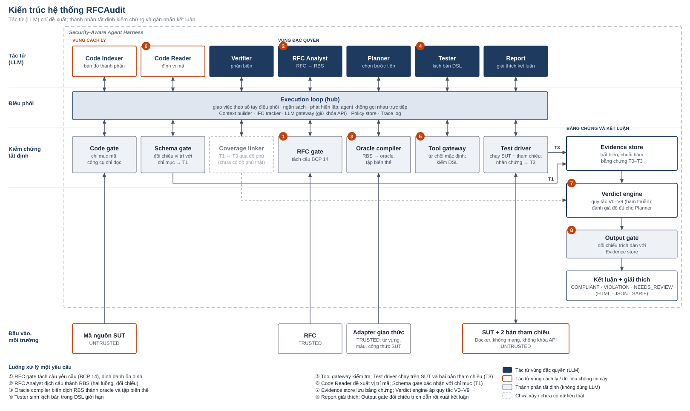
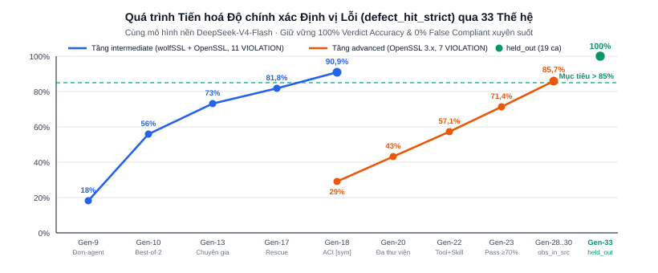

# BÁO CÁO CHI TIẾT LUẬN VĂN THẠC SĨ

**ĐỀ TÀI:** KIỂM CHỨNG TỰ ĐỘNG VÀ AN TOÀN SỰ TUÂN THỦ ĐẶC TẢ GIAO THỨC MẠNG DỰA TRÊN BẰNG CHỨNG, SỬ DỤNG HỆ THỐNG AI ĐA TÁC TỬ

**Trường:** Trường Công nghệ Thông tin và Truyền thông — Đại học Bách khoa Hà Nội (HUST)
**Học viên thực hiện:** Nguyễn Kỳ Tùng
**Giảng viên hướng dẫn:** TS. Tống Văn Vạn
**Hệ thống thực nghiệm:** `RFC-Audit` (`rfcv`; `v1.0` trên nhánh `feat/nextgen-agent-research`, `v2.x` trên nhánh `feat/multi-protocol-eval`) · **Ngày cập nhật:** 28/11/2026

---

## TÓM TẮT (ABSTRACT)

Các triển khai thực tế của giao thức mật mã và giao thức mạng (như TLS 1.3 trên wolfSSL và OpenSSL 3.x) thường chứa các sai lệch tinh vi so với đặc tả RFC (như gửi sai mã cảnh báo, bỏ qua kiểm tra độ dài bản ghi, hoặc thiếu cảnh báo khi gặp loại bản ghi lạ), có thể dẫn tới lỗ hổng bảo mật nghiêm trọng và lỗi tương thích. Các phương pháp hiện hành bộc lộ ba khoảng trống lớn: (1) kiểm thử hộp đen (như TLS-Anvil, tlsfuzzer) phát hiện được sai lệch hành vi nhưng không định vị được dòng mã C gây lỗi; (2) dùng mô hình ngôn ngữ lớn (LLM) đọc mã nguồn tĩnh (như RFCAudit hoặc Single-Agent ReAct) dễ gặp ảo giác, dẫn đến tỷ lệ bỏ sót lỗi (`false_compliant`) và báo nhầm (`false_violation`) cao; và (3) hầu hết hệ thống AI phân tích mã hiện tại chưa giải quyết mô hình đe doạ khi đối thủ kiểm soát mã nguồn (Prompt Injection qua bình luận/chuỗi trong mã C).

Luận văn đề xuất và xây dựng hệ thống **`RFC-Audit`** theo nguyên tắc cốt lõi ***"Agent đề xuất — Thành phần tất định kiểm chứng"*** kết hợp cơ chế kiểm soát luồng thông tin (IFC) và tiến hoá kiến trúc đa tác tử qua 33 thế hệ (`Gen-1` đến `Gen-33`). Đóng góp trung tâm bao gồm: (i) tách bạch hoàn toàn bước sinh bằng chứng (AI Agent) với bước ra kết luận (`VerdictEngine` tất định V0–V9, chuỗi băm chỉ ghi thêm `EvidenceStore`, cổng kiểm định `SchemaGate`); (ii) **Giải đấu Chuyên gia Định tuyến theo Chữ ký Lỗi (`Best-of-2 Specialist Tournament` + `Adaptive Rescue`)** dẫn hướng từ chẩn đoán thực thi động T3; (iii) mô hình **Đóng gói Phân tích tĩnh thành Năng lực của AI Agent** (`code.find_alert_sites` Tool + `locate-alert-sites` Skill) chịu kiểm soát đầy đủ của `ToolGateway` và IFC (`TrustLabel.UNTRUSTED`); và (iv) cổng tự phản hồi `precheck()` kết hợp kiểm chứng mã nguồn tất định `obs_in_source`.

Đánh giá thực nghiệm của mốc `v1.0-tls13-graduated` trên **50 phiên bản Docker thật** của wolfSSL và OpenSSL 3.x (chia 4 tầng chống rò rỉ gồm `basic`, `intermediate` với 7 commit lỗi thật từ lịch sử Git wolfSSL, `advanced` với 8 ca OpenSSL 3.x đa tệp, và **19 ca đóng băng `held_out`** chưa từng chạm) cùng **29 kiểm thử an toàn/đặc tả (`CT08-injection`, `CT26-bad-rbs`)** và **266 kiểm thử đơn vị CI** cho thấy:
- Độ chính xác kết luận (**`verdict_acc`**) đạt **`50/50 = 100,0%`**, với **`0/28 = 0,0%` bỏ sót lỗi (`false_compliant`)** và **`0/22 = 0,0%` báo nhầm (`false_violation`)**.
- Độ chính xác định vị đúng dòng sửa lỗi (**`defect_hit_strict`**) đạt **`80,0%`** trên `basic`, **`90,9%`** (`10/11`, `Gen-18`) trên `intermediate`, **`85,7%`** (`6/7` ổn định 3 lượt liên tiếp `Gen-28..30`) trên `advanced` (OpenSSL 3.x), và đặc biệt **`5/5 = 100,0% ALL STRICT`** cùng **`19/19 = 100,0%` verdict** trên tập đóng băng `held_out` (`Gen-33`, trung bình chỉ `117.638` token và `37,9s`/ca).
- Trong thực nghiệm đối chứng đối đầu trên 27 ca thật (`8` OpenSSL `advanced` + `19` `held_out`), **`RFC-Audit` dù chỉ dùng mô hình gọn `DeepSeek-V4-Flash`** đã áp đảo toàn diện cả **Single-Agent chạy trên flagship Reasoning model `deepseek-v4-pro` (bật full Thinking)**: **`100,0%` vs `74,1%` verdict**, **`0,0%` vs `33,3%` bỏ sót lỗi**, **`0,0%` vs `20,0%` báo nhầm**, **`91,7%` vs `41,7%` định vị strict** (riêng `held_out`: **`100,0%` vs `20,0%`** — gấp 5 lần), đồng thời **nhanh hơn 2,1 lần** (`37,9s` vs `81,3s`/ca), chứng minh rõ rệt luận điểm **`System > Model`**.

Sau mốc `v1.0`, **14 thế hệ tiến hoá có phiếu kiểm toán (`gen-34` → `gen-47`, ba mốc `v2.0-stage-a-complete`, `v2.1-stage-b-complete`, `v2.2-agent-org-complete`)** mở rộng hệ thống theo ba hướng: đa giao thức và đối chứng kiến trúc; hoàn thiện DSL kiểm thử và thu độ phủ dòng khi thực thi; công cụ và mô hình tổ chức đa tác tử. Trên hai giao thức giữ ngoài quá trình phát triển, kết luận đạt `4/4` với SSH (chỉ tính các ca không tương đương, ghép từ hai lượt chạy) và `4/4` với QUIC, nhưng **định vị strict ở lượt đánh giá này bằng `0`**. Trên 6 ca OpenSSL được chọn, giải đấu hai nhánh đạt `6/6` định vị strict (số liệu `Gen-28`), phản biện tuần tự đạt `4/6`, hai cấu hình một tác tử cùng đạt `1/6`; so sánh này không được chạy trên cùng một phiên bản mã. Các kết quả `v2.x` là thực nghiệm cỡ mẫu nhỏ, và tập 50 ca của `v1.0` **chưa được đo lại** trên `v2.x` (điều kiện chi tiết ở các Mục 5.6–5.9).

**Đợt thăm dò bốn đột biến và bản tổng hợp `v3.0` (`gen-48` → `gen-52`, mốc `v2.3-mutation-wave-complete` và `v3.0-synthesized-best`)** sửa cảnh báo giả của bộ quét rò rỉ, thêm tổ chức `Debate + Blind Adjudicator`, công cụ đồ thị gọi hàm `code.call_chain` và bộ nhớ liên ca `EpisodicMemory`. Đánh giá `v3.0` trên cùng một phiên bản mã với 8 ca Docker thật (7 OpenSSL, 1 QUIC) đạt `8/8` kết luận đúng; cả 8 lượt có `leak_scan.clean = true` (ở 7 ca OpenSSL bộ quét chỉ xét `2000/5574` tệp ngoài phạm vi). Định vị strict đạt **`5/6`** trên 6 ca OpenSSL của ablation (**`5/7`** nếu tính cả `OU4`) và `1/1` trên `Q1`. Con số `5/6` cao hơn một tác tử (`1/6`) và phản biện tuần tự (`4/6`) đo ở phiên bản cũ, nhưng **thấp hơn `6/6` của giải đấu hai nhánh ở `Gen-28`**, và các khoảng tin cậy 95% đều giao nhau; mỗi ca chỉ chạy một lượt; tập 50 ca của `v1.0` cũng chưa được đo lại trên `v3.0` (Mục 5.10).

---

## CHƯƠNG 1. ĐẶT VẤN ĐỀ, MỤC TIÊU VÀ ĐÓNG GÓP CHÍNH

### 1.1. Bối cảnh và tính cấp thiết
Các giao thức nền tảng của Internet như TLS 1.3 (RFC 8446), QUIC (RFC 9000), HTTP/2 hay DNS được đặc tả bằng hàng trăm trang văn bản tự nhiên chứa hàng trăm mệnh đề quy phạm (`MUST`, `MUST NOT`, `SHOULD`). Trong thực tế triển khai bằng ngôn ngữ C/C++ (ví dụ `wolfSSL` với tệp `src/internal.c` dài hơn 48.000 dòng, hoặc `OpenSSL 3.x` phân tán qua hơn 15 tệp đa hình dùng con trỏ hàm ở `ssl/record/` và `ssl/statem/`), chỉ một sai lệch nhỏ về mã cảnh báo, thứ tự nhánh `if`, điều kiện biên độ dài bản ghi hoặc macro biên dịch `#ifdef` cũng có thể tạo ra lỗ hổng nghiêm trọng (như CVE về record overflow, downgrade hoặc oracle cảnh báo).

Tuy nhiên, kiểm chứng tuân thủ thủ công cực kỳ tốn kém, còn các phương pháp tự động hiện nay gặp ba rào cản lớn:
1. **Kiểm thử hộp đen (Black-box Conformance Testing):** các bộ test như `TLS-Anvil` hay `tlsfuzzer` phát hiện được sai khác hành vi qua mạng nhưng hoàn toàn mù mã nguồn (`defect_hit = 0%`), không truy vết được dòng mã C cần vá và không kiểm tra được các yêu cầu nội bộ không quan sát được qua mạng (loại D).
2. **Phân tích tĩnh bằng LLM đơn lẻ (Static LLM Auditing):** các hệ thống giao toàn quyền đọc mã và kết luận cho LLM dễ bị ảo giác, bị đánh lừa bởi các nhánh mã chết (`#ifdef [DISABLED]`) hoặc hàm sai giai đoạn giao thức, dẫn tới **lỗi chí tử F1** — kết luận nhầm `COMPLIANT` cho một bản triển khai thực sự có lỗi (`false_compliant`).
3. **Thiếu mô hình an toàn trước mã nguồn không tin cậy:** trong kịch bản kiểm toán thực tế, mã nguồn kiểm chứng có thể do bên thứ ba hoặc đối thủ cung cấp. Chuỗi/bình luận độc hại trong mã C có thể chèn Prompt Injection nhằm thao túng AI Agent bỏ qua lỗi hoặc gọi công cụ ngoài quyền hạn.

### 1.2. Mục tiêu nghiên cứu
Luận văn hướng tới ba mục tiêu cụ thể:
- **MT1 — Kiểm chứng chính xác, dựa trên bằng chứng và truy vết được:** kết hợp bằng chứng thực thi động (`T3`) với định vị mã nguồn có kiểm định (`T1`), đạt tỷ lệ bỏ sót lỗi `false_compliant = 0%`, độ chính xác định vị dòng lỗi vượt `85%`, và mọi kết luận đều tái lập được `100%` từ kho bằng chứng.
- **MT2 — Khả năng mở rộng đa thư viện & đa giao thức:** thiết kế lõi tách biệt miền ứng dụng (bảo đảm bằng 6 hợp đồng kiến trúc `import-linter`), hoạt động thống nhất trên các thư viện khác biệt kiến trúc (`wolfSSL` đơn tệp lớn và `OpenSSL 3.x` đa tệp đa hình) chỉ thông qua tầng adapter.
- **MT3 — An toàn khi đối thủ kiểm soát mã nguồn:** thực thi cách ly vùng đặc quyền/cách ly (`privileged` ↔ `quarantine`), kiểm soát luồng thông tin (IFC) và cổng công cụ (`ToolGateway`), chặn `100%` các kịch bản tấn công Prompt Injection (`CT08`) và phát hiện đặc tả sai (`CT26`).

### 1.3. Các đóng góp khoa học chính
1. **Kiến trúc đa tác tử dựa trên bằng chứng có kiểm chứng tất định (`RFC-Audit`):** phân tách chặt giữa đề xuất của LLM và kiểm định không dùng LLM (`SchemaGate`, `VerdictEngine` V0–V9, `EvidenceStore` chuỗi băm), triệt tiêu hoàn toàn ảo giác nhãn.
2. **Cơ chế Giải đấu Chuyên gia Định tuyến theo Chữ ký Lỗi (`Signature-Routed Best-of-2 Tournament` + `Adaptive Rescue`):** định tuyến tự động cặp tác tử bổ trợ theo chữ ký chẩn đoán từ T3 (`WRONG_ALERT` vs `REACTION_ABSENT`/`NO_CLOSE`), phá vỡ hiệu ứng đường hầm (tunnel vision) và giảm `39%` chi phí token so với đơn-agent.
3. **Mô hình "Phân tích tĩnh như Năng lực của AI Agent" (Static Analysis as Agentic Tool + Skill):** thay vì tiền xử lý tĩnh ẩn ngoài vòng lặp (Hybrid), đóng gói quét điểm phát cảnh báo toàn cục thành công cụ chỉ-đọc `code.find_alert_sites` + kỹ năng `locate-alert-sites/SKILL.md` để AI Agent tự chủ triệu gọi dưới kiểm soát IFC (`TrustLabel.UNTRUSTED`), kết hợp kiểm chứng mã nguồn tất định `obs_in_source`.
4. **Bộ thực nghiệm phân tầng 50 ca Docker thật và đối chứng `System > Model`:** chứng minh thực nghiệm qua 33 thế hệ tiến hoá có kiểm soát (`KEEP`/`REVERT`), đạt `100%` trên 19 ca đóng băng `held_out` và đánh bại flagship Reasoning model `deepseek-v4-pro` chạy đơn lẻ trên mọi chỉ số.
5. **Bằng chứng mở rộng đa giao thức và tự soạn kịch bản (`gen-35` → `gen-41`):** gỡ tên hàm/tệp/macro đặc thù wolfSSL/OpenSSL khỏi `Code Reader` (`handler.py` vẫn còn luật chiều giao thức và giai đoạn bản ghi đặc thù TLS, xem Chương 6); đánh giá thêm SSH và QUIC (đủ 5 giao thức trên Docker); thí nghiệm `Tester` tự soạn kịch bản khi không có mẫu.
6. **Chiến lược hai chiều `Code-First → Targeted Dynamic Verify` (`gen-38`):** trích hằng số nhánh từ mã nguồn một cách tất định rồi bắt buộc kiểm chứng lại bằng `T3` và bản tham chiếu, phát hiện được ca lỗi giá trị đặc biệt `U5` mà kiểm thử một chiều bỏ sót.
7. **Liên kết nhân quả bằng độ phủ thực thi (`gen-43` → `gen-45`):** thu `gcov`/`lcov` trong container chỉ-đọc, tích hợp điểm SBFL Ochiai thành công cụ `coverage.hotspots`, kèm phản hồi `UNEXECUTED_SITE`.
8. **Khảo sát mô hình tổ chức và giao tiếp đa tác tử (`gen-40`, `gen-46`, `gen-47`):** đối sánh một tác tử, phản biện ngang hàng tuần tự và giải đấu song song; bổ sung bảng đen `HypothesisBoard` có kiểm soát IFC.
9. **Đợt thăm dò bốn đột biến và bản tổng hợp `v3.0` (`gen-48` → `gen-52`):** sửa hai nguồn cảnh báo giả của `leak_scan`; mô hình tổ chức `Debate + Blind Adjudicator` (mặc định của `v3.0`); công cụ `code.call_chain`; bộ nhớ liên ca `EpisodicMemory` gắn nhãn `TrustLabel.DERIVED`; và một lượt đánh giá 8 ca trên cùng một phiên bản mã. Đóng góp ở đây là cơ chế và bài học thực nghiệm; số liệu chưa đủ để khẳng định `v3.0` định vị tốt hơn giải đấu hai nhánh (Mục 5.10).

---

## CHƯƠNG 2. TỔNG QUAN NGHIÊN CỨU LIÊN QUAN

| Nhóm / Công trình tiêu biểu | Phương pháp chính | Điểm mạnh | Hạn chế so với `RFC-Audit` |
|---|---|---|---|
| **TLS-Anvil** *(USENIX Security 2022)*, **tlsfuzzer** | Kiểm thử tổ hợp hộp đen qua mạng cho TLS 1.2/1.3 | Độ phủ kịch bản mạng tốt, bằng chứng hành vi thực tế | Hộp đen hoàn toàn (`defect_hit = 0%`), không gắn tự động với câu RFC, viết test thủ công theo từng giao thức |
| **RFCAudit** *(arXiv / USENIX)* | Dùng LLM phân tích tĩnh mã nguồn đối chiếu RFC | Tự động đọc mã nguồn và chỉ ra vị trí nghi vấn | Không có thực thi động T3 kiểm chéo → dễ bỏ sót (`false_compliant`) và báo nhầm; không có IFC chống mã độc |
| **SAGE** *(USENIX Security 2021)*, **RFCNLP** | Trích xuất máy trạng thái / quy tắc từ văn bản RFC bằng NLP | Tự động hoá phân tích văn bản đặc tả | Dừng ở bước trích xuất đặc tả, chưa khép kín với thực thi động và định vị mã nguồn có kiểm chứng |
| **SCALE** *(NSDI 2022)*, **Differential Testing** *(Nezha, Frankencerts)* | So sánh sai khác hành vi giữa nhiều bản triển khai | Phát hiện lỗi tương thích nhanh mà không cần oracle đầy đủ | Mù khi các bản triển khai cùng sai giống nhau; không định vị dòng mã nguồn vi phạm |
| **SWE-agent / Agentless / ReAct** *(Single-Agent LLM)* | Tác tử LLM tổng quát đọc mã bằng `grep`/`read` | Linh hoạt trên nhiều bài toán phần mềm | Thiếu bằng chứng thực thi đặc tả giao thức, thiếu kiểm chứng tất định → tỷ lệ bỏ sót lỗi cao (chứng minh ở Chương 5) |
| **`RFC-Audit` (Luận văn này)** | **Đa tác tử dựa trên bằng chứng T1–T3 + `VerdictEngine` + Agentic Tool/Skill + IFC** | **`100%` verdict, `0%` bỏ sót, `85,7%–100%` định vị strict, an toàn trước mã nguồn đối thủ** | Đòi hỏi adapter thực thi cho từng giao thức mới (tách biệt hoàn toàn khỏi lõi) |

---

## CHƯƠNG 3. KIẾN TRÚC HỆ THỐNG `RFC-AUDIT` VÀ THIẾT KẾ ĐA TÁC TỬ AN TOÀN

### 3.1. Kiến trúc tổng thể và luồng xử lý
Hệ thống `RFC-Audit` được tổ chức theo mô hình **Hub-and-Spoke** với 6 hợp đồng kiến trúc bất biến kiểm tra tự động bằng `import-linter` (lõi `core` không phụ thuộc miền, miền không phụ thuộc runtime/framework LLM, `agents/` chỉ chứa schema và lời nhắc, `VerdictEngine` là hàm thuần không I/O và không LLM).

Luồng điều tra một yêu cầu RFC diễn ra khép kín theo các bước:
1. **Chuẩn hoá đặc tả (`RFC Gate` & `RFC Analyst`):** tách câu RFC có mã băm định danh, chuyển thành đặc tả hành vi có kiểu **RBS** (`Requirement Behavior Spec` gồm `actor`, `state`, `trigger`, `where`, `expect`, `variants`) và biên dịch thành oracle kiểm thử.
2. **Thực thi động có nhân chứng (`Test Driver` → Bằng chứng `T3`):** chạy kịch bản kiểm thử trên SUT thật trong Docker (cùng đối chứng dương/âm như wolfSSL, OpenSSL, GnuTLS), ghi nhận chính xác cảnh báo quan sát được (`observed.alert`), trạng thái đóng kết nối và `outcome` (`PASS`/`FAIL`).
3. **Định vị và đối chiếu mã nguồn (`Code Reader` → Bằng chứng `T1`):** sau khi `T3` đã xác định chữ ký hành vi, `Code Reader` phân tích mã nguồn C qua chỉ mục Tree-sitter (`CodeIndex`), đối chiếu 3 khía cạnh (`CONDITION`, `THRESHOLD`, `REACTION`) và nộp `LocationClaim@1` qua `SchemaGate`.
4. **Phản biện độc lập (`Verifier`):** kiểm tra tính nhất quán giữa `T1` và `T3`, phát hiện nhánh bị bỏ sót (`MISSING_PATH`) hoặc mâu thuẫn bằng chứng trước khi chốt nhãn `COMPLIANT`.
5. **Kết luận tất định (`VerdictEngine` V0–V9):** hàm thuần duy nhất có quyền gán nhãn (`VIOLATION`, `COMPLIANT` kèm mức bảo đảm `LINKED`/`BEHAVIORAL`/`STATIC`, `NEEDS_REVIEW`, hoặc `UNVERIFIABLE`) từ kho bằng chứng `EvidenceStore` (SQLite chuỗi băm SHA-256 chỉ ghi thêm).

### 3.2. Mô hình an toàn khi đối thủ kiểm soát mã nguồn (IFC & SchemaGate)
Để đáp ứng mục tiêu **MT3**, toàn bộ dữ liệu đi qua hệ thống được gán nhãn tin cậy theo cơ chế **Information Flow Control (IFC)**:
- **`TRUSTED`:** văn bản RFC, cấu hình hệ thống, luật `VerdictEngine`.
- **`DERIVED`:** bản tóm tắt có kiểm soát do hub tạo ra (`evidence.summary`, `verdict.sufficiency`).
- **`UNTRUSTED`:** toàn bộ mã nguồn SUT, nhật ký chạy SUT và kết quả trả về từ các công cụ đọc mã (`code.read`, `code.grep`, `code.find_alert_sites`).

Tác tử đọc mã (`Code Reader`) chạy trong vùng **`quarantine`** (chỉ được gọi công cụ chỉ-đọc qua `ToolGateway`, không thấy khoá API, không sửa tệp, không quyết định nhãn). Mọi đầu ra `LocationClaim@1` bắt buộc vượt qua **`SchemaGate`** tất định: kiểm tra tên tệp hợp lệ, hàm tồn tại trong `CodeIndex`, mọi dòng trích dẫn đều đã thực sự được đọc (`LINES_NOT_SHOWN`), nằm trong thân hàm (`LINES_OUTSIDE_SYMBOL`), được biên dịch theo cờ build (`LINES_NOT_COMPILED`), và giá trị `observed` thuộc từ vựng hợp lệ của adapter.

### 3.3. Bốn đột phá kiến trúc đúc kết qua 33 thế hệ tiến hoá

#### 3.3.1. Chẩn đoán ngược từ bằng chứng động (`T3-guided Diagnosis`)
Mô-đun `diagnosis.py` phân tích toàn bộ bản ghi `T3` thành chữ ký lỗi chuẩn hoá:
- **`WRONG_ALERT`:** SUT có phát cảnh báo nhưng sai mã (kể cả trong trường hợp cảnh báo hỗn hợp nhiều biến thể).
- **`REACTION_ABSENT`:** SUT đóng kết nối hoặc bỏ qua mà không phát cảnh báo kỳ vọng.
- **`THRESHOLD_MISMATCH` / `NO_CLOSE`:** sai ngưỡng điều kiện hoặc phát cảnh báo nhưng không đóng kết nối.

#### 3.3.2. Giải đấu Chuyên gia Định tuyến theo Chữ ký Lỗi (`Best-of-2 Tournament` + `Adaptive Rescue`)
Thay vì một tác tử đơn lẻ dễ mắc hiệu ứng đường hầm, `execution_loop.py` (`_run_tournament`) và `code_reader/handler.py` (`branches`) triển khai cặp 2 nhánh AI Agent song song, độc lập ngữ cảnh, chuyên biệt theo chữ ký lỗi:
- Khi **`WRONG_ALERT`**: Nhánh A (`bottom_up_alert_hunter`) truy ngược trực tiếp từ các điểm phát mã cảnh báo sai quan sát bởi T3; Nhánh B (`error_to_alert_mapper`) lần 2 bước từ từ khoá RBS tới mã lỗi nội bộ rồi tới khối `switch`/`case` ánh xạ lỗi sang cảnh báo.
- Khi **`REACTION_ABSENT` / `NO_CLOSE`**: Nhánh A (`early_check_ifdef_hunter`) săn nhánh kiểm tra sớm trả lỗi thiếu cảnh báo hoặc nhánh bị `#ifdef [DISABLED]`; Nhánh B (`top_down_protocol_tracer`) lần từ điểm vào giao thức xuống điểm phân loại bản ghi.
- **`Adaptive Rescue`:** chỉ kích hoạt chạy cứu hộ tăng ngân sách khi **không có nhánh nào vượt qua kiểm chuẩn sạch** (`accepted && has_mismatch && !wrong_dir && !wrong_stage`), giúp tránh lãng phí token trên các ca đã thành công ở lượt đầu.

Mục này mô tả cấu hình dùng cho số liệu `v1.0`. Từ `v3.0`, tổ chức mặc định là `Debate + Blind Adjudicator`; giải đấu vẫn bật được bằng `RFCV_ORG_MODE=tournament` (Mục 5.10).

#### 3.3.3. Đóng gói Phân tích tĩnh thành Năng lực của AI Agent (`code.find_alert_sites` + `locate-alert-sites`)
Trên thư viện đa tệp đa hình như OpenSSL 3.x (hơn 15 tệp dưới `ssl/record/` và `ssl/statem/`), `code.grep` thông thường bị cắt cụt `head_limit` hoặc ngập nhiễu từ `tests/`/`examples/`. Thay vì chèn lát cắt tĩnh ẩn ngoài vòng lặp (Hybrid), luận văn đóng gói năng lực quét tĩnh thành:
- **Công cụ chỉ-đọc `code.find_alert_sites`** (`code_tools.py`): quét toàn bộ kho tệp C/H sản xuất không phân biệt hoa thường, loại bỏ thư mục nhiễu, xếp hạng ứng viên theo từ khoá RBS và hành động gửi cảnh báo (`SSLfatal`/`RLAYERfatal`/`SendAlert`), gắn sẵn `[symbol: <hàm> (a–b)]` và nhãn `[DISABLED]` theo cờ biên dịch, nén gọn (`limit=6, window=4, cap=6144` byte) để tối ưu ngân sách token cho cả tệp đơn 48k dòng lẫn kho đa tệp. Mọi kết quả đi qua `ToolGateway` với nhãn `TrustLabel.UNTRUSTED` và tự động cập nhật `shown_lines` cho `SchemaGate`.
- **Kỹ năng `locate-alert-sites/SKILL.md`:** hướng dẫn `Code Reader` chủ động triệu gọi `code__find_alert_sites`, phân biệt hàm kiểm tra cú pháp extension với kiểm tra hậu thương lượng (`final_key_share`), và phân biệt tầng bản ghi rõ (`state=initial`, `rec_layer_s3.c`) với tầng đã mã hoá (`tls13_validate_record_header`).

#### 3.3.4. Cổng Tự phản hồi (`precheck`) và Trọng tài Kiểm chứng Mã nguồn Tất định (`obs_in_source`)
- **`precheck()`** phát hiện và cho phép tác tử tự sửa ngay trong ngân sách (tối đa 2 lượt retry) các lỗi có hệ thống: `MISMATCH_REQUIRED_ON_VIOLATION`, `WRONG_PROTOCOL_DIRECTION` (chặn nhầm hàm phía client `ServerHello` khi SUT là server nhận `ClientHello`), `WRONG_RECORD_STAGE` (chặn nhầm `tls13_validate_record_header` khi kiểm tra bản ghi rõ `state=initial`), `WRONG_OBSERVED_ALERT`, `HINT_SYMBOL_FILE`, và `HINT_ENCLOSING_SYMBOL`.
- **Trọng tài `select_branch()` với `obs_in_source`:** kiểm chứng tất định trực tiếp trên mã nguồn C tại `CodeIndex` xem đoạn dòng `[line_start, line_end]` mà tác tử nộp có **thực sự chứa tên mã cảnh báo sai do T3 quan sát** hay không (chặn tình huống tác tử ghi nhầm `observed` cho nhánh khác), kết hợp `earlier_bias` ưu tiên nhánh kiểm tra sớm hơn khi hai nhánh cùng nằm trong một `(file, symbol)`.

---

## CHƯƠNG 4. PHƯƠNG PHÁP ĐÁNH GIÁ VÀ BỘ DỮ LIỆU PHÂN TẦNG CHỐNG RÒ RỈ

### 4.1. Thiết kế bộ dữ liệu 4 tầng (`tiered_benchmark.yaml`)
Để đảm bảo tính khoa học, chống rò rỉ dữ liệu và đánh giá năng lực tổng quát hoá thực sự, 50 mẫu Docker thật (trải trên cả **wolfSSL** và **OpenSSL 3.x** cho 3 họ yêu cầu TLS 1.3: họ `R` độ dài bản ghi `RFC8446§5.2`, họ `U` loại bản ghi lạ `RFC8446§5`, họ `G` không có nhóm chung `RFC8446§4.1.1`) cùng 5 ca mô phỏng và 29 kiểm thử an toàn được chia thành **4 tầng nghiêm ngặt**:

| Tầng | Quy mô | Thành phần chi tiết | Ngưỡng tốt nghiệp (Graduation Gate) |
|---|---|---|---|
| **Tầng 1: `basic`** | `12` ca (`5` sim + `7` Docker) | `M5, U2, G2, R14, OR3, M6, G4` (wolfSSL & OpenSSL) + 5 ca mô phỏng `e2e_live`/`e2e_hard` | `verdict_acc = 100%`, `false_compliant = 0`, `defect_hit ≥ 80%`, `0` gate rejects |
| **Tầng 2: `intermediate`** | `16` ca Docker | **7 commit lỗi thật từ lịch sử Git wolfSSL** (`bug, fix, head, P1-parent/fix, P3-parent/fix`) + 9 mutant khó (`M1, M2, U1, U4, G1, G3, R10, OU1, U7`) | `verdict_acc ≥ 95%`, `false_compliant = 0`, `defect_hit ≥ 65%`, `real_bug ≥ 66%`, `avg_tokens ≤ 220k` |
| **Tầng 3: `advanced`** | `8` OpenSSL + `2` cổng an toàn | `OU2, OU3, OU4, OG1, OG2, OG4, OR1, OX3` (OpenSSL 3.x đa tệp) + `CT08-injection` & `CT26-bad-rbs` (`29` test) | `verdict_acc ≥ 90%`, `false_compliant = 0`, `defect_hit ≥ 70%`, **`repeats_per_item ≥ 3`** |
| **Tầng 4: `held_out` (Đóng băng)** | `19` ca Docker | `M7, M8, U8, G5, G6, G7, R9, R12, U13, U14, G8, G9, G11, G12, R16, R17, OG3, OX1, OX2` (`16` wolfSSL + `3` OpenSSL) | **CẤM tối ưu theo tập này**; chỉ chạy 1 lần nghiệm thu cuối để chứng minh không overfit |

### 4.2. Giao thức tiến hoá có kiểm soát (`KEEP` / `REVERT`)
Mọi thế hệ tiến hoá (`Gen-1` đến `Gen-33`) tuân thủ chính sách bất biến trong `backend/eval/meta_policy.yaml`: tuyệt đối không sửa `verdict_engine.py`, `rules.py`, `schema_gate.py`, `ifc.py`, `tool_gateway.py` hay dữ liệu chuẩn; mọi thay đổi đều được kiểm chứng qua `eval_score.py` (CI + kiểm thử bất biến) và lưu vết đầy đủ quyết định `KEEP` hoặc `REVERT` vào `evolution_log.jsonl` và `knowledge_base.md`.

Từ `gen-34`, mỗi thế hệ có một phiếu `backend/eval/evolution/tickets/gen-NN.yaml` (mức và phép đột biến, động cơ, chỉ số trước/sau) và được ghi vào `innovation_log.md`; thành phần bị gỡ được lưu vào `gene_bank.yaml` để có thể đưa trở lại.

---

## CHƯƠNG 5. KẾT QUẢ THỰC NGHIỆM VÀ PHÂN TÍCH CHUYÊN SÂU

### 5.1. Tổng hợp kết quả toàn bộ 50 ca Docker thật trên 4 tầng

Các Mục 5.1–5.5 là số liệu của mốc `v1.0-tls13-graduated` (`Gen-1` → `Gen-33`). Các Mục 5.6–5.9 trình bày giai đoạn `gen-34` → `gen-47`, Mục 5.10 trình bày `gen-48` → `gen-52`.

| Tầng kiểm chuẩn | Tập mẫu | Verdict Accuracy | `false_compliant` | `false_violation` | `defect_hit` (`strict`) | Trạng thái |
|---|---|---|---|---|---|---|
| **Tầng 1: `basic`** (`Gen-31`) | `5` sim + `7` Docker | **`12/12 (100,0%)`** | **`0/5 (0%)`** | **`0/2 (0%)`** | **`4/5 (80,0% ALL STRICT)`** *(tăng 2x từ `40%` ở `Gen-7`)* | **PASS** |
| **Tầng 2: `intermediate`** (`Gen-18` / `Gen-32b`) | `16` Docker (`7` lỗi thật + `9` mutant) | **`16/16 (100,0%)`** *(96/96 qua 6 lượt)* | **`0/11 (0%)`** | **`0/5 (0%)`** | **`10/11 (90,9% ALL STRICT)`** (`Gen-18`) · `9/11 (81,8%)` (`Gen-32b`) | **PASS (7/7)** |
| **Tầng 3: `advanced`** (`Gen-28..30`) | `8` OpenSSL + `29` test an toàn | **`8/8 (100,0%)`** *(72/72 qua 9 lượt)* | **`0/7 (0%)`** | **`0/1 (0%)`** | **`6/7 (85,7% ALL STRICT)`** *(3 lượt liên tiếp `Gen-28/29/30`!)* | **PASS (`repeats=3`)** |
| **Tập đóng băng `held_out`** (`Gen-33`) | `19` Docker chưa từng chạm | **`19/19 (100,0%)`** | **`0/5 (0%)`** | **`0/14 (0%)`** | **`5/5 (100,0% ALL STRICT)`** (`R9, U14, G8, G9, G12`) | **PASS TUYỆT ĐỐI** |
| **TỔNG HỢP 50 CA DOCKER THẬT** | **wolfSSL + OpenSSL 3.x** | **`50/50 (100,0%)`** | **`0/28 (0,0%)`** | **`0/22 (0,0%)`** | **`25/28 (89,3%)`** *(đỉnh theo tầng)* · **`5/5 (100%)` trên `held_out`** | **TỐT NGHIỆP** |

### 5.2. Quá trình tiến hoá 33 thế hệ (`Gen-1` → `Gen-33`) và bài học `KEEP`/`REVERT`

Những mốc bước ngoặt quan trọng nhất được rút ra từ 33 thế hệ thực nghiệm:
- **Giai đoạn 1 (`Gen-1` → `Gen-7`, Tầng `basic`):** sửa lỗi `cexpr.py` (`ZeroDivisionError`), bổ sung `HARD_WRAP_SHARE = 0.78` và regex không phân biệt hoa thường cho `candidate_patterns()`, đạt `12/12 (100%)` verdict, `0` gate rejects và `0` `UsageLimitExceeded`.
- **Giai đoạn 2 (`Gen-8` → `Gen-18`, Tầng `intermediate` — Thuần AI Agent):** nhảy vọt từ đơn-agent `Gen-9` (`2/11 = 18%`, `396k` token/ca) lên **Giải đấu Best-of-2 Chuyên gia + Adaptive Rescue + tiêu đề `[symbol]` trên `code__read` (`Gen-18`)**, đạt **`16/16 = 100%` verdict**, **`10/11 = 90,9% ALL STRICT`** (`8/8 = 100%` trên toàn bộ mutant khó, `11/11 = 100%` distinct strict hit), đồng thời **giảm 39% token trung bình** xuống `191.414` token/ca (`46,4s`/ca).
- **Giai đoạn 3 (`Gen-19` → `Gen-28`, Tầng `advanced` — Agentic Tool + Skill):** khi chuyển sang OpenSSL 3.x đa tệp, `grep` thuần chạm trần `29%–43%`. Việc đóng gói phân tích tĩnh thành **Tool `code.find_alert_sites` + Skill `locate-alert-sites`** (`Gen-22`), kết hợp `WRONG_RECORD_STAGE` (`state=initial` + `variants`) và kiểm chứng mã nguồn tất định **`obs_in_source`** (`Gen-28`) đã đẩy định vị OpenSSL 3.x lên **`6/7 = 85,7% ALL STRICT`** (`OU2, OU3, OG1, OG2, OG4, OR1`) và giữ ổn định tuyệt đối **3 lượt liên tiếp (`Gen-28, Gen-29, Gen-30`)**.
- **Giai đoạn 4 (`Gen-29` → `Gen-32b`, Kiểm thử hồi quy & Kỷ luật `REVERT`):** thử nghiệm thêm `ACTIVE_ALERT_ON_REACTION_ABSENT` và mở rộng `cap=16KB` ở `Gen-29/30` bị phát hiện gây `UsageLimitExceeded` trên tệp 48k dòng của wolfSSL khi kiểm thử hồi quy ở `Gen-32`. Hệ thống đã **REVERT** phần dư thừa về nền `Gen-28` và nén `code.find_alert_sites` về `limit=6, window=4, cap=6144` byte — lập tức giảm **50% token** trên wolfSSL (`R10: 564k → 252k`, `P3-parent: 506k → 224k`) và khôi phục hoàn toàn hiệu năng đa thư viện.

### 5.3. Nghiệm thu tập đóng băng `held_out` (`Gen-33`, 19 ca chưa từng chạm)
Chạy một lần duy nhất trên trọn bộ 19 ca đóng băng (`runs/real/tier_heldout_gen33_final`) đạt **100,0% tuyệt đối trên mọi chỉ số** (Wilson 95% CI cho verdict: `83%–100%`), trung bình chỉ **`117.638` token/ca** và **`37,9s`/ca**:

| Mã ca | Thư viện | Họ | Nhãn chuẩn | Kết luận | Luật | Vòng | Thời gian | Token (`all_role`) | `defect_hit_strict` |
|---|---|---|---|---|---|---|---|---|---|
| `R9` | wolfSSL | `R` | `VIOLATION` | **`VIOLATION`** | `V2` | 2 | `68s` | `210.318` | **TRUE** |
| `U14` | wolfSSL | `U` | `VIOLATION` | **`VIOLATION`** | `V2` | 2 | `31s` | `244.801` | **TRUE** |
| `G8` | wolfSSL | `G` | `VIOLATION` | **`VIOLATION`** | `V2` | 2 | `43s` | `230.905` | **TRUE** |
| `G9` | wolfSSL | `G` | `VIOLATION` | **`VIOLATION`** | `V2` | 2 | `46s` | `241.325` | **TRUE** |
| `G12` | wolfSSL | `G` | `VIOLATION` | **`VIOLATION`** | `V2` | 2 | `45s` | `239.542` | **TRUE** |
| `M7, M8, R12, R16, R17` | wolfSSL | `R` | `COMPLIANT` | **`5/5 COMPLIANT`** | `V6` | 1 | `37–96s` | `25k–34k` | — |
| `G5, G6, G7, G11` | wolfSSL | `G` | `COMPLIANT` | **`4/4 COMPLIANT`** | `V6` | 1 | `8–14s` | `~9,8k` | — |
| `U8, U13` | wolfSSL | `U` | `COMPLIANT` | **`2/2 COMPLIANT`** | `V6` | 5 | `57–61s` | `400k–414k` | — |
| `OG3, OX1, OX2` | OpenSSL | `G, R` | `COMPLIANT` | **`3/3 COMPLIANT`** | `V6` | 1 | `9–69s` | `9,8k–32,9k` | — |

### 5.4. Thực nghiệm Đối chứng Đối đầu: Chứng minh luận điểm `System > Model`
Để đánh giá công bằng và khách quan đóng góp của kiến trúc `RFC-Audit` (Giả thuyết H1 & H2), chúng tôi đối đầu trực tiếp 4 cấu hình trên **cùng 27 ca thật** (**8 ca OpenSSL 3.x `advanced`** + **19 ca đóng băng `held_out`**):
- **`B1` (Test-only hộp đen):** tương đương `TLS-Anvil`/`tlsfuzzer`, chỉ chạy kiểm thử hành vi T3.
- **`B2-Flash` (`DeepSeek-V4-Flash`):** Single-Agent LLM dùng cùng mô hình nền với `RFC-Audit`, trang bị `list_files`, `grep`, `read_file` (12 tool calls / 250k token + cảnh báo chốt kết quả).
- **`B2-Pro` (`deepseek-v4-pro` bật full Thinking/Reasoning mode):** đối thủ nặng ký dùng **flagship Reasoning model mạnh hơn hẳn** chạy cùng bộ công cụ đọc mã tổng quát (`0/27 ERROR`).
- **`C0` (`RFC-Audit`):** kiến trúc đầy đủ của luận văn, **chỉ sử dụng mô hình gọn `DeepSeek-V4-Flash`**.

| Chỉ số (27 ca thật: 8 OpenSSL `advanced` + 19 `held_out`) | `B1` Test-only | `B2-Flash` (`V4-Flash`) | `B2-Pro` (`deepseek-v4-pro` Reasoning) | **`C0` `RFC-Audit`** (`V4-Flash`) | Chênh lệch `C0` vs `B2-Pro` |
|---|---|---|---|---|---|
| **Verdict Accuracy (27 ca)** | `27/27 (100,0%)` | `15/27 (55,6%)` | `20/27 (74,1%)` | **`27/27 (100,0%)`** | **`+25,9` điểm %** |
| **Bỏ sót lỗi (`false_compliant`)** | `0/12 (0,0%)` | `9/12 (75,0%)` | `4/12 (33,3%)` | **`0/12 (0,0%)`** | Triệt tiêu **100%** bỏ sót |
| **Báo nhầm (`false_violation`)** | `0/15 (0,0%)` | `2/15 (13,3%)` | `3/15 (20,0%)` | **`0/15 (0,0%)`** | Triệt tiêu **100%** báo nhầm |
| **Recall `VIOLATION`** | `12/12 (100,0%)` | `3/12 (25,0%)` | `8/12 (66,7%)` | **`12/12 (100,0%)`** | **`+33,3` điểm %** |
| **Định vị `defect_hit_strict` (12 lỗi)** | `0/12 (0,0%)` | `2/12 (16,7%)` | `5/12 (41,7%)` | **`11/12 (91,7% ALL STRICT)`** | **`+50,0` điểm % (gấp 2,2x)** |
| ↳ Riêng OpenSSL `advanced` (7 lỗi) | `0/7 (0,0%)` | `1/7 (14,3%)` | `4/7 (57,1%)` | **`6/7 (85,7% ALL STRICT)`** | **`+28,6` điểm %** |
| ↳ Riêng `held_out` đóng băng (5 lỗi) | `0/5 (0,0%)` | `1/5 (20,0%)` | `1/5 (20,0%)` | **`5/5 (100,0% ALL STRICT)`** | **`+80,0` điểm % (gấp 5,0x)** |
| **Thời gian trung bình (`held_out`)** | ~35s | `10,1s` | `81,3s` | **`37,9s`** | **Nhanh gấp 2,1 lần** |

**Phân tích 4 nguyên nhân kiến trúc giúp `RFC-Audit` (`Flash`) áp đảo `B2-Pro` (`deepseek-v4-pro` Reasoning):**
1. **Thực thi động `T3` + `VerdictEngine` tất định:** `B2-Pro` chỉ đọc mã tĩnh nên phải tự mô phỏng luồng C bằng suy đoán → bị đánh lừa ở `OU2, OU3, OU4` (đọc nhầm `tls13_validate_record_header` rồi kết luận `COMPLIANT`) và báo nhầm ở `OG3, G11, R17`. `RFC-Audit` kiểm chứng trên server TLS thật nên đạt `100%` verdict và `0%` sai lệch.
2. **Định vị ngược từ triệu chứng thực tế (`T3-guided Diagnosis`):** thay vì dò mò trên hàng chục nghìn dòng C, `T3` chỉ thẳng mã cảnh báo sai thực tế, thu hẹp không gian tìm kiếm theo cấp số nhân.
3. **Công cụ chuyên biệt (`code.find_alert_sites` + Skill):** `B2-Pro` chỉ có `grep` dễ bị cắt cụt nên trên `held_out` (`R9, G9, G12`) đoán đúng `VIOLATION` nhưng trỏ nhầm hàm/dòng (`20%` strict); `RFC-Audit` quét toàn kho có xếp hạng và nhãn `[symbol]`/`[DISABLED]` nên đạt `100%` strict.
4. **Đa giả thuyết song song (`Best-of-2`) + kiểm chứng `obs_in_source`:** chống hiệu ứng đường hầm và xác minh trực tiếp mã nguồn thật tại trọng tài, loại bỏ các đề xuất ảo giác.

### 5.5. Kiểm chứng An toàn, Tái lập và Chất lượng Kỹ thuật
Toàn bộ tiêu chuẩn kỹ thuật và an toàn đều vượt qua `100%` ở phiên bản chốt cuối (`eval_score.py --label gen33-final-graduation-heldout-100`):
- **An toàn đối thủ (`MT3`):** `29/29 passed (100%)` trên `tests/test_policy_ifc.py` (`CT08-injection`: Prompt Injection trong mã nguồn không thể thao túng nhãn hoặc gọi công cụ ngoài quyền) và `tests/test_divergence_verifier.py` (`CT26-bad-rbs`: phát hiện đặc tả sai trên nhánh hợp lệ).
- **Chất lượng phần mềm & kiến trúc:** `266/266 pytest passed`, `ruff check` & `ruff format` sạch `100%`, `pyright` strict **`0 errors, 0 warnings`**, `lint-imports` giữ trọn **`6/6` hợp đồng kiến trúc**.
- **Tính tái lập:** trên Tầng `advanced` OpenSSL, `3` lượt chạy liên tiếp (`Gen-28, Gen-29, Gen-30`) cho kết quả đồng nhất `100%` (`8/8` verdict và `6/7 = 85,7%` strict trên cùng 6 ca); trên Tầng `intermediate`, `6` lượt chạy liên tiếp đạt `96/96 = 100%` verdict.

### 5.6. Chặng A: Đa giao thức, gỡ mã cứng và đối chứng kiến trúc (`gen-34` → `gen-41`, mốc `v2.0-stage-a-complete`)

#### 5.6.1. Tinh gọn, tổng quát hoá và bổ sung năng lực (`gen-34` → `gen-38`)

**Bảng 5.6a. Năm thế hệ đầu của Chặng A**

| Thế hệ | Phép đột biến | Thay đổi | Kết quả ghi nhận |
|---|---|---|---|
| `gen-34` | `L4 REMOVE_AGENT` | Tắt `Planner LLM` dự phòng khi sổ tay gặp lỗi tác vụ; lưu vào `gene_bank.yaml` | Trên `held_out` của `Gen-33`, thành phần này được gọi 2 lần và trả `output=null` cả 2. Lần cắt quá rộng ban đầu làm hỏng 3 test của miền độc lập `toy_domain`; phải thu hẹp điều kiện để giữ tính tổng quát |
| `gen-35` | `L2 REMOVE_HARDCODE` | Gỡ tên hàm/tệp/macro đặc thù wolfSSL/OpenSSL khỏi `code_reader/handler.py`; trung lập hoá kỹ năng `locate-alert-sites` | Số ký hiệu mã cứng theo phiếu: `11 → 0`; `test_skills_protocol_neutral` từ FAIL sang PASS; hồi quy 4 ca trên 4 thư viện C (Bảng 5.6b) |
| `gen-36` | `L3 ADD_STEP` | Thêm `_check_reaction_consistency` vào `_ExplanationGate.precheck()`, không sửa `output_gate.py` | Cổng tất định chặn lời giải thích thiếu cặp mã (`ALERT_PAIR_MISSING`) hoặc đảo chiều mã yêu cầu và mã quan sát (`ALERT_DIRECTION_INVERTED`) |
| `gen-37` | `L6 ADD_CAPABILITY` | `specs_from_adapter()` đọc cấu hình chạy SUT từ `sut/*.yaml` | Theo phiếu, thêm thư viện mới không còn phải sửa `docker_launcher.py` |
| `gen-38` | `L6 ADD_STRATEGY` | `Code-First → Targeted Dynamic Verify` (`code_probe.py`) | `U5` từ `COMPLIANT` sai sang `VIOLATION (V2)` |

**Bảng 5.6b. Hồi quy sau khi gỡ mã cứng (các lượt chạy `reg_gen37`, trên mã đã gồm `gen-35`)**

| Ca | Giao thức / thư viện | Kết luận và định vị | Vị trí được trích dẫn | Ghi chú |
|---|---|---|---|---|
| `H1` | HTTP/2, `nghttp2` | `VIOLATION (V2)`, strict | `lib/nghttp2_session.c` | Đạt ở lượt chạy lại; lượt đầu `UNVERIFIABLE (V9)` với 0 token |
| `D3` | DNS, `Knot DNS` | `VIOLATION (V2)`, strict | `src/knot/nameserver/process_query.c` | Đạt ở lượt chạy lại; lượt đầu `UNVERIFIABLE (V9)` với 0 token; lượt đạt có `leak_scan.clean = false` |
| `R9` | TLS 1.3, `wolfSSL` | `VIOLATION (V2)`, trúng dòng sửa | `src/internal.c:[26276, 26292]` | Trích dẫn chứa dòng chuẩn `26290`; `matrix.csv` để trống cột chấm tự động, được đối chiếu thủ công |
| `OU2` | TLS 1.3, `OpenSSL` | `VIOLATION (V2)`, strict | `ssl/record/rec_layer_s3.c:[846, 857]` | Chấm tự động |

Nhật ký tiến hoá tổng hợp kết quả này là **`4/4 ALL STRICT`**.

Với `gen-38`, khi mọi ca kích hoạt hộp đen đều PASS, hệ thống trích tất định hằng số của nhánh `if`/`switch`/`case` quanh điểm phát phản ứng kỳ vọng, sinh biến thể `type_77` cho `wolfssl-U5` và chạy `T3` trên SUT cùng các bản tham chiếu (bằng chứng `T3` ghi nhân chứng `openssl`, `gnutls`, `wolfssl`). Kết quả là **`VIOLATION (V2)`**, trích dẫn `src/internal.c:[26218, 26222]` chứa dòng sửa chuẩn `26218` (tài liệu đúc kết tiến hoá ghi nhận `ALL STRICT`), `leak_scan.clean = true`. Chiến lược chỉ chuyển hằng số trích tất định từ mã nguồn sang `Tester`, và nhãn vẫn do `VerdictEngine` quyết định. `U5` thuộc nhóm đột biến bị loại khỏi bộ chính, và chiến lược được thiết kế để xử lý đúng điểm mù này, nên đây là kiểm chứng khả năng, chưa phải đo tổng quát hoá.

#### 5.6.2. Hai giao thức giữ ngoài quá trình phát triển (`gen-39`)

Sau ba giao thức phát triển (TLS 1.3, HTTP/2, DNS), hệ thống được chạy trên SSH và QUIC với lõi và tác tử đóng băng. Hai lỗi hạ tầng được sửa trong quá trình chạy, không chạm lõi: đồng bộ `docker_cmd` cho `<impl>-ref` và biên timeout UDP 1 ms của backend QUIC.

**Bảng 5.6c. Kết quả trên SSH và QUIC**

| Giao thức / SUT | Ca | Kết luận | Định vị strict | Điều kiện |
|---|---|---|---|---|
| SSH, `Dropbear 2024.86` | `S3, S4` đúng `VIOLATION (V2)`; `S5, S6` đúng `COMPLIANT (V6)` | **`4/4 (100%)`** ca không tương đương; báo nhầm `0%` | `0/2` | `S5, S6` lấy từ lượt đối chứng chạy lại (lượt đầu `UNVERIFIABLE`). `S1, S2` bị kết luận `COMPLIANT` so với nhãn ban đầu `VIOLATION`, được xác định là đột biến tương đương do `requirenext` chặn trước dòng 139. Điểm thô lượt đầu trên 6 ca là `2/6` |
| QUIC, `ngtcp2 v1.11.0` | `Q1, Q2, Q3` đúng `VIOLATION (V2)`; `Q4` đúng `COMPLIANT (V6)` | **`4/4 (100%)`**; bỏ sót `0%`, báo nhầm `0%` | `0/3` | Số liệu của lượt `heldout_quic_gen39_v3`; 2/4 thư mục chạy có `leak_scan.clean = false` |

Hai nguyên nhân định vị đã được ghi nhận. Ở `S3`, `Code Reader` tìm đến đúng dòng `src/common-kex.c:[888, 891]` nhưng `SchemaGate` từ chối (`LINES_OUTSIDE_SYMBOL`) vì `tree-sitter` cắt thiếu biên hàm C kiểu K&R chứa `#ifdef`. Ở QUIC, tác tử dừng tại điểm kiểm tra trùng không nằm trên đường gây lỗi (nhóm `conn_recv_pkt:6109`, trong khi chỗ lỗi là `ngtcp2_accept:10230`). Mỗi giao thức chỉ có 4 ca được tính nên khoảng tin cậy rất rộng (với QUIC `4/4`, Wilson 95% là `51%–100%`).

#### 5.6.3. Đối chứng tách thành phần (`gen-40`)

**Bảng 5.6d. Ablation trên 6 ca OpenSSL `OU2, OU3, OG1, OG2, OG4, OR1`, mô hình `DeepSeek-V4-Flash`**

| Cấu hình | Verdict | `defect_hit` | `defect_hit_strict` (Wilson 95%) | Token trung bình (`all_role`) |
|---|---|---|---|---|
| `A2` `no_diagnosis`: một tác tử, không chẩn đoán, không giải đấu | `6/6` | `2/6` | **`1/6 = 16,7%`** (`3%–56%`) | ~189k |
| `A1` `single_branch`: một tác tử có chẩn đoán | `6/6` | `1/6` | **`1/6 = 16,7%`** (`3%–56%`) | ~167k |
| `C0` `full`: giải đấu 2 nhánh chuyên biệt + `obs_in_source` (số liệu `Gen-28`) | `6/6` | `6/6` | **`6/6 = 100,0%`** (`61%–100%`) | ~244k |

Chênh lệch đo được giữa `C0` và hai cấu hình một tác tử là **`+83,3` điểm %**, hai khoảng tin cậy 95% **không giao nhau**. Cả ba cấu hình đều đạt `6/6` verdict, nên khác biệt nằm ở định vị; `C0` tốn nhiều token hơn.

**Giới hạn của phép so sánh:**

- `A1`, `A2` chạy ở `gen-40`, còn `C0` không được chạy lại mà lấy từ `Gen-28`, trước khi `gen-35` gỡ mã cứng (gồm tên tệp, tên hàm OpenSSL) khỏi `Code Reader` và kỹ năng định vị. Chênh lệch vì vậy không thể quy hoàn toàn cho kiến trúc.
- Sáu ca này đúng là sáu ca `C0` định vị đúng trong 7 ca `VIOLATION` của tầng `advanced`; ca `C0` trượt (`OU4`) không nằm trong ablation. Đây là thiên lệch chọn mẫu theo hướng có lợi cho `C0`.
- Tầng `advanced` đã được dùng để tinh chỉnh ở `Gen-19` → `Gen-28`.
- Số liệu ablation của mỗi cấu hình `A1`, `A2` đến từ một lượt.

Kết quả là bằng chứng ủng hộ vai trò của giải đấu hai nhánh, chưa phải phép đối chứng có kiểm soát đầy đủ.

#### 5.6.4. `Tester` tự soạn kịch bản không dùng mẫu (`gen-41`)

Thư mục `templates/` được xoá về 0 mẫu cho 5 yêu cầu trên 4 giao thức: `R9` và `OU2` (TLS 1.3), `H1` (HTTP/2), `D3` (DNS), `Q1` (QUIC). Theo phiếu `gen-41`, kết quả là **`5/5 = 100%`** kịch bản do LLM tự soạn được xác minh trên bản tham chiếu Docker, `0` `gate_reject`, tổng **`96`** bằng chứng `T3`, và **`5/5 VIOLATION (V2)`**.

**Điều kiện đi kèm:** tệp tổng hợp `summary.json` lưu **`3/5`** (`R9, OU2, H1`). `D3` và `Q1` ở lượt đầu không cho ra đầu ra hợp lệ của `Tester` và kết thúc `UNVERIFIABLE (V9)` do hết ngân sách; cả hai đạt `VIOLATION (V2)` ở lượt chạy lại, và `summary.json` không được cập nhật. Do đó `5/5` là kết quả **sau khi chạy lại**, còn tỷ lệ của lượt đầu là `3/5`. Lượt chạy lại của `D3` có `leak_scan.clean = false`. Thí nghiệm đo khả năng soạn kịch bản và kết luận, không dùng để khẳng định độ chính xác định vị.

### 5.7. Chặng B: Mở rộng DSL và độ phủ thực thi (`gen-42` → `gen-43`, mốc `v2.1-stage-b-complete`)

1. **Đủ `8/8` thao tác DSL cho `tlsfuzzer` (`gen-42`):** bổ sung `mutate`, `reorder`, `repeat` (trước đó `5/8`). Phiếu ghi nhận kiểm thử đơn vị và chạy thật trên OpenSSL trong Docker: `reorder: ["finished", "client_hello"]` và `repeat: "client_hello"` đều gây `unexpected_message` kèm đóng kết nối. Thay đổi này mở đường kiểm thử các yêu cầu về thứ tự, lặp thông điệp và đột biến trường; chưa có số liệu benchmark riêng cho lớp yêu cầu đó.
2. **Thu độ phủ dòng `gcov`/`lcov` trong container `--read-only` (`gen-43`):** dùng `GCOV_PREFIX=/tmp/gcov`, thu `192.480` byte LCOV trên ảnh `rfcv/sut-ngtcp2:cov-head`. Liên kết độ phủ phân biệt tất định `ngtcp2_accept:10230` (`linked=True`) với `conn_recv_pkt:6108–6116` (`linked=False`), tạo cơ sở nhân quả cho mức bảo đảm `LINKED`. Đây là xác minh năng lực trên một trường hợp `ngtcp2`, chưa phải phép đo tỷ lệ đạt `LINKED` trên toàn bộ benchmark.

### 5.8. Chặng C: Công cụ, tổ chức và giao tiếp đa tác tử (`gen-44` → `gen-47`, mốc `v2.2-agent-org-complete`)

#### 5.8.1. SBFL Ochiai, `coverage.hotspots` và phản hồi `UNEXECUTED_SITE` (`gen-44`, `gen-45`)

`gen-44` đưa điểm định vị theo phổ độ phủ **SBFL Ochiai** vào `Code Reader` và dùng `executed_in_fail` khi xếp hạng nhánh. `gen-45` đóng gói thành công cụ chủ động `coverage.hotspots`, kỹ năng trung lập giao thức `coverage-guided-localization/SKILL.md`, và thêm phản hồi `UNEXECUTED_SITE` trong `LocationHandler.precheck` khi dòng trích dẫn có LCOV bằng 0 trên ca FAIL.

Trên ảnh `rfcv/sut-ngtcp2:cov-Q1`, phiếu `gen-45` ghi nhận cả hai nhánh tự chuyển từ `conn_recv_handshake_pkt:6108–6116` (LCOV bằng 0) sang **`ngtcp2_accept` (`lib/ngtcp2_conn.c:10230–10232`, `executed_in_fail=true`)**, đưa `Q1` từ **`0/1` (`gen-39`) lên `1/1 = 100%` strict**.

**Điều kiện đi kèm:** kết quả đạt ở lượt thứ ba (`v3`), hai lượt trước vẫn trích dẫn `conn_recv_handshake_pkt`; thư mục chạy đạt có `leak_scan.clean = false`; `Q1` đã được dùng để phát triển công cụ nên không còn là ca giữ ngoài; lượt `Q1` của `gen-47` lại trích dẫn `conn_recv_handshake_pkt` (`0/1` strict). Đây là bằng chứng cơ chế có thể lật được ca này, chưa chứng minh tính ổn định.

#### 5.8.2. Phản biện ngang hàng và đối sánh ba mô hình tổ chức (`gen-46`)

`RFCV_ORG_MODE=peer_review` bật quy trình tuần tự `Investigator → Skeptic Reviewer`; ở thời điểm `gen-46`, giải đấu song song vẫn là mặc định.

**Bảng 5.8. Ba mô hình tổ chức trên 6 ca `OU2, OU3, OG1, OG2, OG4, OR1`**

| Mô hình tổ chức | Nguồn số liệu | Verdict | `defect_hit_strict` | Chênh lệch so với một tác tử |
|---|---|---|---|---|
| Một tác tử (`A1`, `A2`) | `gen-40` | `6/6` | **`1/6 = 16,7%`** | mốc so sánh |
| Phản biện ngang hàng tuần tự | `gen-46` | `6/6` | **`4/6 = 66,7%`** (Wilson 95%: `30%–90%`) | **`+50,0` điểm %** |
| Giải đấu độc lập song song (`C0`) | `Gen-28`, dùng trong `gen-40` | `6/6` | **`6/6 = 100,0%`** | **`+83,3` điểm %** |

Giải đấu song song cao hơn phản biện tuần tự **`33,3` điểm %**. Phản biện tuần tự dùng trung bình khoảng `201k` token theo cột `tokens` (chỉ số ghi trong phiếu), tương ứng khoảng `222k` theo `all_role`; khi so với Bảng 5.6d phải dùng số `all_role`.

Hai ca trượt là `OU3` và `OG1`. Với `OU3`, phiếu `gen-46` quy nguyên nhân cho **thiên lệch neo (anchoring bias)** khi `Reviewer` xem trước bản nháp của `Investigator`. Cách giải thích này dựa trên một ca, chưa có thí nghiệm tách riêng yếu tố neo và không giải thích ca `OG1`. Khoảng tin cậy của `4/6` giao với khoảng của cả hai cấu hình còn lại, và số liệu `C0` đến từ phiên bản mã cũ hơn, nên thứ hạng giữa ba mô hình là kết quả sơ bộ.

#### 5.8.3. Bảng đen War-Room `HypothesisBoard` an toàn IFC (`gen-47`)

`rfcv/core/blackboard.py` bổ sung bảng đen cộng tác hai chiều, gắn vào `ExecutionLoop._shared_context` dưới nhãn `TrustLabel.DERIVED` (`warroom.blackboard`). Bảng chỉ nhận định danh đơn và từ vựng adapter, chặn văn bản tự do và mã nguồn thô; mục trùng được khử. `Tester` đăng tín hiệu hành vi, điểm nóng độ phủ, ứng viên nhánh và kết quả thăm dò; `Code Reader` đọc bảng và đăng giả thuyết vị trí sau khi `SchemaGate` duyệt.

- **`U5`:** `VIOLATION (V2)` với chuỗi cộng tác `Tester (hb-001 → verified, hb-002) ↔ Code Reader (hb-003)` và **`leak_scan.clean = true`**. Vị trí mã được trích trong lượt này (`src/internal.c`, quanh dòng `26840`) không trùng dòng sửa chuẩn `26216/26218`, nên không được tính là định vị đúng.
- **`Q1`:** ghi nhận 18 mục cộng tác hai chiều, kết luận `VIOLATION (V2)`; định vị strict `0/1` và `leak_scan.clean = false`.
- **`Q4` (đối chứng):** `COMPLIANT (V6)`, báo nhầm `0%`, `0` mục nhiễu trên bảng.

Các kết quả này xác nhận kênh giao tiếp hoạt động; chưa có số liệu cho thấy bảng đen làm tăng độ chính xác kết luận hay định vị.

### 5.9. Điều kiện diễn giải kết quả `gen-34` → `gen-47`

1. **Phạm vi của số liệu `v1.0`:** kết quả `50/50` và `19/19 held_out` thuộc mốc `v1.0`, chưa được chạy lại trọn bộ sau 14 thế hệ mới. Trace của `held_out` đã được dùng làm đầu vào chẩn đoán cho `gen-34` (`U8, U13`) và `gen-36` (`R9`), `R9` còn được dùng để hồi quy ở các thế hệ sau. Vì vậy, đối với `v2.x`, tập này không còn là tập đóng băng chưa chạm.
2. **Chạy lại:** một số kết quả chỉ đạt sau khi chạy lại (`H1`, `D3` ở hồi quy; `S5, S6`; `D3, Q1` ở `gen-41`; `Q1` ở `gen-45`). Các tỷ lệ tương ứng không đại diện cho xác suất thành công trong một lượt.
3. **Quét rò rỉ:** không phải mọi lượt đều sạch. Trong các thư mục kết quả được đối chiếu, `leak_scan.clean = false` xuất hiện ở `A1` (`3/6`), phản biện ngang hàng (`1/6`), QUIC `gen-39` (`2/4`), `Q1` của `gen-45` và `gen-47`, hồi quy `D3`, `gen-41` (`1/7` thư mục chạy), và cả lượt `Gen-28` cung cấp số liệu `C0` (`1/8`). Loại cảnh báo `out_of_scope` nghĩa là một dòng của tệp ngoài phạm vi xuất hiện trong dữ liệu lần chạy. Đây là trạng thái ghi trong báo cáo gốc của các lượt chạy. `gen-48` phân tích nguyên nhân và sửa bộ quét; kết quả quét lại, gồm cả phần vẫn còn cảnh báo, nằm ở Mục 5.10.1.
4. **Bằng chứng lưu vết:** số liệu của `gen-42` và `gen-43` dựa trên phiếu tiến hoá, nhật ký và sổ giới hạn hệ thống; không tìm thấy thư mục lần chạy riêng của hai thế hệ này để đối chiếu lại.
5. **Cỡ mẫu:** các thí nghiệm giai đoạn này nhỏ (thường vài ca), phần lớn không có lượt lặp để đo độ ổn định.

### 5.10. Chặng D: Đợt thăm dò bốn đột biến và bản tổng hợp `v3.0` (`gen-48` → `gen-52`)

Số liệu trong mục này được đối chiếu với `matrix.csv`, `leak_scan.json` và sự kiện trong `trace.db` của các thư mục lần chạy; số kiểm thử theo từng thế hệ lấy từ phiếu tiến hoá nếu không ghi khác. `gen-48` → `gen-51` (mốc `v2.3-mutation-wave-complete`) là đợt thăm dò bốn đột biến; `gen-52` (mốc `v3.0-synthesized-best`) là bản tổng hợp.

#### 5.10.1. Sửa cảnh báo giả của bộ quét rò rỉ (`gen-48`)

Phân tích của `gen-48` chỉ ra hai nguồn cảnh báo giả: dòng phân cách khuôn mẫu, và dòng của tệp ngoài phạm vi nhưng là chuỗi con của một tệp trong phạm vi (ví dụ `tests/ngtcp2_transport_params_test.c:126` nằm trong `lib/ngtcp2_transport_params.c`). Bản sửa thêm `_is_marker` (tối thiểu `MIN_ALNUM_CHARS = 12` ký tự chữ-số) và bước đối chiếu chuỗi con trong phạm vi; `17/17` kiểm thử của `test_leak_scan.py` đạt. Phiếu `gen-48` ghi lượt quét lại `Q1` cho `clean = true`. Tóm tắt của phiếu còn kết luận không có rò rỉ thật nào trong các cảnh báo đã xét; phép quét lại dưới đây cho thấy kết luận đó **không bao được mọi lượt chạy cũ**.

**Quét lại độc lập khi soạn báo cáo.** Bộ quét mới được chạy lại (chỉ đọc, không ghi đè `leak_scan.json` cũ) trên `103` thư mục lần chạy trong `backend/runs/` đang ghi `clean = false`. `79` thư mục tìm được adapter có mã băm trùng với bản kê của lượt chạy; `24` thư mục cũ còn lại không tìm được nên **chưa được quét lại**.

**Bảng 5.10a. Kết quả quét lại 79 lượt từng bị cảnh báo**

| Nhóm | Số lượt | Kết quả với bộ quét `gen-48` |
|---|---|---|
| Hết cảnh báo | `41` | `clean`; các lượt OpenSSL, wolfSSL trong nhóm vẫn chịu giới hạn `2000` tệp |
| Còn cảnh báo, wolfSSL | `31` | trùng dòng trong các tệp `README` dưới `IDE/` (ngoài phạm vi) |
| Còn cảnh báo, DNS | `7` | trùng dòng trong tệp danh sách `Knot.files` |

Kiểm tra tay **một mẫu ở mỗi nhóm còn cảnh báo**: mẫu wolfSSL là chuỗi tên bộ mã `SSL cipher suite is TLS_AES_128_GCM_SHA256` xuất hiện trong một artifact; mẫu DNS là đường dẫn tệp `src/knot/modules/authsignal/authsignal.c` xuất hiện trong `trace.db`. Cả hai có vẻ là trùng ngẫu nhiên, nhưng **các lượt còn lại chưa được phân tích từng trường hợp**.

Trong `11` lượt cảnh báo được nêu ở Mục 5.9 (ý 3), `9` lượt nay sạch (`A1` `3`, phản biện ngang hàng `1`, QUIC `gen-39` `2`, `Q1` của `gen-45` và `gen-47` `2`, `Gen-28` `1`) và `2` lượt DNS `D3` (hồi quy, `gen-41`) vẫn còn cảnh báo. Vậy `gen-48` loại được phần lớn cảnh báo ở các lượt đã được trích dẫn, nhưng **chưa thể khẳng định mọi cảnh báo cũ đều là giả**.

#### 5.10.2. Ba đột biến thăm dò (`gen-49` → `gen-51`)

**Bảng 5.10b. Ba đột biến và kết quả trên Docker**

| Thế hệ | Thay đổi | Kết quả đo được | Điều kiện |
|---|---|---|---|
| `gen-49` | `Debate + Blind Adjudicator` (`RFCV_ORG_MODE=debate`), mô hình tổ chức thứ 4: 2 tác tử điều tra song song, độc lập; dừng sớm khi đồng thuận; gọi tác tử trọng tài mù (`adjudicator`) khi bất đồng hoặc có nhánh bị cổng từ chối | `OU3, OU4, OG1`: `3/3 VIOLATION (V2)`, `3/3 leak_scan.clean = true`. `OU3` đồng thuận, `52s`, strict. Ở `OG1`, cả hai tác tử bị `SchemaGate` từ chối (`LINES_OUTSIDE_SYMBOL`); trọng tài sửa tên hàm thành `extract_keyshares:704–707` và được duyệt (`adjudicator_won = true`) | Định vị strict chỉ **`1/3`** (`OU3`). Ở `OG1`, trọng tài cứu được một nhận định **qua cổng**, nhưng lượt này **không** định vị đúng |
| `gen-50` | Công cụ `code.call_chain` (BFS đồ thị gọi hàm, lọc dòng điều kiện theo định danh) và kỹ năng `call-chain-tracing` | `OU4`: `VIOLATION (V2)`, `leak_scan.clean = true`. Theo phiếu: `32/32` kiểm thử mục tiêu đạt, `import-linter` `6/6` | `OU4` định vị strict `0/1`; công cụ được gọi **`0` lần** (lượt chạy ở chế độ giải đấu). Phiếu quy nguyên nhân cho việc lời nhắc và chỉ dẫn chiến lược chưa nhắc tới công cụ |
| `gen-51` | `EpisodicMemory` (`rfcv/core/episodic_memory.py`, ngữ cảnh `memory.codebase_map`): chỉ lưu mốc `(file, symbol, dòng, rtype, finding)` đã qua `SchemaGate`, làm sạch thành định danh đơn, nhãn `TrustLabel.DERIVED` | Chuỗi `OU2 → OU3`: `2/2` strict, `2/2 leak_scan.clean = true`; mốc `ssl3_read_bytes` đạt `hits = 2`; `OU3` dùng `31s`, `11` lời gọi công cụ | Cả hai lượt chạy ở **chế độ giải đấu**, không phải `debate`. `OU2` cần nhánh cứu hộ, dùng `32` lời gọi và `525.480` token (cột thời gian của lượt này bất thường, `57133s`, nên không dùng) |

Tác dụng của bộ nhớ liên ca lên chi phí **chưa được chứng minh**. Bảng 5.10c liệt kê các lượt `OU3` dùng để đối chiếu.

**Bảng 5.10c. Ca `OU3` qua năm lượt chạy**

| Lượt chạy | Tổ chức | Bộ nhớ liên ca | Thời gian | Lời gọi công cụ | Strict |
|---|---|---|---|---|---|
| `Gen-28` | giải đấu | không | `30s` | `12` | đúng |
| `gen-46` | phản biện tuần tự | không | `79s` | `15` | sai |
| `gen-49` | `debate` | không | `52s` | `15` | đúng |
| `gen-51` | giải đấu | có (sau `OU2`) | `31s` | `11` | đúng |
| `v3.0` (`gen-52`) | `debate` | có (sau `OU2`) | `59s` | `19` | đúng |

Mức `31s` và `11` lời gọi thấp hơn hai lượt không có bộ nhớ ở `gen-46` và `gen-49` (`52s–79s`, `15` lời gọi), nhưng hai lượt đó dùng tổ chức khác. So với lượt cùng kiểu tổ chức (`Gen-28`, mã cũ hơn) thì gần như không đổi (`30s`, `12` lời gọi), còn lượt `v3.0` có bộ nhớ lại tốn `59s` và `19` lời gọi. Mỗi cấu hình chỉ có một lượt, nên chênh lệch không thể quy cho bộ nhớ. Tương tự, việc `gen-49` định vị đúng `OU3` (nơi phản biện tuần tự trượt) phù hợp với giả thuyết thiên lệch neo, nhưng một ca và một lượt chưa chứng minh được giả thuyết.

#### 5.10.3. Bản tổng hợp `v3.0` (`gen-52`)

`v3.0` đặt `Debate + Blind Adjudicator` làm mặc định (vẫn giữ `tournament` và `peer_review` để tái lập), siết tiêu chí đồng thuận thành **cùng tệp và hai khoảng dòng chồng nhau hoặc cách nhau không quá 10 dòng**, và viết lại `agents/code_reader/prompt.md` theo hướng trung lập giao thức, có hướng dẫn dùng bộ nhớ, bảng đen, độ phủ và `code.call_chain`. Phiếu ghi `69/69` kiểm thử đặc tả và `845/845` kiểm thử ngoài nhóm tài liệu đạt. Chạy lại toàn bộ khi soạn báo cáo (28/11/2026): `845 passed`, `2 failed`, `1 skipped`; hai kiểm thử trượt thuộc `test_naming.py` (quy ước đặt tên tệp trong `docs/`). `ruff check` sạch, `pyright` `0` lỗi, `import-linter` giữ `6/6` hợp đồng.

Đánh giá gồm 8 ca Docker có lỗi, mỗi ca một lượt, trên cùng phiên bản `v3.0`: 7 ca OpenSSL chạy nối tiếp `OU2 → OU3 → OU4 → OG1 → OG2 → OG4 → OR1` dùng chung `EpisodicMemory`, và `Q1` của QUIC (ảnh có độ phủ `cov-Q1`) chạy riêng. Bản kê của 8 lượt có cùng mã băm lời nhắc, bộ quy tắc, chính sách, cấu hình mô hình và registry; mã băm kỹ năng giống nhau ở 7 lượt OpenSSL và khác ở `Q1` (adapter QUIC). Bản kê không ghi commit của mã hệ thống; cả 8 lượt bắt đầu trong khoảng 10:12–10:30 ngày 28/11/2026, trước commit `17a84b9` (10:37), nên việc gắn các lượt này với đúng mã của commit dựa trên quy trình thực hiện.

**Bảng 5.10d. Kết quả từng ca của `v3.0`** (cả 8 ca: `VIOLATION (V2)`)

| Ca | Strict | Cách chốt vị trí | Vị trí được chọn | Thời gian | Lời gọi | Token (`all_role`) |
|---|---|---|---|---|---|---|
| `OU2` | **sai** | đồng thuận | `tls13_validate_record_header:256–278` | `81s` | `11` | `266.446` |
| `OU3` | đúng | một tác tử không có đầu ra; gọi trọng tài, chọn nhánh điều tra | `ssl3_read_bytes:846–856` | `59s` | `19` | `325.284` |
| `OU4` | **sai** | đồng thuận | `tls13_validate_record_header:259–265` | `48s` | `11` | `236.754` |
| `OG1` | đúng | bất đồng; nhánh trọng tài thắng (`adjudicator_won = true`) | `final_key_share:1412–1417` | `70s` | `19` | `332.512` |
| `OG2` | đúng | đồng thuận | `final_key_share:1412–1417` | `63s` | `11` | `243.374` |
| `OG4` | đúng | đồng thuận | `final_key_share:1412–1417` | `56s` | `14` | `243.210` |
| `OR1` | đúng | đồng thuận | `tls13_validate_record_header:272–276` | `172s` | `12` | `267.646` |
| `Q1` | đúng | tác tử thứ hai và trọng tài không có đầu ra; còn một nhánh hợp lệ | `ngtcp2_accept:10230–10232` (`executed_in_fail = true`) | `344s` | `28` | `387.512` |

**Tổng hợp:**
- **Kết luận:** `8/8` đúng (Wilson 95%: `68%–100%`), `false_compliant` `0/8`. Tập này chỉ gồm ca có lỗi nên **không đo được `false_violation`**. `OU4` dừng vì hết ngân sách (`stop_reason = BUDGET`, 8 vòng), kết luận vẫn là `V2`.
- **Rò rỉ:** `8/8 leak_scan.clean = true`, danh sách rò rỉ rỗng. Ở **7 ca OpenSSL, bộ quét chỉ xét `2000/5574` tệp ngoài phạm vi** (`MAX_FILES = 2000`); lượt `Q1` không bị giới hạn này. Vì vậy `clean` của các ca OpenSSL không nói gì về `3574` tệp còn lại.
- **Định vị:** 6 ca OpenSSL của ablation đạt **`5/6 = 83,3%` strict** (Wilson 95%: `44%–97%`); cả 7 ca **`5/7 = 71,4%`** (`36%–92%`); `Q1` **`1/1`** (`21%–100%`).

**Bảng 5.10e. Đối chiếu trên 6 ca `OU2, OU3, OG1, OG2, OG4, OR1` (bốn dòng dùng bốn phiên bản mã)**

| Cấu hình | Nguồn | `defect_hit_strict` (Wilson 95%) | Token trung bình (`all_role`) |
|---|---|---|---|
| Một tác tử (`A1`, `A2`) | `gen-40` | `1/6 = 16,7%` (`3%–56%`) | ~167k–189k |
| Phản biện tuần tự | `gen-46` | `4/6 = 66,7%` (`30%–90%`) | ~222k |
| Giải đấu hai nhánh | `Gen-28` | `6/6 = 100,0%` (`61%–100%`) | ~244k |
| `v3.0` (`debate` + bộ nhớ) | `gen-52` | `5/6 = 83,3%` (`44%–97%`) | ~280k |

Về điểm số, `v3.0` cao hơn một tác tử `66,6` điểm % và cao hơn phản biện tuần tự `16,6` điểm %, nhưng **thấp hơn giải đấu ở `Gen-28` `16,7` điểm %** và tốn nhiều token nhất trong bảng. Khoảng tin cậy của `v3.0` giao với cả ba dòng còn lại, kể cả một tác tử. "Cùng một phiên bản" chỉ đúng cho 8 ca của `v3.0`; ba dòng còn lại không được chạy lại, và thiên lệch chọn mẫu ở Mục 5.6.3 vẫn áp dụng. Do đó **chưa có bằng chứng rằng đổi mặc định sang `debate` làm định vị tốt hơn**.

**Bài học từ `v3.0`:**
1. **Đồng thuận không đồng nghĩa với đúng.** `5/7` ca OpenSSL dừng sớm theo đồng thuận (`OU2, OU4, OG2, OG4, OR1`), nhưng chỉ `3/5` đúng strict. Ở hai ca sai (`OU2, OU4`), cả hai nhánh đều bị bộ chấm gắn cờ `wrong_stage = true` mà vẫn được coi là đồng thuận, nên trọng tài không được gọi: tiêu chí đồng thuận chỉ xét tệp và khoảng dòng.
2. **Đóng góp riêng của trọng tài ở lượt này chưa tách được.** Trọng tài được gọi ở `OU3, OG1, Q1`. Chỉ `OG1` có `adjudicator_won = true`, nhưng một tác tử điều tra đã được duyệt với **đúng vị trí đó** (`final_key_share:1412–1417`), nên ca này không cho thấy kết quả strict phụ thuộc vào trọng tài. Lượt mà trọng tài sửa được nhận định bị cổng từ chối của cả hai tác tử là `OG1` của `gen-49`, và ở đó định vị vẫn sai.
3. **`code.call_chain` vẫn không được dùng:** `0` lời gọi trên cả 8 ca, dù lời nhắc đã có hướng dẫn. Cách giải thích (chuỗi `find_alert_sites` + `grep` + `read` đã đủ cho điểm lỗi nằm trong một hoặc hai hàm) là giả thuyết chưa kiểm chứng; `OU4` vẫn trượt strict. `coverage.hotspots` chỉ được gọi ở `OU3`.
4. **Mốc trong bộ nhớ chỉ được bảo đảm là đã qua `SchemaGate`, không bảo đảm đúng.** Ca đầu tiên (`OU2`, định vị sai) đã ghi `tls13_validate_record_header:256–278` vào bộ nhớ dùng chung; `OU4` sau đó cũng chọn hàm này. Dữ liệu không đủ để kết luận bộ nhớ gây ra lỗi của `OU4`, nhưng cho thấy một mốc sai có thể được truyền sang ca sau. Bộ nhớ cũng làm 7 ca OpenSSL phụ thuộc thứ tự chạy, không còn là các phép đo độc lập.
5. **Tính trung lập chưa trọn vẹn.** `prompt.md` đã trung lập, nhưng `agents/code_reader/handler.py` còn luật đặc thù TLS về chiều giao thức và giai đoạn bản ghi trong `select_branch` và `precheck` (Chương 6).

---

## CHƯƠNG 6. MỐI ĐE DOẠ TÍNH HỢP LỆ, GIỚI HẠN VÀ HƯỚNG PHÁT TRIỂN

1. **Mối đe doạ tính hợp lệ nội tại & ngoại tại:** benchmark phân tầng 50 ca (`v1.0`) chỉ gồm TLS 1.3 trên 2 thư viện C công nghiệp có kiến trúc trái ngược nhau (`wolfSSL` đơn tệp lớn và `OpenSSL 3.x` đa tệp đa hình). Giai đoạn `v2.x` đã chạy thật trên 5 giao thức (TLS 1.3, HTTP/2, DNS, SSH, QUIC) nhưng với số ca nhỏ, chưa phải thực nghiệm quy mô lớn. Trường hợp `S1, S2` cho thấy mọi đột biến mới cần được xác minh bằng thực thi độc lập trước khi gán nhãn. Các giới hạn về so sánh khác phiên bản, chọn mẫu, chạy lại và quét rò rỉ được nêu ở Mục 5.6.3, 5.9 và 5.10. Riêng 8 ca của `v3.0` đều là ca có lỗi, mỗi ca một lượt; 7 ca OpenSSL dùng chung bộ nhớ nên phụ thuộc thứ tự chạy.
2. **Giới hạn còn tồn tại:** dạng lỗi xoá hoàn toàn lệnh gửi cảnh báo (`DEL_ALERT` / `REACTION_ABSENT` như `OU4` trong hàm 500 dòng `ssl3_read_bytes` có một nhánh `default:` vẫn gửi cảnh báo ở cuối hàm) vẫn là bài toán khó nhất cho mô hình `Flash` vì không có ký hiệu cảnh báo sai trực tiếp tại dòng đột biến.
   Giai đoạn `v2.x` bộc lộ thêm: định vị strict bằng `0` trên SSH và QUIC ở lượt đánh giá giữ ngoài (`gen-39`); biên hàm C kiểu K&R chứa `#ifdef` bị cắt sai; bẫy nhiều điểm kiểm tra trùng trên `ngtcp2` mới được giải ở một lượt (`gen-45`) và không lặp lại ở lượt `gen-47`.
3. **Phần đặc thù TLS còn trong `Code Reader`:** `gen-35` và `gen-52` đã gỡ tên hàm, tên tệp riêng của thư viện và trung lập hoá `prompt.md`, nhưng `agents/code_reader/handler.py` vẫn còn luật chỉ đúng cho TLS:
   - `select_branch`: phạt sai chiều giao thức (`wrong_dir`: trigger `client_hello` mà tên hàm chứa `serverhello`) và sai giai đoạn bản ghi (`wrong_stage`: trạng thái `initial` với trường `record.content_type`, hoặc từ khoá gồm cả `content` và `type`, mà tên hàm là hàm kiểm tra header sau mã hoá hay chứa `post_handshake`);
   - `precheck`: trả `WRONG_PROTOCOL_DIRECTION` và `WRONG_RECORD_STAGE` theo cùng kiểu quy tắc dựa trên tên hàm.

   Vì vậy chưa thể nói phần xử lý của `Code Reader` trung lập hoàn toàn với giao thức. Hướng xử lý là chuyển các luật này thành dữ liệu hoặc hook trong adapter TLS; việc này chưa làm.
4. **Phạm vi của bộ quét `leak_scan`:** kết quả `clean = true` chỉ có nghĩa là không tìm thấy dòng trùng nguyên văn theo các điều kiện sau:
   - xét tối đa `2000` tệp ngoài phạm vi (với OpenSSL là `2000/5574`) và tối đa `200` dòng dấu hiệu mỗi tệp;
   - bỏ qua dòng ngắn hơn `40` ký tự hoặc có dưới `12` ký tự chữ-số;
   - bỏ qua dòng là chuỗi con của một tệp trong phạm vi;
   - không phát hiện được nội dung bị diễn đạt lại, cắt khúc hay mã hoá lại.

   Bộ lọc chuỗi con và độ dài (`gen-48`) giảm cảnh báo giả nhưng cũng nới điều kiện phát hiện. Bộ quét cũng còn cảnh báo ở một số lượt cũ (Mục 5.10.1). Đây là công cụ kiểm tra sau khi chạy, không phải bằng chứng hình thức rằng không có rò rỉ.
5. **Giới hạn của `v3.0`:** tiêu chí đồng thuận không xét cờ `wrong_stage` nên hai tác tử có thể cùng dừng ở một điểm sai (`OU2, OU4`); `EpisodicMemory` có thể truyền một mốc đã qua cổng nhưng sai; `code.call_chain` chưa được tác tử sử dụng; chi phí token cao hơn các cấu hình trước trên cùng 6 ca.
6. **Hướng phát triển tương lai:**
   - Chuyển luật chiều giao thức và giai đoạn bản ghi từ `handler.py` vào adapter TLS.
   - Không dừng sớm khi nhận định đồng thuận bị gắn cờ `wrong_dir`/`wrong_stage`; đo tác dụng của thay đổi này.
   - Đo riêng bộ nhớ liên ca (có/không, cùng tổ chức và phiên bản, đảo thứ tự ca, có lượt lặp).
   - Bỏ hoặc nâng giới hạn `2000` tệp của `leak_scan` và phân tích các cảnh báo còn lại.
   - Mở rộng thu thập độ phủ (đã có từ `gen-43`) cho các SUT khác và đánh giá `coverage.hotspots` trên dạng lỗi `DEL_ALERT` (`OU4`), hiện chưa có số liệu.
   - Chạy lại trọn bộ 50 ca trên `v3.0` và xây dựng một tập đóng băng mới chưa từng dùng.
   - Chạy lại `A1`, `A2`, phản biện ngang hàng, giải đấu và `debate` trên cùng một phiên bản mã, gồm cả `OU4`, có lượt lặp; tách riêng yếu tố thiên lệch neo bằng cấu hình `Reviewer` không xem bản nháp.
   - Cải thiện việc xác định biên hàm trong `CodeIndex`.
   - Tăng số ca trên HTTP/2, DNS, SSH, QUIC và đánh giá chéo với nhiều họ mô hình khác (Claude, Gemini, Qwen).

---

## CHƯƠNG 7. KẾT LUẬN

Luận văn đã thiết kế, xây dựng và kiểm chứng thành công hệ thống kiểm chứng tuân thủ giao thức mạng **`RFC-Audit`** dựa trên bằng chứng và an toàn trước mã nguồn đối thủ. Qua 33 thế hệ tiến hoá có kiểm soát trên **50 phiên bản Docker thật** của wolfSSL và OpenSSL 3.x, hệ thống đạt **`100,0%` độ chính xác kết luận (`0%` bỏ sót lỗi, `0%` báo nhầm)**, **`100,0% ALL STRICT`** trên trọn bộ **19 ca đóng băng `held_out`**, vượt qua **100% cổng an toàn IFC & kiểm thử kỹ thuật (`266/266 pytest`, `29/29` test an toàn)**, và chứng minh thực nghiệm luận điểm **`System > Model`** khi dùng mô hình gọn `DeepSeek-V4-Flash` nhưng áp đảo toàn diện cả flagship Reasoning model `deepseek-v4-pro` chạy đơn lẻ.

Qua 14 thế hệ tiếp theo (`gen-34` → `gen-47`), hệ thống được tinh gọn và gỡ mã cứng theo thư viện, mở rộng đánh giá sang 5 giao thức, hoàn thiện `8/8` thao tác DSL, thu được độ phủ thực thi trong sandbox chỉ-đọc, và bổ sung công cụ định vị theo độ phủ, chế độ phản biện ngang hàng cùng bảng đen cộng tác có kiểm soát IFC. Kết quả đáng chú ý gồm phát hiện được `U5` bằng chiến lược hai chiều, định vị đúng `Q1` ở một lượt có độ phủ (`gen-45`), và chênh lệch lớn về định vị giữa giải đấu hai nhánh với cấu hình một tác tử trên 6 ca OpenSSL. Các kết quả này chủ yếu cho thấy tính khả thi: cỡ mẫu còn nhỏ, một số số liệu phụ thuộc lượt chạy lại hoặc so sánh khác phiên bản, và định vị trên giao thức mới còn là vấn đề mở.

Đợt `gen-48` → `gen-52` sửa hai nguồn cảnh báo giả của bộ quét rò rỉ, thử thêm mô hình tổ chức, công cụ và bộ nhớ, rồi hợp nhất thành `v3.0`. Trên 8 ca Docker cùng một phiên bản, `v3.0` đạt `8/8` kết luận đúng, `8/8` lượt được `leak_scan` báo sạch trong phạm vi bộ quét xét, `5/6` định vị strict trên 6 ca OpenSSL của ablation (`5/7` tính cả `OU4`) và `1/1` trên `Q1`. Bản tổng hợp **chưa chứng minh được là tốt hơn giải đấu hai nhánh** (`6/6` ở `Gen-28`), chi phí token cao hơn, và để lộ ba bài học: đồng thuận giữa các tác tử có thể cùng sai; công cụ được đăng ký và nhắc trong lời nhắc chưa chắc được dùng; bộ nhớ liên ca cần được đo riêng trước khi khẳng định lợi ích. `Code Reader` cũng còn luật đặc thù TLS và bộ quét rò rỉ còn giới hạn phạm vi. Việc đo lại có kiểm soát, có lượt lặp trên `v3.0` là bước cần thiết trước khi mở rộng các khẳng định của `v1.0` sang phiên bản mới.

---

## TÀI LIỆU THAM KHẢO CHÍNH

1. E. Rescorla, *"The Transport Layer Security (TLS) Protocol Version 1.3"*, IETF RFC 8446, 2018.
2. M. Merget, M. Brinkmann, N. Aviram, J. Somorovsky, J. Mittmann, J. Schwenk, *"TLS-Anvil: Adapting Combinatorial Testing for TLS Libraries"*, USENIX Security Symposium, 2022.
3. M. L. Pacheco, M. von Hippel, B. Weintraub, D. Goldwasser, C. Nita-Rotaru, *"Automated Attack Synthesis by Extracting Finite State Machines from Protocol Specification Documents (SAGE)"*, IEEE S&P / USENIX Security, 2021–2022.
4. S. Kakarla, R. Beckett, B. Arzani, T. Millstein, G. Varghese, *"SCALE: Finding RFC Compliance Bugs in DNS Implementations"*, USENIX NSDI, 2022.
5. *RFCAudit: Automated RFC Compliance Auditing with Large Language Models*, arXiv / Security Preprint, 2024–2025.
6. wolfSSL Inc., *wolfSSL Embedded SSL/TLS Library (Git Commit History & Source Code)*, 2025–2026.
7. OpenSSL Software Foundation, *OpenSSL 3.6.x TLS 1.3 Record & State Machine Architecture*, 2026.
