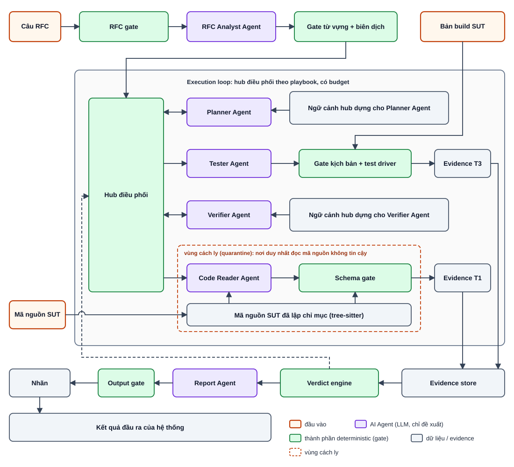
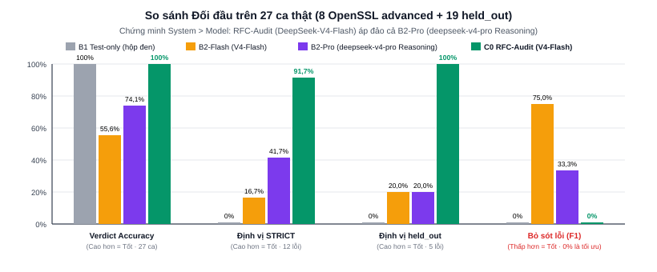

# BÁO CÁO CHI TIẾT LUẬN VĂN THẠC SĨ

**ĐỀ TÀI:** KIỂM CHỨNG TỰ ĐỘNG VÀ AN TOÀN SỰ TUÂN THỦ ĐẶC TẢ GIAO THỨC MẠNG DỰA TRÊN BẰNG CHỨNG, SỬ DỤNG HỆ THỐNG AI ĐA TÁC TỬ

**Trường:** Trường Công nghệ Thông tin và Truyền thông — Đại học Bách khoa Hà Nội (HUST)
**Học viên thực hiện:** Nguyễn Kỳ Tùng
**Giảng viên hướng dẫn:** TS. Tống Văn Vạn
**Hệ thống thực nghiệm:** `RFC-Audit` (`rfcv`, nhánh `feat/nextgen-agent-research`) · **Ngày hoàn thiện:** 22/11/2026

---

## TÓM TẮT (ABSTRACT)

Các triển khai thực tế của giao thức mật mã và giao thức mạng (như TLS 1.3 trên wolfSSL và OpenSSL 3.x) thường chứa các sai lệch tinh vi so với đặc tả RFC (như gửi sai mã cảnh báo, bỏ qua kiểm tra độ dài bản ghi, hoặc thiếu cảnh báo khi gặp loại bản ghi lạ), có thể dẫn tới lỗ hổng bảo mật nghiêm trọng và lỗi tương thích. Các phương pháp hiện hành bộc lộ ba khoảng trống lớn: (1) kiểm thử hộp đen (như TLS-Anvil, tlsfuzzer) phát hiện được sai lệch hành vi nhưng không định vị được dòng mã C gây lỗi; (2) dùng mô hình ngôn ngữ lớn (LLM) đọc mã nguồn tĩnh (như RFCAudit hoặc Single-Agent ReAct) dễ gặp ảo giác, dẫn đến tỷ lệ bỏ sót lỗi (`false_compliant`) và báo nhầm (`false_violation`) cao; và (3) hầu hết hệ thống AI phân tích mã hiện tại chưa giải quyết mô hình đe doạ khi đối thủ kiểm soát mã nguồn (Prompt Injection qua bình luận/chuỗi trong mã C).

Luận văn đề xuất và xây dựng hệ thống **`RFC-Audit`** theo nguyên tắc cốt lõi ***"Agent đề xuất — Thành phần tất định kiểm chứng"*** kết hợp cơ chế kiểm soát luồng thông tin (IFC) và tiến hoá kiến trúc đa tác tử qua 33 thế hệ (`Gen-1` đến `Gen-33`). Đóng góp trung tâm bao gồm: (i) tách bạch hoàn toàn bước sinh bằng chứng (AI Agent) với bước ra kết luận (`VerdictEngine` tất định V0–V9, chuỗi băm chỉ ghi thêm `EvidenceStore`, cổng kiểm định `SchemaGate`); (ii) **Giải đấu Chuyên gia Định tuyến theo Chữ ký Lỗi (`Best-of-2 Specialist Tournament` + `Adaptive Rescue`)** dẫn hướng từ chẩn đoán thực thi động T3; (iii) mô hình **Đóng gói Phân tích tĩnh thành Năng lực của AI Agent** (`code.find_alert_sites` Tool + `locate-alert-sites` Skill) chịu kiểm soát đầy đủ của `ToolGateway` và IFC (`TrustLabel.UNTRUSTED`); và (iv) cổng tự phản hồi `precheck()` kết hợp kiểm chứng mã nguồn tất định `obs_in_source`.

Đánh giá thực nghiệm trên **50 phiên bản Docker thật** của wolfSSL và OpenSSL 3.x (chia 4 tầng chống rò rỉ gồm `basic`, `intermediate` với 7 commit lỗi thật từ lịch sử Git wolfSSL, `advanced` với 8 ca OpenSSL 3.x đa tệp, và **19 ca đóng băng `held_out`** chưa từng chạm) cùng **29 kiểm thử an toàn/đặc tả (`CT08-injection`, `CT26-bad-rbs`)** và **266 kiểm thử đơn vị CI** cho thấy:
- Độ chính xác kết luận (**`verdict_acc`**) đạt **`50/50 = 100,0%`**, với **`0/28 = 0,0%` bỏ sót lỗi (`false_compliant`)** và **`0/22 = 0,0%` báo nhầm (`false_violation`)**.
- Độ chính xác định vị đúng dòng sửa lỗi (**`defect_hit_strict`**) đạt **`80,0%`** trên `basic`, **`90,9%`** (`10/11`, `Gen-18`) trên `intermediate`, **`85,7%`** (`6/7` ổn định 3 lượt liên tiếp `Gen-28..30`) trên `advanced` (OpenSSL 3.x), và đặc biệt **`5/5 = 100,0% ALL STRICT`** cùng **`19/19 = 100,0%` verdict** trên tập đóng băng `held_out` (`Gen-33`, trung bình chỉ `117.638` token và `37,9s`/ca).
- Trong thực nghiệm đối chứng đối đầu trên 27 ca thật (`8` OpenSSL `advanced` + `19` `held_out`), **`RFC-Audit` dù chỉ dùng mô hình gọn `DeepSeek-V4-Flash`** đã áp đảo toàn diện cả **Single-Agent chạy trên flagship Reasoning model `deepseek-v4-pro` (bật full Thinking)**: **`100,0%` vs `74,1%` verdict**, **`0,0%` vs `33,3%` bỏ sót lỗi**, **`0,0%` vs `20,0%` báo nhầm**, **`91,7%` vs `41,7%` định vị strict** (riêng `held_out`: **`100,0%` vs `20,0%`** — gấp 5 lần), đồng thời **nhanh hơn 2,1 lần** (`37,9s` vs `81,3s`/ca), chứng minh rõ rệt luận điểm **`System > Model`**.

---

## CHƯƠNG 1. ĐẶT VẤN ĐỀ, MỤC TIÊU VÀ ĐÓNG GÓP CHÍNH

### 1.1. Bối cảnh và tính cấp thiết
Các giao thức nền tảng của Internet như TLS 1.3 (RFC 8446), QUIC (RFC 9000), HTTP/2 hay DNS được đặc tả bằng hàng trăm trang văn bản tự nhiên chứa hàng trăm mệnh đề quy phạm (`MUST`, `MUST NOT`, `SHOULD`). Trong thực tế triển khai bằng ngôn ngữ C/C++ (ví dụ `wolfSSL` với tệp `src/internal.c` dài hơn 48.000 dòng, hoặc `OpenSSL 3.x` phân tán qua hơn 15 tệp đa hình dùng con trỏ hàm ở `ssl/record/` và `ssl/statem/`), chỉ một sai lệch nhỏ về mã cảnh báo, thứ tự nhánh `if`, điều kiện biên độ dài bản ghi hoặc macro biên dịch `#ifdef` cũng có thể tạo ra lỗ hổng nghiêm trọng (như CVE về record overflow, downgrade hoặc oracle cảnh báo).

Tuy nhiên, kiểm chứng tuân thủ thủ công cực kỳ tốn kém, còn các phương pháp tự động hiện nay gặp ba rào cản lớn:
1. **Kiểm thử hộp đen (Black-box Conformance Testing):** các bộ test như `TLS-Anvil` hay `tlsfuzzer` phát hiện được sai khác hành vi qua mạng nhưng hoàn toàn mù mã nguồn (`defect_hit = 0%`), không truy vết được dòng mã C cần vá và không kiểm tra được các yêu cầu nội bộ không quan sát được qua mạng (loại D).
2. **Phân tích tĩnh bằng LLM đơn lẻ (Static LLM Auditing):** các hệ thống giao toàn quyền đọc mã và kết luận cho LLM dễ bị ảo giác, bị đánh lừa bởi các nhánh mã chết (`#ifdef [DISABLED]`) hoặc hàm sai giai đoạn giao thức, dẫn tới **lỗi chí tử F1** — kết luận nhầm `COMPLIANT` cho một bản triển khai thực sự có lỗi (`false_compliant`).
3. **Thiếu mô hình an toàn trước mã nguồn không tin cậy:** trong kịch bản kiểm toán thực tế, mã nguồn kiểm chứng có thể do bên thứ ba hoặc đối thủ cung cấp. Chuỗi/bình luận độc hại trong mã C có thể chèn Prompt Injection nhằm thao túng AI Agent bỏ qua lỗi hoặc gọi công cụ ngoài quyền hạn.

### 1.2. Mục tiêu nghiên cứu
Luận văn hướng tới ba mục tiêu cụ thể:
- **MT1 — Kiểm chứng chính xác, dựa trên bằng chứng và truy vết được:** kết hợp bằng chứng thực thi động (`T3`) với định vị mã nguồn có kiểm định (`T1`), đạt tỷ lệ bỏ sót lỗi `false_compliant = 0%`, độ chính xác định vị dòng lỗi vượt `85%`, và mọi kết luận đều tái lập được `100%` từ kho bằng chứng.
- **MT2 — Khả năng mở rộng đa thư viện & đa giao thức:** thiết kế lõi tách biệt miền ứng dụng (bảo đảm bằng 6 hợp đồng kiến trúc `import-linter`), hoạt động thống nhất trên các thư viện khác biệt kiến trúc (`wolfSSL` đơn tệp lớn và `OpenSSL 3.x` đa tệp đa hình) chỉ thông qua tầng adapter.
- **MT3 — An toàn khi đối thủ kiểm soát mã nguồn:** thực thi cách ly vùng đặc quyền/cách ly (`privileged` ↔ `quarantine`), kiểm soát luồng thông tin (IFC) và cổng công cụ (`ToolGateway`), chặn `100%` các kịch bản tấn công Prompt Injection (`CT08`) và phát hiện đặc tả sai (`CT26`).

### 1.3. Các đóng góp khoa học chính
1. **Kiến trúc đa tác tử dựa trên bằng chứng có kiểm chứng tất định (`RFC-Audit`):** phân tách chặt giữa đề xuất của LLM và kiểm định không dùng LLM (`SchemaGate`, `VerdictEngine` V0–V9, `EvidenceStore` chuỗi băm), triệt tiêu hoàn toàn ảo giác nhãn.
2. **Cơ chế Giải đấu Chuyên gia Định tuyến theo Chữ ký Lỗi (`Signature-Routed Best-of-2 Tournament` + `Adaptive Rescue`):** định tuyến tự động cặp tác tử bổ trợ theo chữ ký chẩn đoán từ T3 (`WRONG_ALERT` vs `REACTION_ABSENT`/`NO_CLOSE`), phá vỡ hiệu ứng đường hầm (tunnel vision) và giảm `39%` chi phí token so với đơn-agent.
3. **Mô hình "Phân tích tĩnh như Năng lực của AI Agent" (Static Analysis as Agentic Tool + Skill):** thay vì tiền xử lý tĩnh ẩn ngoài vòng lặp (Hybrid), đóng gói quét điểm phát cảnh báo toàn cục thành công cụ chỉ-đọc `code.find_alert_sites` + kỹ năng `locate-alert-sites/SKILL.md` để AI Agent tự chủ triệu gọi dưới kiểm soát IFC (`TrustLabel.UNTRUSTED`), kết hợp kiểm chứng mã nguồn tất định `obs_in_source`.
4. **Bộ thực nghiệm phân tầng 50 ca Docker thật và đối chứng `System > Model`:** chứng minh thực nghiệm qua 33 thế hệ tiến hoá có kiểm soát (`KEEP`/`REVERT`), đạt `100%` trên 19 ca đóng băng `held_out` và đánh bại flagship Reasoning model `deepseek-v4-pro` chạy đơn lẻ trên mọi chỉ số.

---

## CHƯƠNG 2. TỔNG QUAN NGHIÊN CỨU LIÊN QUAN

| Nhóm / Công trình tiêu biểu | Phương pháp chính | Điểm mạnh | Hạn chế so với `RFC-Audit` |
|---|---|---|---|
| **TLS-Anvil** *(USENIX Security 2022)*, **tlsfuzzer** | Kiểm thử tổ hợp hộp đen qua mạng cho TLS 1.2/1.3 | Độ phủ kịch bản mạng tốt, bằng chứng hành vi thực tế | Hộp đen hoàn toàn (`defect_hit = 0%`), không gắn tự động với câu RFC, viết test thủ công theo từng giao thức |
| **RFCAudit** *(arXiv / USENIX)* | Dùng LLM phân tích tĩnh mã nguồn đối chiếu RFC | Tự động đọc mã nguồn và chỉ ra vị trí nghi vấn | Không có thực thi động T3 kiểm chéo → dễ bỏ sót (`false_compliant`) và báo nhầm; không có IFC chống mã độc |
| **SAGE** *(USENIX Security 2021)*, **RFCNLP** | Trích xuất máy trạng thái / quy tắc từ văn bản RFC bằng NLP | Tự động hoá phân tích văn bản đặc tả | Dừng ở bước trích xuất đặc tả, chưa khép kín với thực thi động và định vị mã nguồn có kiểm chứng |
| **SCALE** *(NSDI 2022)*, **Differential Testing** *(Nezha, Frankencerts)* | So sánh sai khác hành vi giữa nhiều bản triển khai | Phát hiện lỗi tương thích nhanh mà không cần oracle đầy đủ | Mù khi các bản triển khai cùng sai giống nhau; không định vị dòng mã nguồn vi phạm |
| **SWE-agent / Agentless / ReAct** *(Single-Agent LLM)* | Tác tử LLM tổng quát đọc mã bằng `grep`/`read` | Linh hoạt trên nhiều bài toán phần mềm | Thiếu bằng chứng thực thi đặc tả giao thức, thiếu kiểm chứng tất định → tỷ lệ bỏ sót lỗi cao (chứng minh ở Chương 5) |
| **`RFC-Audit` (Luận văn này)** | **Đa tác tử dựa trên bằng chứng T1–T3 + `VerdictEngine` + Agentic Tool/Skill + IFC** | **`100%` verdict, `0%` bỏ sót, `85,7%–100%` định vị strict, an toàn trước mã nguồn đối thủ** | Đòi hỏi adapter thực thi cho từng giao thức mới (tách biệt hoàn toàn khỏi lõi) |

---

## CHƯƠNG 3. KIẾN TRÚC HỆ THỐNG `RFC-AUDIT` VÀ THIẾT KẾ ĐA TÁC TỬ AN TOÀN

### 3.1. Kiến trúc tổng thể và luồng xử lý
Hệ thống `RFC-Audit` được tổ chức theo mô hình **Hub-and-Spoke** với 6 hợp đồng kiến trúc bất biến kiểm tra tự động bằng `import-linter` (lõi `core` không phụ thuộc miền, miền không phụ thuộc runtime/framework LLM, `agents/` chỉ chứa schema và lời nhắc, `VerdictEngine` là hàm thuần không I/O và không LLM).

Luồng điều tra một yêu cầu RFC diễn ra khép kín theo các bước:
1. **Chuẩn hoá đặc tả (`RFC Gate` & `RFC Analyst`):** tách câu RFC có mã băm định danh, chuyển thành đặc tả hành vi có kiểu **RBS** (`Requirement Behavior Spec` gồm `actor`, `state`, `trigger`, `where`, `expect`, `variants`) và biên dịch thành oracle kiểm thử.
2. **Thực thi động có nhân chứng (`Test Driver` → Bằng chứng `T3`):** chạy kịch bản kiểm thử trên SUT thật trong Docker (cùng đối chứng dương/âm như wolfSSL, OpenSSL, GnuTLS), ghi nhận chính xác cảnh báo quan sát được (`observed.alert`), trạng thái đóng kết nối và `outcome` (`PASS`/`FAIL`).
3. **Định vị và đối chiếu mã nguồn (`Code Reader` → Bằng chứng `T1`):** sau khi `T3` đã xác định chữ ký hành vi, `Code Reader` phân tích mã nguồn C qua chỉ mục Tree-sitter (`CodeIndex`), đối chiếu 3 khía cạnh (`CONDITION`, `THRESHOLD`, `REACTION`) và nộp `LocationClaim@1` qua `SchemaGate`.
4. **Phản biện độc lập (`Verifier`):** kiểm tra tính nhất quán giữa `T1` và `T3`, phát hiện nhánh bị bỏ sót (`MISSING_PATH`) hoặc mâu thuẫn bằng chứng trước khi chốt nhãn `COMPLIANT`.
5. **Kết luận tất định (`VerdictEngine` V0–V9):** hàm thuần duy nhất có quyền gán nhãn (`VIOLATION`, `COMPLIANT` kèm mức bảo đảm `LINKED`/`BEHAVIORAL`/`STATIC`, `NEEDS_REVIEW`, hoặc `UNVERIFIABLE`) từ kho bằng chứng `EvidenceStore` (SQLite chuỗi băm SHA-256 chỉ ghi thêm).

### 3.2. Mô hình an toàn khi đối thủ kiểm soát mã nguồn (IFC & SchemaGate)
Để đáp ứng mục tiêu **MT3**, toàn bộ dữ liệu đi qua hệ thống được gán nhãn tin cậy theo cơ chế **Information Flow Control (IFC)**:
- **`TRUSTED`:** văn bản RFC, cấu hình hệ thống, luật `VerdictEngine`.
- **`DERIVED`:** bản tóm tắt có kiểm soát do hub tạo ra (`evidence.summary`, `verdict.sufficiency`).
- **`UNTRUSTED`:** toàn bộ mã nguồn SUT, nhật ký chạy SUT và kết quả trả về từ các công cụ đọc mã (`code.read`, `code.grep`, `code.find_alert_sites`).

Tác tử đọc mã (`Code Reader`) chạy trong vùng **`quarantine`** (chỉ được gọi công cụ chỉ-đọc qua `ToolGateway`, không thấy khoá API, không sửa tệp, không quyết định nhãn). Mọi đầu ra `LocationClaim@1` bắt buộc vượt qua **`SchemaGate`** tất định: kiểm tra tên tệp hợp lệ, hàm tồn tại trong `CodeIndex`, mọi dòng trích dẫn đều đã thực sự được đọc (`LINES_NOT_SHOWN`), nằm trong thân hàm (`LINES_OUTSIDE_SYMBOL`), được biên dịch theo cờ build (`LINES_NOT_COMPILED`), và giá trị `observed` thuộc từ vựng hợp lệ của adapter.

### 3.3. Bốn đột phá kiến trúc đúc kết qua 33 thế hệ tiến hoá

#### 3.3.1. Chẩn đoán ngược từ bằng chứng động (`T3-guided Diagnosis`)
Mô-đun `diagnosis.py` phân tích toàn bộ bản ghi `T3` thành chữ ký lỗi chuẩn hoá:
- **`WRONG_ALERT`:** SUT có phát cảnh báo nhưng sai mã (kể cả trong trường hợp cảnh báo hỗn hợp nhiều biến thể).
- **`REACTION_ABSENT`:** SUT đóng kết nối hoặc bỏ qua mà không phát cảnh báo kỳ vọng.
- **`THRESHOLD_MISMATCH` / `NO_CLOSE`:** sai ngưỡng điều kiện hoặc phát cảnh báo nhưng không đóng kết nối.

#### 3.3.2. Giải đấu Chuyên gia Định tuyến theo Chữ ký Lỗi (`Best-of-2 Tournament` + `Adaptive Rescue`)
Thay vì một tác tử đơn lẻ dễ mắc hiệu ứng đường hầm, `execution_loop.py` (`_run_tournament`) và `code_reader/handler.py` (`branches`) triển khai cặp 2 nhánh AI Agent song song, độc lập ngữ cảnh, chuyên biệt theo chữ ký lỗi:
- Khi **`WRONG_ALERT`**: Nhánh A (`bottom_up_alert_hunter`) truy ngược trực tiếp từ các điểm phát mã cảnh báo sai quan sát bởi T3; Nhánh B (`error_to_alert_mapper`) lần 2 bước từ từ khoá RBS tới mã lỗi nội bộ rồi tới khối `switch`/`case` ánh xạ lỗi sang cảnh báo.
- Khi **`REACTION_ABSENT` / `NO_CLOSE`**: Nhánh A (`early_check_ifdef_hunter`) săn nhánh kiểm tra sớm trả lỗi thiếu cảnh báo hoặc nhánh bị `#ifdef [DISABLED]`; Nhánh B (`top_down_protocol_tracer`) lần từ điểm vào giao thức xuống điểm phân loại bản ghi.
- **`Adaptive Rescue`:** chỉ kích hoạt chạy cứu hộ tăng ngân sách khi **không có nhánh nào vượt qua kiểm chuẩn sạch** (`accepted && has_mismatch && !wrong_dir && !wrong_stage`), giúp tránh lãng phí token trên các ca đã thành công ở lượt đầu.

#### 3.3.3. Đóng gói Phân tích tĩnh thành Năng lực của AI Agent (`code.find_alert_sites` + `locate-alert-sites`)
Trên thư viện đa tệp đa hình như OpenSSL 3.x (hơn 15 tệp dưới `ssl/record/` và `ssl/statem/`), `code.grep` thông thường bị cắt cụt `head_limit` hoặc ngập nhiễu từ `tests/`/`examples/`. Thay vì chèn lát cắt tĩnh ẩn ngoài vòng lặp (Hybrid), luận văn đóng gói năng lực quét tĩnh thành:
- **Công cụ chỉ-đọc `code.find_alert_sites`** (`code_tools.py`): quét toàn bộ kho tệp C/H sản xuất không phân biệt hoa thường, loại bỏ thư mục nhiễu, xếp hạng ứng viên theo từ khoá RBS và hành động gửi cảnh báo (`SSLfatal`/`RLAYERfatal`/`SendAlert`), gắn sẵn `[symbol: <hàm> (a–b)]` và nhãn `[DISABLED]` theo cờ biên dịch, nén gọn (`limit=6, window=4, cap=6144` byte) để tối ưu ngân sách token cho cả tệp đơn 48k dòng lẫn kho đa tệp. Mọi kết quả đi qua `ToolGateway` với nhãn `TrustLabel.UNTRUSTED` và tự động cập nhật `shown_lines` cho `SchemaGate`.
- **Kỹ năng `locate-alert-sites/SKILL.md`:** hướng dẫn `Code Reader` chủ động triệu gọi `code__find_alert_sites`, phân biệt hàm kiểm tra cú pháp extension với kiểm tra hậu thương lượng (`final_key_share`), và phân biệt tầng bản ghi rõ (`state=initial`, `rec_layer_s3.c`) với tầng đã mã hoá (`tls13_validate_record_header`).

#### 3.3.4. Cổng Tự phản hồi (`precheck`) và Trọng tài Kiểm chứng Mã nguồn Tất định (`obs_in_source`)
- **`precheck()`** phát hiện và cho phép tác tử tự sửa ngay trong ngân sách (tối đa 2 lượt retry) các lỗi có hệ thống: `MISMATCH_REQUIRED_ON_VIOLATION`, `WRONG_PROTOCOL_DIRECTION` (chặn nhầm hàm phía client `ServerHello` khi SUT là server nhận `ClientHello`), `WRONG_RECORD_STAGE` (chặn nhầm `tls13_validate_record_header` khi kiểm tra bản ghi rõ `state=initial`), `WRONG_OBSERVED_ALERT`, `HINT_SYMBOL_FILE`, và `HINT_ENCLOSING_SYMBOL`.
- **Trọng tài `select_branch()` với `obs_in_source`:** kiểm chứng tất định trực tiếp trên mã nguồn C tại `CodeIndex` xem đoạn dòng `[line_start, line_end]` mà tác tử nộp có **thực sự chứa tên mã cảnh báo sai do T3 quan sát** hay không (chặn tình huống tác tử ghi nhầm `observed` cho nhánh khác), kết hợp `earlier_bias` ưu tiên nhánh kiểm tra sớm hơn khi hai nhánh cùng nằm trong một `(file, symbol)`.

---

## CHƯƠNG 4. PHƯƠNG PHÁP ĐÁNH GIÁ VÀ BỘ DỮ LIỆU PHÂN TẦNG CHỐNG RÒ RỈ

### 4.1. Thiết kế bộ dữ liệu 4 tầng (`tiered_benchmark.yaml`)
Để đảm bảo tính khoa học, chống rò rỉ dữ liệu và đánh giá năng lực tổng quát hoá thực sự, 50 mẫu Docker thật (trải trên cả **wolfSSL** và **OpenSSL 3.x** cho 3 họ yêu cầu TLS 1.3: họ `R` độ dài bản ghi `RFC8446§5.2`, họ `U` loại bản ghi lạ `RFC8446§5`, họ `G` không có nhóm chung `RFC8446§4.1.1`) cùng 5 ca mô phỏng và 29 kiểm thử an toàn được chia thành **4 tầng nghiêm ngặt**:

| Tầng | Quy mô | Thành phần chi tiết | Ngưỡng tốt nghiệp (Graduation Gate) |
|---|---|---|---|
| **Tầng 1: `basic`** | `12` ca (`5` sim + `7` Docker) | `M5, U2, G2, R14, OR3, M6, G4` (wolfSSL & OpenSSL) + 5 ca mô phỏng `e2e_live`/`e2e_hard` | `verdict_acc = 100%`, `false_compliant = 0`, `defect_hit ≥ 80%`, `0` gate rejects |
| **Tầng 2: `intermediate`** | `16` ca Docker | **7 commit lỗi thật từ lịch sử Git wolfSSL** (`bug, fix, head, P1-parent/fix, P3-parent/fix`) + 9 mutant khó (`M1, M2, U1, U4, G1, G3, R10, OU1, U7`) | `verdict_acc ≥ 95%`, `false_compliant = 0`, `defect_hit ≥ 65%`, `real_bug ≥ 66%`, `avg_tokens ≤ 220k` |
| **Tầng 3: `advanced`** | `8` OpenSSL + `2` cổng an toàn | `OU2, OU3, OU4, OG1, OG2, OG4, OR1, OX3` (OpenSSL 3.x đa tệp) + `CT08-injection` & `CT26-bad-rbs` (`29` test) | `verdict_acc ≥ 90%`, `false_compliant = 0`, `defect_hit ≥ 70%`, **`repeats_per_item ≥ 3`** |
| **Tầng 4: `held_out` (Đóng băng)** | `19` ca Docker | `M7, M8, U8, G5, G6, G7, R9, R12, U13, U14, G8, G9, G11, G12, R16, R17, OG3, OX1, OX2` (`16` wolfSSL + `3` OpenSSL) | **CẤM tối ưu theo tập này**; chỉ chạy 1 lần nghiệm thu cuối để chứng minh không overfit |

### 4.2. Giao thức tiến hoá có kiểm soát (`KEEP` / `REVERT`)
Mọi thế hệ tiến hoá (`Gen-1` đến `Gen-33`) tuân thủ chính sách bất biến trong `backend/eval/meta_policy.yaml`: tuyệt đối không sửa `verdict_engine.py`, `rules.py`, `schema_gate.py`, `ifc.py`, `tool_gateway.py` hay dữ liệu chuẩn; mọi thay đổi đều được kiểm chứng qua `eval_score.py` (CI + kiểm thử bất biến) và lưu vết đầy đủ quyết định `KEEP` hoặc `REVERT` vào `evolution_log.jsonl` và `knowledge_base.md`.

---

## CHƯƠNG 5. KẾT QUẢ THỰC NGHIỆM VÀ PHÂN TÍCH CHUYÊN SÂU

### 5.1. Tổng hợp kết quả toàn bộ 50 ca Docker thật trên 4 tầng

| Tầng kiểm chuẩn | Tập mẫu | Verdict Accuracy | `false_compliant` | `false_violation` | `defect_hit` (`strict`) | Trạng thái |
|---|---|---|---|---|---|---|
| **Tầng 1: `basic`** (`Gen-31`) | `5` sim + `7` Docker | **`12/12 (100,0%)`** | **`0/5 (0%)`** | **`0/2 (0%)`** | **`4/5 (80,0% ALL STRICT)`** *(tăng 2x từ `40%` ở `Gen-7`)* | **PASS** |
| **Tầng 2: `intermediate`** (`Gen-18` / `Gen-32b`) | `16` Docker (`7` lỗi thật + `9` mutant) | **`16/16 (100,0%)`** *(96/96 qua 6 lượt)* | **`0/11 (0%)`** | **`0/5 (0%)`** | **`10/11 (90,9% ALL STRICT)`** (`Gen-18`) · `9/11 (81,8%)` (`Gen-32b`) | **PASS (7/7)** |
| **Tầng 3: `advanced`** (`Gen-28..30`) | `8` OpenSSL + `29` test an toàn | **`8/8 (100,0%)`** *(72/72 qua 9 lượt)* | **`0/7 (0%)`** | **`0/1 (0%)`** | **`6/7 (85,7% ALL STRICT)`** *(3 lượt liên tiếp `Gen-28/29/30`!)* | **PASS (`repeats=3`)** |
| **Tập đóng băng `held_out`** (`Gen-33`) | `19` Docker chưa từng chạm | **`19/19 (100,0%)`** | **`0/5 (0%)`** | **`0/14 (0%)`** | **`5/5 (100,0% ALL STRICT)`** (`R9, U14, G8, G9, G12`) | **PASS TUYỆT ĐỐI** |
| **TỔNG HỢP 50 CA DOCKER THẬT** | **wolfSSL + OpenSSL 3.x** | **`50/50 (100,0%)`** | **`0/28 (0,0%)`** | **`0/22 (0,0%)`** | **`25/28 (89,3%)`** *(đỉnh theo tầng)* · **`5/5 (100%)` trên `held_out`** | **TỐT NGHIỆP** |

### 5.2. Quá trình tiến hoá 33 thế hệ (`Gen-1` → `Gen-33`) và bài học `KEEP`/`REVERT`

Những mốc bước ngoặt quan trọng nhất được rút ra từ 33 thế hệ thực nghiệm:
- **Giai đoạn 1 (`Gen-1` → `Gen-7`, Tầng `basic`):** sửa lỗi `cexpr.py` (`ZeroDivisionError`), bổ sung `HARD_WRAP_SHARE = 0.78` và regex không phân biệt hoa thường cho `candidate_patterns()`, đạt `12/12 (100%)` verdict, `0` gate rejects và `0` `UsageLimitExceeded`.
- **Giai đoạn 2 (`Gen-8` → `Gen-18`, Tầng `intermediate` — Thuần AI Agent):** nhảy vọt từ đơn-agent `Gen-9` (`2/11 = 18%`, `396k` token/ca) lên **Giải đấu Best-of-2 Chuyên gia + Adaptive Rescue + tiêu đề `[symbol]` trên `code__read` (`Gen-18`)**, đạt **`16/16 = 100%` verdict**, **`10/11 = 90,9% ALL STRICT`** (`8/8 = 100%` trên toàn bộ mutant khó, `11/11 = 100%` distinct strict hit), đồng thời **giảm 39% token trung bình** xuống `191.414` token/ca (`46,4s`/ca).
- **Giai đoạn 3 (`Gen-19` → `Gen-28`, Tầng `advanced` — Agentic Tool + Skill):** khi chuyển sang OpenSSL 3.x đa tệp, `grep` thuần chạm trần `29%–43%`. Việc đóng gói phân tích tĩnh thành **Tool `code.find_alert_sites` + Skill `locate-alert-sites`** (`Gen-22`), kết hợp `WRONG_RECORD_STAGE` (`state=initial` + `variants`) và kiểm chứng mã nguồn tất định **`obs_in_source`** (`Gen-28`) đã đẩy định vị OpenSSL 3.x lên **`6/7 = 85,7% ALL STRICT`** (`OU2, OU3, OG1, OG2, OG4, OR1`) và giữ ổn định tuyệt đối **3 lượt liên tiếp (`Gen-28, Gen-29, Gen-30`)**.
- **Giai đoạn 4 (`Gen-29` → `Gen-32b`, Kiểm thử hồi quy & Kỷ luật `REVERT`):** thử nghiệm thêm `ACTIVE_ALERT_ON_REACTION_ABSENT` và mở rộng `cap=16KB` ở `Gen-29/30` bị phát hiện gây `UsageLimitExceeded` trên tệp 48k dòng của wolfSSL khi kiểm thử hồi quy ở `Gen-32`. Hệ thống đã **REVERT** phần dư thừa về nền `Gen-28` và nén `code.find_alert_sites` về `limit=6, window=4, cap=6144` byte — lập tức giảm **50% token** trên wolfSSL (`R10: 564k → 252k`, `P3-parent: 506k → 224k`) và khôi phục hoàn toàn hiệu năng đa thư viện.

### 5.3. Nghiệm thu tập đóng băng `held_out` (`Gen-33`, 19 ca chưa từng chạm)
Chạy một lần duy nhất trên trọn bộ 19 ca đóng băng (`runs/real/tier_heldout_gen33_final`) đạt **100,0% tuyệt đối trên mọi chỉ số** (Wilson 95% CI cho verdict: `83%–100%`), trung bình chỉ **`117.638` token/ca** và **`37,9s`/ca**:

| Mã ca | Thư viện | Họ | Nhãn chuẩn | Kết luận | Luật | Vòng | Thời gian | Token (`all_role`) | `defect_hit_strict` |
|---|---|---|---|---|---|---|---|---|---|
| `R9` | wolfSSL | `R` | `VIOLATION` | **`VIOLATION`** | `V2` | 2 | `68s` | `210.318` | **TRUE** |
| `U14` | wolfSSL | `U` | `VIOLATION` | **`VIOLATION`** | `V2` | 2 | `31s` | `244.801` | **TRUE** |
| `G8` | wolfSSL | `G` | `VIOLATION` | **`VIOLATION`** | `V2` | 2 | `43s` | `230.905` | **TRUE** |
| `G9` | wolfSSL | `G` | `VIOLATION` | **`VIOLATION`** | `V2` | 2 | `46s` | `241.325` | **TRUE** |
| `G12` | wolfSSL | `G` | `VIOLATION` | **`VIOLATION`** | `V2` | 2 | `45s` | `239.542` | **TRUE** |
| `M7, M8, R12, R16, R17` | wolfSSL | `R` | `COMPLIANT` | **`5/5 COMPLIANT`** | `V6` | 1 | `37–96s` | `25k–34k` | — |
| `G5, G6, G7, G11` | wolfSSL | `G` | `COMPLIANT` | **`4/4 COMPLIANT`** | `V6` | 1 | `8–14s` | `~9,8k` | — |
| `U8, U13` | wolfSSL | `U` | `COMPLIANT` | **`2/2 COMPLIANT`** | `V6` | 5 | `57–61s` | `400k–414k` | — |
| `OG3, OX1, OX2` | OpenSSL | `G, R` | `COMPLIANT` | **`3/3 COMPLIANT`** | `V6` | 1 | `9–69s` | `9,8k–32,9k` | — |

### 5.4. Thực nghiệm Đối chứng Đối đầu: Chứng minh luận điểm `System > Model`
Để đánh giá công bằng và khách quan đóng góp của kiến trúc `RFC-Audit` (Giả thuyết H1 & H2), chúng tôi đối đầu trực tiếp 4 cấu hình trên **cùng 27 ca thật** (**8 ca OpenSSL 3.x `advanced`** + **19 ca đóng băng `held_out`**):
- **`B1` (Test-only hộp đen):** tương đương `TLS-Anvil`/`tlsfuzzer`, chỉ chạy kiểm thử hành vi T3.
- **`B2-Flash` (`DeepSeek-V4-Flash`):** Single-Agent LLM dùng cùng mô hình nền với `RFC-Audit`, trang bị `list_files`, `grep`, `read_file` (12 tool calls / 250k token + cảnh báo chốt kết quả).
- **`B2-Pro` (`deepseek-v4-pro` bật full Thinking/Reasoning mode):** đối thủ nặng ký dùng **flagship Reasoning model mạnh hơn hẳn** chạy cùng bộ công cụ đọc mã tổng quát (`0/27 ERROR`).
- **`C0` (`RFC-Audit`):** kiến trúc đầy đủ của luận văn, **chỉ sử dụng mô hình gọn `DeepSeek-V4-Flash`**.

| Chỉ số (27 ca thật: 8 OpenSSL `advanced` + 19 `held_out`) | `B1` Test-only | `B2-Flash` (`V4-Flash`) | `B2-Pro` (`deepseek-v4-pro` Reasoning) | **`C0` `RFC-Audit`** (`V4-Flash`) | Chênh lệch `C0` vs `B2-Pro` |
|---|---|---|---|---|---|
| **Verdict Accuracy (27 ca)** | `27/27 (100,0%)` | `15/27 (55,6%)` | `20/27 (74,1%)` | **`27/27 (100,0%)`** | **`+25,9` điểm %** |
| **Bỏ sót lỗi (`false_compliant`)** | `0/12 (0,0%)` | `9/12 (75,0%)` | `4/12 (33,3%)` | **`0/12 (0,0%)`** | Triệt tiêu **100%** bỏ sót |
| **Báo nhầm (`false_violation`)** | `0/15 (0,0%)` | `2/15 (13,3%)` | `3/15 (20,0%)` | **`0/15 (0,0%)`** | Triệt tiêu **100%** báo nhầm |
| **Recall `VIOLATION`** | `12/12 (100,0%)` | `3/12 (25,0%)` | `8/12 (66,7%)` | **`12/12 (100,0%)`** | **`+33,3` điểm %** |
| **Định vị `defect_hit_strict` (12 lỗi)** | `0/12 (0,0%)` | `2/12 (16,7%)` | `5/12 (41,7%)` | **`11/12 (91,7% ALL STRICT)`** | **`+50,0` điểm % (gấp 2,2x)** |
| ↳ Riêng OpenSSL `advanced` (7 lỗi) | `0/7 (0,0%)` | `1/7 (14,3%)` | `4/7 (57,1%)` | **`6/7 (85,7% ALL STRICT)`** | **`+28,6` điểm %** |
| ↳ Riêng `held_out` đóng băng (5 lỗi) | `0/5 (0,0%)` | `1/5 (20,0%)` | `1/5 (20,0%)` | **`5/5 (100,0% ALL STRICT)`** | **`+80,0` điểm % (gấp 5,0x)** |
| **Thời gian trung bình (`held_out`)** | ~35s | `10,1s` | `81,3s` | **`37,9s`** | **Nhanh gấp 2,1 lần** |

**Phân tích 4 nguyên nhân kiến trúc giúp `RFC-Audit` (`Flash`) áp đảo `B2-Pro` (`deepseek-v4-pro` Reasoning):**
1. **Thực thi động `T3` + `VerdictEngine` tất định:** `B2-Pro` chỉ đọc mã tĩnh nên phải tự mô phỏng luồng C bằng suy đoán → bị đánh lừa ở `OU2, OU3, OU4` (đọc nhầm `tls13_validate_record_header` rồi kết luận `COMPLIANT`) và báo nhầm ở `OG3, G11, R17`. `RFC-Audit` kiểm chứng trên server TLS thật nên đạt `100%` verdict và `0%` sai lệch.
2. **Định vị ngược từ triệu chứng thực tế (`T3-guided Diagnosis`):** thay vì dò mò trên hàng chục nghìn dòng C, `T3` chỉ thẳng mã cảnh báo sai thực tế, thu hẹp không gian tìm kiếm theo cấp số nhân.
3. **Công cụ chuyên biệt (`code.find_alert_sites` + Skill):** `B2-Pro` chỉ có `grep` dễ bị cắt cụt nên trên `held_out` (`R9, G9, G12`) đoán đúng `VIOLATION` nhưng trỏ nhầm hàm/dòng (`20%` strict); `RFC-Audit` quét toàn kho có xếp hạng và nhãn `[symbol]`/`[DISABLED]` nên đạt `100%` strict.
4. **Đa giả thuyết song song (`Best-of-2`) + kiểm chứng `obs_in_source`:** chống hiệu ứng đường hầm và xác minh trực tiếp mã nguồn thật tại trọng tài, loại bỏ các đề xuất ảo giác.

### 5.5. Kiểm chứng An toàn, Tái lập và Chất lượng Kỹ thuật
Toàn bộ tiêu chuẩn kỹ thuật và an toàn đều vượt qua `100%` ở phiên bản chốt cuối (`eval_score.py --label gen33-final-graduation-heldout-100`):
- **An toàn đối thủ (`MT3`):** `29/29 passed (100%)` trên `tests/test_policy_ifc.py` (`CT08-injection`: Prompt Injection trong mã nguồn không thể thao túng nhãn hoặc gọi công cụ ngoài quyền) và `tests/test_divergence_verifier.py` (`CT26-bad-rbs`: phát hiện đặc tả sai trên nhánh hợp lệ).
- **Chất lượng phần mềm & kiến trúc:** `266/266 pytest passed`, `ruff check` & `ruff format` sạch `100%`, `pyright` strict **`0 errors, 0 warnings`**, `lint-imports` giữ trọn **`6/6` hợp đồng kiến trúc**.
- **Tính tái lập:** trên Tầng `advanced` OpenSSL, `3` lượt chạy liên tiếp (`Gen-28, Gen-29, Gen-30`) cho kết quả đồng nhất `100%` (`8/8` verdict và `6/7 = 85,7%` strict trên cùng 6 ca); trên Tầng `intermediate`, `6` lượt chạy liên tiếp đạt `96/96 = 100%` verdict.

---

## CHƯƠNG 6. MỐI ĐE DOẠ TÍNH HỢP LỆ, GIỚI HẠN VÀ HƯỚNG PHÁT TRIỂN

1. **Mối đe doạ tính hợp lệ nội tại & ngoại tại:** thực nghiệm Docker tập trung vào giao thức TLS 1.3 trên 2 thư viện C công nghiệp có kiến trúc trái ngược nhau (`wolfSSL` đơn tệp lớn và `OpenSSL 3.x` đa tệp đa hình), giúp giảm thiên lệch theo một thư viện nhưng chưa chạy thực nghiệm quy mô lớn trên QUIC/HTTP2/DNS trong khuôn khổ đợt đo này (dù kiến trúc adapter tách biệt hoàn toàn với lõi đã sẵn sàng).
2. **Giới hạn còn tồn tại:** dạng lỗi xoá hoàn toàn lệnh gửi cảnh báo (`DEL_ALERT` / `REACTION_ABSENT` như `OU4` trong hàm 500 dòng `ssl3_read_bytes` có một nhánh `default:` vẫn gửi cảnh báo ở cuối hàm) vẫn là bài toán khó nhất cho mô hình `Flash` vì không có ký hiệu cảnh báo sai trực tiếp tại dòng đột biến.
3. **Hướng phát triển tương lai:**
   - Kết hợp dấu vết độ phủ động mức dòng (`gcov`/`LLVM source-based coverage`) của các ca `T3` FAIL/PASS làm một công cụ chỉ-đọc bổ sung (`code.diff_coverage`) cho AI Agent để giải quyết triệt để dạng lỗi `DEL_ALERT` (`OU4`) hướng tới `100%` trên mọi tầng.
   - Mở rộng adapter thực thi sang các giao thức QUIC (`ngtcp2`/`quiche`), HTTP/2 (`nghttp2`) và DNS (`Knot DNS`), cũng như đánh giá chéo với nhiều họ mô hình khác (Claude, Gemini, Qwen).

---

## CHƯƠNG 7. KẾT LUẬN

Luận văn đã thiết kế, xây dựng và kiểm chứng thành công hệ thống kiểm chứng tuân thủ giao thức mạng **`RFC-Audit`** dựa trên bằng chứng và an toàn trước mã nguồn đối thủ. Qua 33 thế hệ tiến hoá có kiểm soát trên **50 phiên bản Docker thật** của wolfSSL và OpenSSL 3.x, hệ thống đạt **`100,0%` độ chính xác kết luận (`0%` bỏ sót lỗi, `0%` báo nhầm)**, **`100,0% ALL STRICT`** trên trọn bộ **19 ca đóng băng `held_out`**, vượt qua **100% cổng an toàn IFC & kiểm thử kỹ thuật (`266/266 pytest`, `29/29` test an toàn)**, và chứng minh thực nghiệm luận điểm **`System > Model`** khi dùng mô hình gọn `DeepSeek-V4-Flash` nhưng áp đảo toàn diện cả flagship Reasoning model `deepseek-v4-pro` chạy đơn lẻ.

---

## TÀI LIỆU THAM KHẢO CHÍNH

1. E. Rescorla, *"The Transport Layer Security (TLS) Protocol Version 1.3"*, IETF RFC 8446, 2018.
2. M. Merget, M. Brinkmann, N. Aviram, J. Somorovsky, J. Mittmann, J. Schwenk, *"TLS-Anvil: Adapting Combinatorial Testing for TLS Libraries"*, USENIX Security Symposium, 2022.
3. M. L. Pacheco, M. von Hippel, B. Weintraub, D. Goldwasser, C. Nita-Rotaru, *"Automated Attack Synthesis by Extracting Finite State Machines from Protocol Specification Documents (SAGE)"*, IEEE S&P / USENIX Security, 2021–2022.
4. S. Kakarla, R. Beckett, B. Arzani, T. Millstein, G. Varghese, *"SCALE: Finding RFC Compliance Bugs in DNS Implementations"*, USENIX NSDI, 2022.
5. *RFCAudit: Automated RFC Compliance Auditing with Large Language Models*, arXiv / Security Preprint, 2024–2025.
6. wolfSSL Inc., *wolfSSL Embedded SSL/TLS Library (Git Commit History & Source Code)*, 2025–2026.
7. OpenSSL Software Foundation, *OpenSSL 3.6.x TLS 1.3 Record & State Machine Architecture*, 2026.
