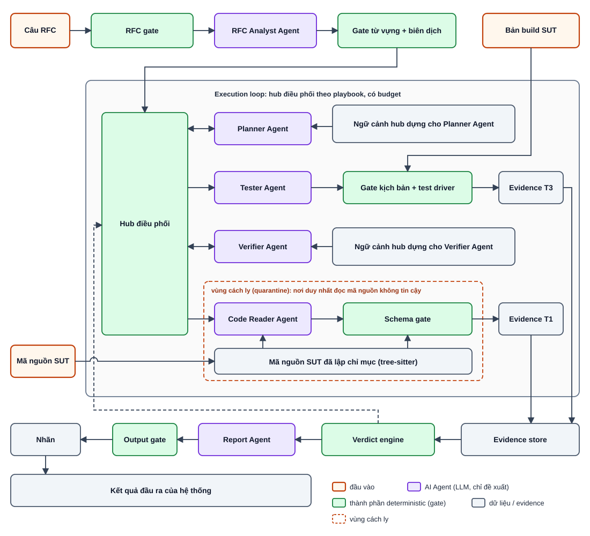
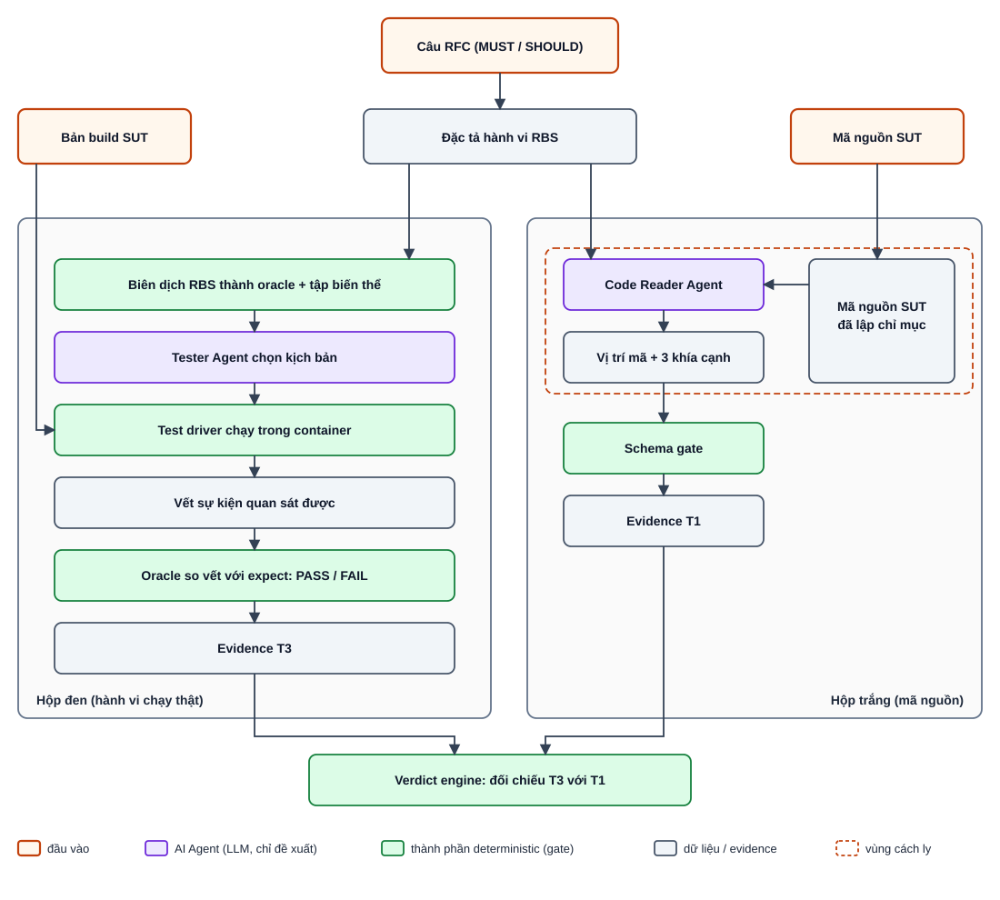
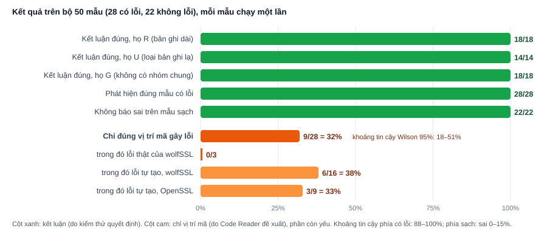
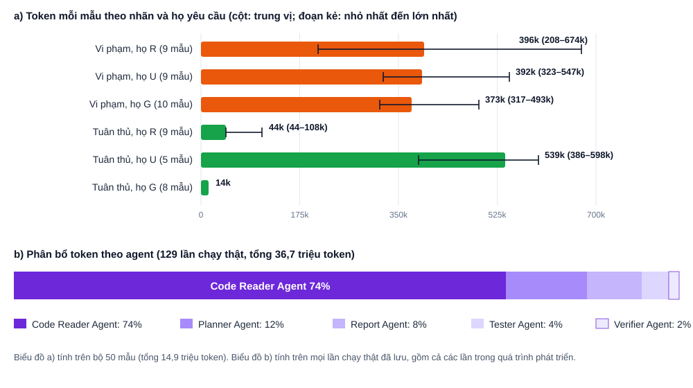

# BÁO CÁO TIẾN ĐỘ NGHIÊN CỨU – LẦN 1

**Đề tài:** Kiểm chứng tự động và an toàn sự tuân thủ đặc tả giao thức mạng dựa trên bằng chứng, sử dụng hệ thống AI đa tác tử

**Người hướng dẫn:** TS. Tống Văn Vạn

**Nghiên cứu sinh:** Nguyễn Kỳ Tùng

**Giai đoạn báo cáo:** 15/10/2026 – 25/10/2026

---

## 1. Tóm tắt

Các RFC quy định hành vi của phần mềm mạng bằng những câu có từ khóa MUST, SHOULD (BCP 14). Hệ thống nhận một câu yêu cầu như vậy cùng một phần mềm cần kiểm (SUT), sau đó kết luận phần mềm có tuân thủ câu yêu cầu hay không. Kết luận là một trong ba nhãn: tuân thủ, vi phạm hoặc cần xem xét, và đi kèm bằng chứng có thể chạy lại. Công việc do nhiều AI Agent sử dụng LLM phối hợp thực hiện.

Cách tiếp cận là không dùng LLM để quyết định kết luận. Các agent chỉ đề xuất đặc tả, kịch bản kiểm thử và vị trí trong mã. Một đề xuất chỉ trở thành bằng chứng sau khi qua các gate không dùng LLM, và nhãn kết luận do một bộ quy tắc cố định tính từ bằng chứng. Khi LLM sai, hệ thống kết luận được ít hơn hoặc tốn nhiều token hơn, nhưng nhãn đã đưa ra không bị đảo.

Hệ thống đã chạy từ đầu đến cuối trên wolfSSL và OpenSSL với các yêu cầu của TLS 1.3, và kết luận đúng cả 50 mẫu trong bộ dữ liệu có gán nhãn (28 mẫu có lỗi, 22 mẫu không lỗi). Bộ 50 mẫu này đã loại 9 mẫu có thiết kế chưa phù hợp, trong đó có 2 mẫu hệ thống từng kết luận sai (mục 3.2). Có hai hạn chế: vị trí mã gây lỗi chỉ được chỉ đúng ở 9 trong 28 mẫu có lỗi (32%), và RFC Analyst Agent chưa tự viết được đặc tả đạt yêu cầu nên đặc tả hiện vẫn được viết tay. Chi phí chủ yếu nằm ở việc đọc mã (mục 3.3).

---

## 2. Hệ thống AI Agent

### 2.1 Luồng xử lý

Hình 1 mô tả luồng xử lý một yêu cầu. Hệ thống có ba đầu vào: câu RFC, mã nguồn và bản build chạy được của phần mềm cần kiểm (SUT). Mã nguồn được lập chỉ mục rồi chỉ đưa vào vùng cách ly, nơi Code Reader Agent đọc và Schema gate kiểm tra; bản build chỉ đưa vào Test driver để chạy kịch bản trong container. Câu RFC được chuyển thành đặc tả hành vi (RBS) có dạng "khi nhận X thì phải phản ứng Y", rồi biên dịch thành oracle (bộ phán định tự động) cùng tập biến thể cần thử. Sau đó một vòng điều tra (execution loop) cho ra bằng chứng, và Verdict engine tính nhãn từ bằng chứng.



**Hình 1.** Luồng xử lý một yêu cầu, từ các đầu vào (câu RFC, mã nguồn SUT, bản build SUT) đến kết quả đầu ra. AI Agent (màu tím) chỉ đề xuất. Mọi đề xuất đi qua thành phần deterministic (màu xanh lá) mới trở thành evidence; Verdict engine tính nhãn từ evidence mà không dùng LLM. Code Reader Agent nằm trong vùng cách ly (nét đứt màu cam). Trong các lần đánh giá ở mục 3, đặc tả RBS do người viết tay; RFC Analyst Agent chưa được đưa vào để tạo ra đặc tả cho kết luận.

Vòng điều tra do một hub điều phối. Hub là thành phần deterministic, không phải LLM, và đảm nhiệm các việc sau:

- Giao nhiệm vụ cho agent theo playbook (sổ tay điều tra viết dưới dạng dữ liệu);
- Giữ budget giới hạn số vòng, số token và số lần gọi tool;
- Từ chối dừng khi còn việc làm được;
- Dừng khi đã đủ bằng chứng, hết budget hoặc phát hiện lặp (cùng một nhiệm vụ giao nhiều lần mà bằng chứng không tăng).

Agent không gọi trực tiếp nhau; mọi giao việc là một nhiệm vụ có kiểu đi qua hub. Nhiều bước của playbook là tất định nên hub tự lập kế hoạch mà không cần gọi Planner Agent.

### 2.2 Các AI Agent

#### 2.2.1 Cách một agent được định nghĩa

Mỗi agent được khai báo bằng một hồ sơ gồm:

- Vùng tin cậy (privileged hoặc quarantine);
- Danh sách trường ngữ cảnh được phép nhận;
- Danh sách tool được phép gọi;
- Các skill (tài liệu hướng dẫn nghiệp vụ nạp theo nhu cầu);
- Schema đầu ra;
- Budget cho mỗi nhiệm vụ.

Ngữ cảnh mà agent nhận được do một thành phần deterministic dựng theo hồ sơ này, mỗi giá trị gắn nhãn tin cậy. Đầu ra của agent bắt buộc theo schema; sai schema thì agent phải làm lại. Mọi lời gọi tool đi qua một tool gateway kiểm tra vai trò và tham số. Các agent được trình bày theo thứ tự thực hiện trong vòng điều tra: Planner Agent chọn bước, Tester Agent và Code Reader Agent tạo bằng chứng, Verifier Agent phản biện, Report Agent giải thích kết luận. RFC Analyst Agent và Code Indexer Agent không nằm trong vòng này (đặc tả hiện viết tay, bản đồ hàm chưa được playbook sử dụng) nên được trình bày sau cùng. Bảng 1 tóm tắt các agent theo cùng thứ tự.

**Bảng 1.** Các AI Agent: vùng, tool và budget mỗi nhiệm vụ.

| Agent | Vùng | Tool chính | Budget mỗi nhiệm vụ | Đầu ra |
|---|---|---|---|---|
| Planner Agent | privileged | Đọc tóm tắt bằng chứng, đọc quy tắc kết luận | 4 lần gọi tool, 150 nghìn token | Kế hoạch (nhiệm vụ tiếp theo hoặc dừng) |
| Tester Agent | privileged | Xem mẫu kịch bản, chạy thử một biến thể, tra định nghĩa RFC | 12 lần gọi tool, 150 nghìn token | Kịch bản kiểm thử (DSL) |
| Code Reader Agent | quarantine | grep, glob, read, eval (chỉ đọc), Locator | 30 lần gọi tool, 400 nghìn token | Vị trí trong mã và đánh giá khía cạnh |
| Verifier Agent | privileged | Đọc bằng chứng, đọc quy tắc, đọc mục RFC | 6 lần gọi tool, 200 nghìn token | Danh sách vấn đề |
| Report Agent | privileged | Đọc bằng chứng, đọc kết luận | 6 lần gọi tool, 120 nghìn token | Bản giải thích |
| RFC Analyst Agent | privileged | Tra RFC (đọc câu, đọc mục, tìm kiếm, tra định nghĩa) | 10 lần gọi tool, 200 nghìn token | Đặc tả RBS |
| Code Indexer Agent | quarantine | Liệt kê thư mục, đọc cấu trúc tệp, tìm ký hiệu | 40 lần gọi tool, 200 nghìn token | Bản đồ hàm theo thành phần |

#### 2.2.2 Planner Agent: chọn bước điều tra

Planner Agent quyết định mỗi vòng giao việc gì cho agent nào. Nó không gán nhãn; nhãn do Verdict engine quyết định. Mục tiêu của Planner Agent là đưa cuộc điều tra tới chỗ có đủ bằng chứng để một quy tắc quyết định, với chi phí thấp nhất và không bỏ qua dấu hiệu sai. Agent nhận yêu cầu và loại của nó, câu RFC, đánh giá độ đủ do Verdict engine tính (nhãn tạm, còn thiếu bằng chứng nào, có mâu thuẫn nào), tóm tắt bằng chứng đã có, vấn đề do Verifier Agent nêu gần nhất, lịch sử các nhiệm vụ đã giao và budget còn lại.

Mỗi lượt, Planner Agent xác định điều gì đang chặn một nhãn quyết định, đọc lịch sử nhiệm vụ để tránh lặp việc đã thất bại (nhiệm vụ không thêm bằng chứng nào hoặc bị hỏng thì không giao lại y nguyên), rồi chọn việc theo giá trị và chi phí: một lượt Code Reader Agent tốn 100–300 nghìn token, Verifier Agent khoảng 40 nghìn, Tester Agent khoảng 10 nghìn. Đầu ra là tối đa hai nhiệm vụ độc lập (tìm vị trí mã, lần theo các đường xử lý, xem lại một khía cạnh, chọn kịch bản kiểm thử, phản biện) hoặc quyết định dừng, kèm mã lý do. Playbook gợi ý nhiệm vụ cho từng tình huống; Planner Agent được làm khác playbook nhưng phải khai báo là làm khác.

#### 2.2.3 Tester Agent: chọn kịch bản kiểm thử

Tester Agent thiết kế một kịch bản kiểm thử để đưa SUT tới trạng thái tiền điều kiện của yêu cầu rồi tạo đúng sự kiện kích hoạt. Hệ thống sẽ chạy kịch bản này với mọi biến thể giá trị trên SUT và các bản tham chiếu. Kịch bản được viết bằng một ngôn ngữ giới hạn (DSL) gồm tám thao tác chung cho mọi giao thức:

- `connect`: mở kết nối;
- `complete_handshake`: hoàn tất bắt tay;
- `send_msg`: gửi thông điệp hợp lệ;
- `send_raw_record`: gửi một đơn vị dữ liệu thô với độ dài và nội dung cho trước;
- `mutate`: sửa một trường;
- `reorder`: đổi thứ tự thông điệp;
- `repeat`: gửi lặp;
- `expect`: chờ và kiểm tra phản ứng.

Giá trị phụ thuộc biến thể không được viết cứng mà dùng biến khai báo trong phần ràng buộc, để hệ thống thay giá trị cho từng biến thể.

Agent đọc đặc tả, xem các mẫu kịch bản của adapter, chọn mẫu gần nhất rồi dựng các bước. Nó chạy thử biến thể đối chứng (giá trị hợp lệ sát ngưỡng) trên bản tham chiếu: kịch bản phải chạm được sự kiện kích hoạt và cho kết quả đạt. Sau đó chạy thử một biến thể phía vi phạm để thấy bản tham chiếu phản ứng đúng. Kịch bản chỉ được nộp khi qua hai bước này. Hai ràng buộc quan trọng: Tester Agent không tự đánh giá đạt hay không đạt của SUT (chạy thử chỉ để gỡ lỗi kịch bản), và không được xem bằng chứng về mã hay nhãn tạm, để kết quả kiểm thử độc lập với việc đọc mã. Khi đặc tả khớp một mẫu có sẵn của adapter, kịch bản được dựng trực tiếp từ mẫu mà không cần gọi Tester Agent.

#### 2.2.4 Code Reader Agent: đọc mã nguồn

Code Reader Agent trả lời một câu hỏi hẹp: đoạn mã nào thực hiện yêu cầu, và nó làm đúng hay sai. Agent nhận đặc tả (phần điều kiện và phản ứng), câu RFC kèm ngữ cảnh, nhiệm vụ cụ thể được giao (tìm vị trí, xem lại một khía cạnh, lần theo đường xử lý) và cờ build của phiên bản đang kiểm. Mã nguồn được lập chỉ mục bằng tree-sitter (ký hiệu, đồ thị gọi hàm, các dòng thực sự được biên dịch theo cờ build).

Code Reader Agent có năm công cụ: **grep** (tìm văn bản bằng ripgrep), **read** (đọc một khoảng dòng của tệp), **glob** (liệt kê tệp), **eval** (khai triển macro và xét điều kiện biên dịch như `#if`) và Locator (xếp hạng hàm ứng viên, chỉ là gợi ý, không phải bằng chứng). Hai công cụ chính dùng theo cặp: grep tìm các nơi liên quan theo mã cảnh báo, tên trường hoặc hằng số của yêu cầu, sau đó read đọc đoạn mã quanh kết quả tìm được. Eval dùng để tính giá trị ngưỡng khi mã viết bằng macro và để xác định dòng nào thực sự được biên dịch. Trong 2.409 lần gọi công cụ đọc mã ghi nhận qua các lần chạy, các lần đọc (read, gồm đọc theo khoảng dòng và theo hàm) chiếm 38%, grep chiếm 30% và eval chiếm 13%; phần còn lại là các công cụ tra cứu của những phiên bản trước và glob. Các kỹ thuật phân tích khác như tra tham chiếu và đồ thị gọi hàm chủ yếu do Schema gate dùng để kiểm tra, không phải công cụ chính của agent.

Kết quả của Code Reader Agent là một vị trí (tệp, hàm, khoảng dòng) kèm đánh giá ba khía cạnh so với đặc tả:

- CONDITION: phép so sánh đúng đại lượng và đúng hướng;
- THRESHOLD: giá trị ngưỡng bằng giá trị trong đặc tả;
- REACTION: khi kiểm tra không đạt, mã gửi đúng loại phản ứng.

Mỗi khía cạnh được gán MATCH, MISMATCH hoặc UNCLEAR; chỉ được gán MATCH hay MISMATCH khi agent đã đọc và tính được, còn lại phải ghi UNCLEAR và nêu phần chưa kiểm tra. Trước khi thành bằng chứng T1, kết quả phải qua schema gate kiểm tra không dùng LLM, trong đó điều kiện quan trọng nhất là mọi dòng được dẫn phải nằm trong số dòng agent đã đọc và thuộc phần mã được biên dịch.

#### 2.2.5 Verifier Agent: phản biện kết luận

Verifier Agent được gọi khi Verdict engine sắp kết luận (thường là nhãn tạm tuân thủ, vì đây là nhãn dễ sai nhất) hoặc khi bằng chứng mâu thuẫn. Câu hỏi của agent là: kết luận này có thể sai ở đâu? Agent không đọc mã, không gán nhãn và không giao việc. Nó nhận đặc tả, câu RFC và đoạn chứa câu, tóm tắt bằng chứng (vị trí mã, đánh giá khía cạnh, kết quả kiểm thử theo từng biến thể), đánh giá độ đủ và lịch sử nhiệm vụ.

Agent lần lượt xét năm giả thuyết và chỉ nêu vấn đề khi có căn cứ cụ thể trong dữ liệu:

1. Mâu thuẫn giữa mã và hành vi, ví dụ cảnh báo mà mã gửi khác cảnh báo kiểm thử quan sát được;
2. Vị trí mã sai, ví dụ hàm thuộc tầng khác với mục RFC hoặc kiểm sai đại lượng;
3. Thiếu đường xử lý khi câu RFC đòi đúng trên mọi đường;
4. Thiếu biến thể gần ngưỡng;
5. Thiếu bằng chứng mã.

Mỗi vấn đề kèm mã bằng chứng có lỗi và nhiệm vụ nên làm để giải quyết (xem lại, định vị lại, lần đường xử lý, thêm kiểm thử). Agent phải cân bằng hai loại sai: bỏ sót vấn đề thật làm lọt một kết luận tuân thủ sai, trong khi nêu vấn đề không có căn cứ tốn thêm một vòng điều tra. Danh sách rỗng có nghĩa là đã kiểm và không tìm được căn cứ cho thấy kết luận sai.

#### 2.2.6 Report Agent: giải thích kết luận

Report Agent viết phần giải thích bằng văn bản cho một kết luận đã có, dành cho kỹ sư đọc báo cáo: vì sao yêu cầu mang nhãn này, dựa trên bằng chứng nào và nên làm gì tiếp. Agent nhận bản ghi kết luận, các bằng chứng căn cứ, các vấn đề phản biện chưa được giải quyết (phải nêu như điểm còn ngỏ) và câu RFC gốc. Mỗi nhận định phải gắn với một bằng chứng đã lưu; Output gate kiểm tra điều này và loại bỏ phần giải thích nếu có điểm không có căn cứ, khi đó báo cáo vẫn có nhãn nhưng không có lời giải thích. Report Agent không thể đổi nhãn.

#### 2.2.7 RFC Analyst Agent: từ câu RFC đến đặc tả

RFC Analyst Agent chuyển câu yêu cầu của RFC thành đặc tả RBS. Đây là khâu có hậu quả lớn nhất về độ trung thành: một đặc tả sai ý câu RFC làm mọi kết luận phía sau sai theo, kể cả khi các agent khác làm đúng. Agent nhận nhóm câu cùng mục, gói ngữ cảnh (đoạn chứa câu, câu liền trước và liền sau, các khối định nghĩa mà câu nhắc tới) và từ vựng của adapter (chữ ký sự kiện, trạng thái, giá trị liệt kê, miền giá trị từng trường).

Agent làm việc theo ba bước. Trước hết phân loại yêu cầu theo bốn loại:

- Loại A: ràng buộc về dữ liệu phần mềm gửi đi;
- Loại B: phản ứng khi nhận dữ liệu sai;
- Loại C: ràng buộc trạng thái và thứ tự thông điệp;
- Loại D: hành vi nội bộ không quan sát được.

Câu chỉ định nghĩa hoặc khuyến nghị không kiểm chứng được bằng hành vi thì đánh dấu không phải hành vi và không viết đặc tả. Tiếp theo xác định đại lượng bị giới hạn và giá trị số của nó, tra khối định nghĩa trong RFC để biết trường thuộc cấu trúc nào. Cuối cùng viết RBS theo ngữ pháp cố định, gồm các thành phần:

- Sự kiện kích hoạt;
- Điều kiện trên một trường;
- Phản ứng bắt buộc (có thể nhiều bước, kèm thời hạn);
- Hành vi bị cấm;
- Các biến thể cần thử.

Đặc tả phải qua kiểm tra cú pháp, kiểm tra từ vựng và biên dịch được thành oracle thì mới được dùng. Thiết kế dự kiến chạy hai luồng dịch độc lập (hai mô hình khác họ) rồi đối chiếu, câu nào hai luồng lệch nhau được chuyển cho người duyệt; phần này chưa bật. Agent đã được thử riêng trên một số câu RFC đã có đặc tả viết tay, nhưng chất lượng chưa đạt yêu cầu nên chưa được đưa vào luồng tạo kết luận.

#### 2.2.8 Code Indexer Agent: lập bản đồ hàm

Code Indexer Agent lập bản đồ gán các hàm trong mã nguồn vào các thành phần của giao thức (ví dụ phân tích thông điệp, xử lý khóa) để hỗ trợ định vị. Trên wolfSSL, agent gán đúng 44 trên 44 hàm được thử. Tuy nhiên chưa có số đo cho thấy bản đồ này làm đổi kết quả định vị, nên playbook hiện chưa giao việc cho agent này.

### 2.3 Đối chiếu với RFC

Phần mềm cần kiểm (SUT) không đọc được câu RFC, còn câu RFC không chạy được. Hệ thống nối hai phía bằng đặc tả hành vi RBS và đối chiếu theo hai hướng độc lập: chạy phần mềm và quan sát hành vi (hộp đen), đọc mã nguồn (hộp trắng). Mỗi hướng cho một loại bằng chứng, rồi Verdict engine đối chiếu hai loại bằng chứng này (Hình 2).



**Hình 2.** Đối chiếu RFC với phần mềm. Cột trái: kiểm tra qua hành vi chạy thật (hộp đen), cho bằng chứng T3. Cột phải: kiểm tra qua mã nguồn (hộp trắng), cho bằng chứng T1. Verdict engine đối chiếu hai loại bằng chứng.

#### 2.3.1 Đặc tả hành vi RBS làm cầu nối

RBS biểu diễn một câu RFC thành dạng máy kiểm tra được: sự kiện kích hoạt, điều kiện trên một trường và phản ứng bắt buộc. Ví dụ, câu "bản ghi vượt độ dài tối đa phải bị từ chối bằng cảnh báo record_overflow" được biểu diễn là `receive(record) where length > 16640 → send_alert(record_overflow)`. Từ một đặc tả, hệ thống sinh ra hai thứ: oracle (bộ phán định, so hành vi quan sát được với phản ứng bắt buộc) và tập biến thể giá trị cần thử. Code Reader Agent cũng dùng cùng đặc tả này để biết cần tìm điều kiện và phản ứng nào trong mã.

#### 2.3.2 Hộp đen: kiểm thử hành vi chạy thật (bằng chứng T3)

Một lần kiểm thử gồm các bước sau:

1. Tester Agent chọn kịch bản đưa SUT tới trạng thái tiền điều kiện (ví dụ đã bắt tay xong) rồi tạo đúng sự kiện kích hoạt.
2. Test driver chạy kịch bản trong container với từng biến thể giá trị, trên SUT và trên ít nhất hai bản tham chiếu độc lập (hai phần mềm khác được coi là đã tuân thủ).
3. Test driver ghi vết sự kiện quan sát được: cảnh báo gửi ra, kết nối có đóng không, thời gian phản ứng.
4. Oracle so vết với phản ứng bắt buộc của đặc tả và cho kết quả đạt hoặc không đạt. Kết quả này là bằng chứng T3.

Tập biến thể được sinh để phủ cả hai phía của ngưỡng:

- Giá trị biên, ngay trên ngưỡng (ví dụ 16641 với ngưỡng 16640);
- Giá trị cực đại của trường (ví dụ 65535);
- Các giá trị ngẫu nhiên phía vi phạm;
- Biến thể đối chứng và các giá trị ngẫu nhiên phía hợp lệ, trong đó có giá trị đúng bằng ngưỡng (16640): phần mềm phải chấp nhận các giá trị này.

Có hai cơ chế để kết quả kiểm thử đáng tin. Thứ nhất là nhân chứng dương: một kịch bản chỉ được tính khi có ít nhất một bản tham chiếu độc lập vượt qua, vì nếu mọi bản tham chiếu đều không đạt thì có thể chính kịch bản hoặc oracle sai chứ không phải SUT. Thứ hai là chạy lại các ca không đạt để loại kết quả không ổn định; kết quả không nhất quán giữa các lần chạy dẫn tới nhãn cần xem xét.

#### 2.3.3 Hộp trắng: đọc mã nguồn (bằng chứng T1)

Code Reader Agent so điều kiện, ngưỡng và phản ứng trong mã với đặc tả như ở mục 2.2.4. Bằng chứng này bổ sung cho kiểm thử chứ không thay thế. Nếu cảnh báo mà mã được ghi nhận sẽ gửi khác với cảnh báo kiểm thử thực sự quan sát được thì hệ thống thêm một vòng điều tra. Nếu T1 chỉ ra một khía cạnh MISMATCH trong khi mọi kiểm thử đều đạt thì nhãn chuyển sang cần xem xét. Liên kết với độ phủ mã (kiểm tra dòng mã được dẫn có thực sự chạy trong kiểm thử) đã được xây nhưng chưa có dữ liệu thật, nên nhãn tuân thủ hiện chỉ ở mức dựa trên hành vi chạy thật.

#### 2.3.4 Từ bằng chứng đến nhãn

Verdict engine xét các quy tắc V0–V9 theo thứ tự trong Bảng 2, quy tắc đầu tiên khớp quyết định nhãn. Thứ tự thể hiện hai nguyên tắc: hành vi chạy thật được ưu tiên hơn đọc mã, và khi còn nghi ngờ thì không kết luận. Có bốn nhãn: vi phạm, tuân thủ, cần xem xét và không kiểm chứng được.

**Bảng 2.** Các quy tắc chính của Verdict engine, theo thứ tự xét (yêu cầu quan sát được từ bên ngoài).

| Quy tắc | Điều kiện | Nhãn |
|---|---|---|
| V0 | Kết quả kiểm thử không nhất quán giữa các lần chạy hoặc giữa các môi trường | Cần xem xét |
| V1 | Kịch bản không có nhân chứng dương (mọi bản tham chiếu đều không đạt) | Cần xem xét |
| V2 | Có ca không đạt hợp lệ: sự kiện kích hoạt đã xảy ra, phản ứng đúng chữ ký, có nhân chứng dương | Vi phạm |
| V7 | Biến thể đối chứng không đạt; hoặc mọi kiểm thử đạt nhưng T1 bác bỏ; hoặc đã thu độ phủ nhưng không đi qua vị trí T1 | Cần xem xét |
| V5 | Đủ biến thể đạt và T3 được liên kết với T1 qua độ phủ | Tuân thủ (mức bảo đảm liên kết) |
| V6 | Đủ biến thể đạt, chưa có T1 hoặc chưa thu độ phủ | Tuân thủ (mức bảo đảm theo hành vi) |
| V9 | Không quy tắc nào ở trên khớp | Không kiểm chứng được |

Ba quy tắc còn lại ít gặp hơn: V3 (vi phạm từ chuỗi thông điệp do máy trạng thái học được, với yêu cầu về thứ tự thông điệp), V4 (có nhánh nghi vấn trên đường xử lý) và V8 (hành vi nội bộ không quan sát được, dùng truy vấn tĩnh).

Áp dụng vào ví dụ trên: 12 ca phía kích hoạt (giá trị biên 16641, giá trị cực đại 65535 và các giá trị ngẫu nhiên lớn hơn ngưỡng) đều không đạt, trong khi 18 ca phía hợp lệ đều đạt và các bản tham chiếu đạt. Quy tắc V0 và V1 không khớp, V2 khớp nên nhãn là vi phạm. Với bản đã sửa, mọi biến thể đều đạt, chưa có liên kết độ phủ nên quy tắc V6 khớp và nhãn là tuân thủ theo hành vi.

### 2.4 Kết quả đầu ra của hệ thống

Với mỗi yêu cầu, hệ thống ghi một bản kết luận có cấu trúc cố định. Các trường chính được mô tả ở Bảng 3.

**Bảng 3.** Cấu trúc bản kết luận của một yêu cầu.

| Trường | Nội dung | Ví dụ thực tế (TLS13-0042, wolfSSL bản lỗi) |
|---|---|---|
| Yêu cầu | Mã yêu cầu, định danh câu RFC, từ khóa | TLS13-0042, RFC8446§5.2#p4s3, MUST |
| Nhãn | Tuân thủ, vi phạm hoặc cần xem xét (không đủ căn cứ thì không kết luận) | VIOLATION (vi phạm) |
| Quy tắc áp dụng | Mã quy tắc V0–V9 và nội dung quy tắc | V2: có ca kiểm thử không đạt hợp lệ, lỗi nằm ở SUT |
| Mức bảo đảm | Chỉ có với nhãn tuân thủ: dựa trên hành vi chạy thật, hoặc có liên kết độ phủ mã | không áp dụng cho nhãn vi phạm |
| Lý do dừng | Vì sao điều tra kết thúc | Đã đủ bằng chứng |
| Bằng chứng căn cứ | Danh sách mã định danh bằng chứng đã lưu (mã băm) | 12 bằng chứng quyết định; tổng cộng 31 (30 kết quả chạy thật, 1 vị trí mã) |
| Kết quả kiểm thử | Số ca đạt, không đạt theo từng phía (hợp lệ, kích hoạt) | phía hợp lệ 18 đạt; phía kích hoạt 12 không đạt |
| Vị trí mã | Tệp, hàm, khoảng dòng và đánh giá CONDITION, THRESHOLD, REACTION | src/internal.c, DoProcessReplyEx, dòng 23426–23443; CONDITION khớp, REACTION không khớp |
| Đối chiếu kỳ vọng và thực tế | Phản ứng RFC yêu cầu so với phản ứng quan sát được | Kỳ vọng record_overflow, quan sát không có cảnh báo nào |
| Giải thích | Đoạn văn do Report Agent viết, chỉ trích dẫn bằng chứng đã lưu | Có (trích bên dưới) |

Ví dụ ở Bảng 3 lấy từ một lần chạy thật trên wolfSSL (commit 0cecccd, bản có lỗi), mất khoảng 290 nghìn token (chi tiết ở mục 3.3). Cùng yêu cầu đó, bản đã sửa và bản mới nhất đều cho nhãn tuân thủ. Phần dữ liệu có cấu trúc của bản kết luận (rút gọn danh sách bằng chứng) như sau:

```json
{
  "requirement_id": "TLS13-0042",
  "spec_ref": "RFC8446§5.2#p4s3",
  "modal": "MUST",
  "label": "VIOLATION",
  "rule": "V2",
  "stop_reason": "SUFFICIENT",
  "evidence_ids": ["sha256:0043d05a…", "sha256:a41c17a7…", "… (12 mục)"],
  "location": { "file": "src/internal.c", "symbol": "DoProcessReplyEx", "lines": [23426, 23443] }
}
```

Phần giải thích do Report Agent viết gồm bốn đoạn. Đoạn đầu nêu kết luận và bằng chứng hành vi: "toàn bộ 12 ca đều FAIL … Ở mọi ca, alert = none: không có cảnh báo nào được phát ra, kể cả khi vượt ngưỡng rất xa (65535 so với ngưỡng 16486 trong mã)". Đoạn về vị trí mã nêu hàm DoProcessReplyEx với khía cạnh CONDITION khớp và REACTION không khớp. Đoạn về nguyên nhân gốc cho biết khối mã gửi cảnh báo bị loại khi biên dịch vì macro HAVE_MAX_FRAGMENT không được bật trong bản dựng. Đoạn cuối đề xuất hướng khắc phục (đưa lời gọi gửi cảnh báo ra khỏi điều kiện của macro này hoặc bật macro) kèm các biến thể cần chạy lại để xác nhận.

Nhãn và các con số được lấy trực tiếp từ nhật ký và Evidence store, không tính lại bằng LLM; phần giải thích bằng văn bản đã qua Output gate và không bao giờ sửa nhãn. Kết quả được xuất ra ba định dạng:

- Bản ghi JSON để xử lý tự động;
- Báo cáo HTML và PDF cho từng lần chạy, có cả hành trình các agent và căn cứ;
- Tệp SARIF 2.1.0 (chuẩn của GitHub code scanning và IDE), trong đó mỗi kết luận vi phạm có vị trí mã được ghi thành một kết quả, với mã quy tắc là định danh câu RFC.

Tất cả cũng xem được trên giao diện web.

### 2.5 Bảo đảm độ tin cậy và giao diện

Độ tin cậy dựa trên bốn cơ chế:

- Tách hai vùng agent (Dual LLM);
- Phân tầng bằng chứng (T1 vị trí mã đã xác nhận, T3 kết quả chạy thật; Evidence store chỉ ghi thêm và nối chuỗi hash);
- Nhân chứng dương (một kịch bản chỉ được tính khi có ít nhất một bản tham chiếu độc lập vượt qua);
- Bộ quy tắc V0–V9.

Giao diện web cho phép theo dõi từng bước của mỗi agent (tool đã gọi, kết quả) trong và sau khi chạy, so sánh hai lần chạy và xuất báo cáo.

---

## 3. Đánh giá

### 3.1 Bộ dữ liệu và phương pháp

Bộ dữ liệu dựa trên ba yêu cầu của RFC 8446 (TLS 1.3), mỗi yêu cầu có một đặc tả viết tay:

- (R) Bản ghi dài vượt giới hạn phải bị từ chối bằng cảnh báo `record_overflow`;
- (U) Loại bản ghi không được định nghĩa phải bị từ chối bằng `unexpected_message`;
- (G) ClientHello không có nhóm trao đổi khóa chung phải bị từ chối bằng `handshake_failure`.

Bộ dữ liệu chính gồm 50 mẫu phần mềm (Bảng 4), sau khi loại 9 mẫu có thiết kế chưa phù hợp (xem mục 3.2), trong đó 28 mẫu có lỗi và 22 mẫu không lỗi (các thay đổi không vi phạm yêu cầu đang xét, ví dụ đổi nội dung nhật ký).

**Bảng 4.** Thành phần bộ dữ liệu.

| Nguồn | Số mẫu | Cách tạo mẫu |
|---|---|---|
| Lỗi thật của wolfSSL (bản lỗi, bản đã sửa, bản mới) | 7 | Dùng các commit sửa lỗi có thật |
| Lỗi tự tạo trên wolfSSL | 30 | Sửa hoặc xóa dòng có sẵn: đổi mã cảnh báo, bỏ lệnh gửi cảnh báo, đảo điều kiện |
| Lỗi tự tạo trên OpenSSL 3.6.5 | 13 | Tương tự như trên wolfSSL |

Nhãn của từng mẫu được xác định theo ý nghĩa của phép sửa, đối chiếu với RFC, và được ghi lại trước khi chạy hệ thống. Với 13 mẫu OpenSSL, hành vi còn được kiểm tra bằng một client kiểm thử riêng, không đi qua hệ thống, và khớp với nhãn. Hệ thống chỉ được cung cấp phần mềm và yêu cầu, không có thông tin về commit hay diff. Mỗi mẫu được chạy một lần; các tỷ lệ kèm khoảng tin cậy Wilson 95%. Các số liệu về chi phí và kết quả của bộ 50 mẫu lấy từ đợt đánh giá đầy đủ gần nhất; riêng ví dụ ở mục 2.4 là một lần chạy riêng. Một đối chứng độc lập không dùng AI Agent là bộ kiểm thử của tlsfuzzer (145 ca): bản wolfSSL lỗi đạt 12/145 ca, bản đã sửa đạt 144/145 ca, phù hợp với kết luận của hệ thống.

### 3.2 Kết quả trên bộ 50 mẫu

**Bảng 5.** Kết quả trên bộ 50 mẫu.

| Chỉ số | Kết quả |
|---|---|
| Kết luận đúng nhãn | 50/50 |
| Phát hiện đúng mẫu có lỗi | 28/28 (khoảng tin cậy Wilson 95%: 88–100%) |
| Kết luận sai trên mẫu không lỗi | 0/22 (0–15%) |
| Chỉ đúng vị trí mã nguồn gây lỗi | 9/28 = 32% (18–51%) |
| Chi phí | 14,9 triệu token; 208–674 nghìn token cho mỗi mẫu có lỗi |



**Hình 3.** Kết quả trên bộ 50 mẫu. Phần kết luận (cột xanh) đúng toàn bộ trong phạm vi đánh giá; phần chỉ vị trí mã (cột cam) còn thấp, nhất là với lỗi thật (0/3).

Cần lưu ý khi đọc kết quả 50/50. Bộ dữ liệu chính đã loại 9 mẫu có thiết kế chưa phù hợp, trong đó có 2 mẫu mà hệ thống từng kết luận sai, vì lỗi chỉ xuất hiện ở giá trị nằm ngoài tập biến thể của oracle. Do đó kết quả chỉ đúng với các biến thể đã thử. Nhãn do một người xác định và mới có 7 mẫu lỗi thật.

### 3.3 Chi phí

Chi phí được đo bằng số token LLM tiêu thụ và số tiền quy đổi theo bảng giá mô hình (DeepSeek-V4-Flash) do thư viện agent ghi lại cho từng lượt gọi, đã tính giảm giá cho phần ngữ cảnh lặp lại được lưu đệm. Giá thực tế của nhà cung cấp có thể khác bảng giá này, nên số tiền chỉ mang tính ước lượng.

#### 3.3.1 Chi phí của một lần chạy

Bảng 6 là chi phí của lần chạy ví dụ ở mục 2.4 (yêu cầu TLS13-0042 trên wolfSSL bản có lỗi), chia theo agent. Verifier Agent không được gọi vì nhãn vi phạm đã đủ căn cứ để dừng.

**Bảng 6.** Chi phí một lần chạy (TLS13-0042, wolfSSL bản có lỗi).

| Agent | Lượt gọi LLM | Token vào | Token ra | Chi phí (USD) | Thời gian gọi LLM |
|---|---|---|---|---|---|
| Planner Agent | 2 | 15.503 | 216 | 0,0002 | 3,0 giây |
| Tester Agent | 9 | 63.770 | 1.730 | 0,0018 | 30,3 giây |
| Code Reader Agent | 10 | 190.428 | 2.830 | 0,0059 | 24,6 giây |
| Report Agent | 2 | 14.138 | 1.481 | 0,0020 | 10,1 giây |
| Tổng | 23 | 283.839 | 6.257 | 0,0099 | 68,0 giây |

Một lần chạy cho một yêu cầu tốn khoảng 290 nghìn token, tương đương chưa đến một xu Mỹ, và 68 giây gọi LLM. Thời gian này chưa gồm thời gian chạy kiểm thử trong container. Token vào chiếm gần như toàn bộ vì mỗi lượt gọi gửi lại ngữ cảnh đã tích lũy; đây là lý do giới hạn số lượt gọi tool cho mỗi agent (Bảng 1) có tác dụng giữ chi phí.

Trên bộ 50 mẫu, tổng chi phí là 14,9 triệu token, trung bình khoảng 300 nghìn token mỗi mẫu. Cách đếm này theo bộ đếm ngân sách của hệ thống nên lệch vài phần trăm so với số liệu của nhà cung cấp ở Bảng 6. Chi phí mỗi mẫu phụ thuộc mạnh vào nhãn và họ yêu cầu (Hình 4, biểu đồ a).

#### 3.3.2 Chi phí theo agent

Bảng 7 tổng hợp trên 129 lần chạy thật đã lưu (419 lượt chạy agent), gồm cả các lần trong quá trình phát triển.

**Bảng 7.** Chi phí theo agent, tổng hợp trên 129 lần chạy thật.

| Agent | Lượt chạy | Token | Tỷ lệ token | Chi phí (USD) | Tỷ lệ chi phí |
|---|---|---|---|---|---|
| Code Reader Agent | 101 | 27,1 triệu | 74,0% | 0,52 | 63,1% |
| Planner Agent | 146 | 4,5 triệu | 12,2% | 0,07 | 8,6% |
| Report Agent | 128 | 3,0 triệu | 8,2% | 0,15 | 17,6% |
| Tester Agent | 31 | 1,5 triệu | 4,1% | 0,06 | 6,8% |
| Verifier Agent | 13 | 0,6 triệu | 1,6% | 0,03 | 3,9% |
| Tổng | 419 | 36,7 triệu | 100% | 0,83 | 100% |



**Hình 4.** Chi phí token. a) Trung vị và khoảng nhỏ nhất đến lớn nhất của mỗi mẫu, theo nhãn và họ yêu cầu. b) Phân bổ token theo agent (số liệu Bảng 7).

Có bốn nhận xét:

- **Đọc mã chiếm phần lớn chi phí.** Code Reader Agent dùng 74% số token và 63% chi phí. Phần này cũng là phần có kết quả yếu nhất (định vị đúng 32%, mục 3.2).
- **Report Agent rẻ về token nhưng đắt hơn tỷ lệ về tiền.** Agent chỉ dùng 8% số token nhưng 18% chi phí, vì phần lớn token của nó là token ra, có đơn giá cao hơn token vào.
- **Mẫu có lỗi tốn nhiều hơn mẫu không lỗi.** Mẫu vi phạm tốn 208–674 nghìn token (trung vị 388 nghìn) vì còn phải đọc mã để chỉ vị trí lỗi và phản biện. Mẫu tuân thủ có trung vị 44 nghìn token.
- **Mẫu tuân thủ có thể rất rẻ hoặc rất đắt.** Họ yêu cầu về nhóm trao đổi khóa (họ G) chỉ tốn 14 nghìn token vì kiểm thử đủ để kết luận mà không cần đọc mã. Họ yêu cầu về loại bản ghi lạ (họ U) tốn trung vị 539 nghìn token vì hệ thống vẫn đọc mã dù kiểm thử đã đạt; lý do chưa được xử lý.

Hướng tối ưu là rút ngắn việc đọc mã khi kiểm thử đã đủ để kết luận, và cải thiện độ chính xác định vị trong cùng lượt đọc.

---

## 4. Kết luận

Hệ thống AI Agent đã chạy trọn vẹn từ đặc tả đến kết luận trên phần mềm thật. Với nguyên lý để AI Agent chỉ đề xuất và để thành phần deterministic kiểm chứng, hệ thống kết luận đúng 50/50 mẫu trong phạm vi đánh giá, kèm bằng chứng có thể chạy lại.

Hệ thống còn bốn hạn chế:

1. Kết luận chỉ có giá trị với các biến thể kiểm thử đã thử; do chưa đo độ phủ mã nên chưa chứng minh được khả năng chống gian lận kiểm thử (test gaming).
2. Độ chính xác định vị lỗi trong mã còn thấp (32%).
3. Đặc tả hành vi vẫn viết tay vì RFC Analyst Agent chưa đạt.
4. Phạm vi đánh giá còn hẹp: ba yêu cầu, hai phần mềm, một họ mô hình LLM, nhãn do một người xác định và chưa có đường cơ sở để so sánh.

Kế hoạch đến giữa tháng 11/2026:

- Cải thiện việc định vị lỗi và dựng bản phần mềm có đo độ phủ;
- Mở rộng tập biến thể theo các ràng buộc trong RFC;
- Bổ sung lỗi thật và họ yêu cầu;
- Thử cho hệ thống tự sinh biến thể và giới hạn lựa chọn của RFC Analyst Agent;
- Xây các đường cơ sở để so sánh và đo độ ổn định khi chạy lại.
